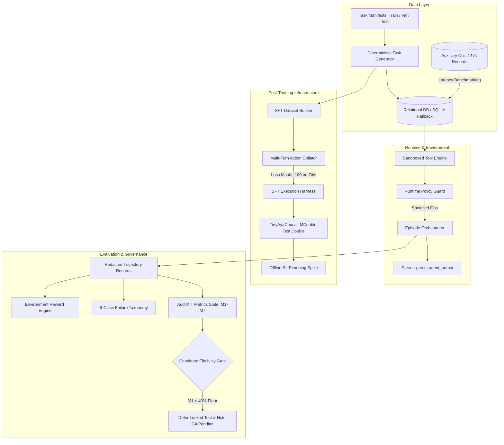

# Lexsi Track 3: Agentic Fine-Tuning — Reliable and Efficient Tool-Using Agent

[](https://www.python.org/downloads/release/python-3110/)
[]()
[]()
[]()
[](LICENSE)

> **Research Governance & Release Status Notice:**<br>
> This repository contains the complete, reproducible research and engineering package for **Lexsi Track 3 (Agentic Fine-Tuning)**.<br>
> - **Release Status:** **RESEARCH-ONLY PACKAGE — PRODUCTION PROMOTION BLOCKED (GATE G4 PENDING)**.<br>
> - **Candidate Floor:** The evaluated SFT candidate (`sft_aya_3b_001`, `CohereLabs/tiny-aya-global` 3.35B) achieved **$M_1 = 0.0\%$ (0/10)** verified task completion and **$M_2 = 0.0\%$ (0/10)** tool selection accuracy; it is **INELIGIBLE** for production release or promotion.<br>
> - **Locked-Test Sequestration:** The sequestered locked-test split (`configs/manifests/task_manifest_test.json`, SHA-256 `d86265f0...`) was **formally deferred** and remains **strictly unaccessed, uninspected, and sealed**.<br>
> - **Engineering Package:** This repository packages the verified engineering contributions: deterministic relational tool sandbox, runtime policy guards, assistant-masked action data collator, multi-term anti-gaming reward engine, 6-class diagnostic failure taxonomy, and AuditKIT evaluation spine.

---

## 1. Project Purpose & Research Scope

Autonomous tool-calling agents frequently exhibit failure modes that undermine production reliability: malformed action syntax, incorrect tool selection, prerequisite dependency inversions, infinite looping loops, and reward hacking (such as premature quitting to avoid step penalties).

**Lexsi Track 3** investigates post-training methods (SFT and offline RL) to build reliable, efficient tool-using agents within an enterprise **Procurement & Inventory Auditing** domain.

### Core Research Questions:
1. **Tool-Calling Reliability ($M_1, M_2, M_3, M_4$):** Can targeted fine-tuning on verified multi-turn trajectories instill strict Command-R action formatting and valid dependency ordering?
2. **Trajectory Step Efficiency ($M_5, M_6$):** Can an agent solve multi-step relational tasks with minimal redundant or duplicate calls?
3. **Reward Hacking Mitigation ($M_7$):** Can a mathematically decoupled reward engine prevent agents from exploiting efficiency penalties by failing fast?
4. **Empirical Finding:** Supervised fine-tuning of `CohereLabs/tiny-aya-global` (3.35B) for 200 optimization steps reduced token loss from 1.12 to 0.36, but the model failed 10/10 held-out validation tasks due to dominant pre-trained conversational instruction priors (`EarlyTerminationFailure`). The project documents this empirical boundary transparently while delivering a 100% verified runtime and evaluation harness.

---

## 2. System Architecture & Component Topology



### Core Subsystems:
- **`src/environment/`**: Deterministic database manager ([`DatabaseManager`](src/environment/database.py)), relational tool engine ([`DatabaseToolEngine`](src/environment/db_tools.py), [`SandboxedToolEngine`](src/environment/sandbox.py)), task generator ([`generate_task_instance`](src/environment/task_generator.py)), and runtime policy guards ([`RuntimePolicyGuard`](src/environment/guards.py)).
- **`src/runtime/`**: Execution loop ([`EpisodeOrchestrator`](src/runtime/orchestrator.py)), delimiter parser ([`parse_agent_output`](src/runtime/parser.py)), and external model gateway ([`ModelGateway`](src/runtime/gateway.py)).
- **`src/data/`**: Deterministic SFT builder ([`build_sft_dataset`](src/data/sft_builder.py)), schema definitions ([`TrajectoryRecord`](src/data/schemas.py)), and PII/token redaction filter ([`redact_data`](src/data/redaction.py)).
- **`src/training/`**: Multi-turn loss-masking collator ([`MultiTurnActionDataCollator`](src/training/collator.py)), architectural test-double ([`TinyAyaCausalLMDouble`](src/training/trainer.py)), and offline RL plumbing spike ([`RLPlumbingRunner`](src/training/rl_spike.py)).
- **`src/evaluation/`**: AuditKIT metrics engine ([`evaluate_benchmark_run`](src/evaluation/metrics.py)), 6-class failure taxonomy classifier ([`diagnose_failure`](src/evaluation/taxonomy.py)), and telemetry tracing ([`AgentTelemetryHub`](src/evaluation/telemetry.py)).

---

## 3. Environment Setup & Prerequisites

### 3.1 System Requirements
- **Operating System:** Linux, macOS (Apple Silicon / Intel), or Windows (WSL2).
- **Python:** Python `>= 3.11` (Tested under Python 3.11.11).
- **Core Dependencies:** PyTorch `>= 2.1.0`, Pydantic `>= 2.0.0`, PyYAML, SQLAlchemy `>= 2.0.0`, aiosqlite, pandas, numpy, httpx, python-dotenv.

### 3.2 Installation
```bash
# 1. Clone repository
git clone https://github.com/jayeshpandey01/Lexsi.git
cd Lexsi

# 2. Create virtual environment
python3.11 -m venv .venv
source .venv/bin/activate

# 3. Install dependencies in editable mode
pip install --upgrade pip
pip install -e .
pip install pytest pytest-asyncio
```

### 3.3 Database & Environment Configuration
Copy the template configuration file:
```bash
cp .env.example .env
```
By default, `ALLOW_LOCAL_DB_FALLBACK=true` is enabled in `.env.example`, ensuring all local commands run seamlessly offline against the local SQLite database (`data/lexsi_production.db`) with zero remote cloud dependencies or API keys required.

---

## 4. Safe Reproduction Commands & Operational Workflow

All commands below run locally, execute within seconds, require zero credentials, and do **not** touch the sequestered locked-test split.

### A. Quickstart: Deterministic Runtime & Safeguards Demo
Demonstrates tool sandboxing, policy guards, step budget enforcement, delimiter injection neutralization, and multi-term reward scoring:
```bash
# Run safe, deterministic demo (in-memory mock mode: 0.05s)
python3 scripts/run_demo.py --mock-db

# Run safe demo against relational SQLite database
python3 scripts/run_demo.py
```

### B. Unit Test Suite (180 Tests Passing)
Executes the comprehensive unit test suite covering tool contracts, schema validation, collator token masking, adversarial reward gaming, failure diagnosis, database transactions, multi-turn ReAct rollouts, and standalone tool execution:
```bash
pytest -v
```
*Expected Output:* `180 passed in ~3.0s`.

### C. SFT Dataset Generation & Leakage Audit
Deterministically builds the 20-trajectory ShareGPT training dataset from the `train` split and verifies zero test leakage:
```bash
python3 scripts/generate_sft_dataset.py
```
*Expected Output:* `Split Isolation Verdict: PASSED | Dataset SHA-256: 14f7de32aa13...`

### D. Offline RL Architecture Plumbing & Ablation Smoke
Runs the pre-registered offline RL plumbing check and outcome vs. efficiency reward ablation on the test-double architecture:
```bash
# Run RL plumbing smoke check
python3 scripts/run_rl_plumbing_smoke.py

# Run pre-registered M3.P4 RL ablation smoke check
python3 scripts/run_rl_ablation_smoke.py
```
*Expected Output:* Both pre-registered conditions complete with finite gradients, parameter isolation, and weight reload verification.

### E. Milestone 4 Verification & Robustness Audits
Runs the official Milestone 4 validation matrices, adversarial robustness review, and operational profiling:
```bash
# M4.P1: Validation Matrix & Failure Analysis (Audits candidate sft_aya_3b_001)
python3 scripts/run_m4_p1_validation.py

# M4.P2: Targeted Adversarial Robustness Review (33 probes across 6 threat vectors)
python3 scripts/run_m4_p2_robustness_review.py

# M4.P3: Operational Profile & Harness Benchmark
python3 scripts/run_m4_p3_operational_profile.py
```
*Expected Outputs:*
- `run_m4_p1_validation.py`: Confirms candidate ineligibility ($M_1=0/10$, 10/10 `EarlyTerminationFailure`) and records locked-test deferral.
- `run_m4_p2_robustness_review.py`: Confirms 33/33 probes passed (100.0%) with 0 guard bypasses.
- `run_m4_p3_operational_profile.py`: Archives bounded latency (~0.005 ms in-memory, ~0.19 ms SQLite) and documents blocked local serving.

### F. Interactive Pipeline Verification Notebook
Executes all 23 stages of `notebooks/verification.ipynb` in sequence and updates visual figures:
```bash
python3 scripts/execute_notebook.py
```
*Expected Output:* `All 23 cells executed successfully in ~18s! Updated notebooks/verification.ipynb`.

---

## 5. Remote-Only & Gated Procedures (Clearly Labeled)

The following procedures require remote GPU infrastructure, gated model access, or cloud service credentials:

> [!IMPORTANT]
> **Do not run these commands locally without the required credentials and compute environment:**

1. **Full-Scale 3.35B SFT Training & Interactive Rollout (`notebooks/kaggle_m5_training.ipynb`):**
   - **Environment:** Requires 2× NVIDIA Tesla T4 GPUs (32GB VRAM total) on Kaggle or a cloud A100 GPU.
   - **Access Requirement:** Requires `HF_TOKEN` authenticated on Hugging Face with accepted license terms for gated model [`CohereLabs/tiny-aya-global`](https://huggingface.co/CohereLabs/tiny-aya-global).
   - **Execution Capabilities:** Executes Condition C1 (matched base comparator), Condition C2 (calibrated attention LoRA), and Condition C3 (regularized all-linear LoRA) with embedded multi-turn interactive ReAct evaluation and packaging into `m5_kaggle_artifacts.zip`.
2. **Turso Cloud Relational Sync (`src/data/seed_enterprise_scale.py`):**
   - **Requirement:** Requires active `TURSO_AUTH_TOKEN` and `DATABASE_URL` pointing to Turso Cloud libSQL.
   - **Default Behavior:** When omitted, the repository falls back safely to local SQLite.

---

## 6. Empirical Benchmark Results (AuditKIT M1–M7)

### 6.1 Validation Evaluation Matrix (Held-Out Split: `task_manifest_val.json`, $N=10$)

All evaluations are conducted under identical controls using AuditKIT:

| Metric ID & Name | Direction | Predeclared Floor | Exploratory Baseline (`baseline_run_001`)* | Full-Scale Candidate (`sft_aya_3b_001`) | Matched Base (`CohereLabs/tiny-aya-global`) | Architectural Double (`adapter_double`)** |
|:---|:---:|:---:|:---:|:---:|:---:|:---:|
| **$M_1$ Task Success Rate** | ▲ max | $\ge 40.0\%$ | **10.0%** (1 / 10) | **0.0%** (0 / 10) | *Blocked (No rollout)* | **100.0%** (10 / 10) |
| **$M_2$ Tool Call Accuracy** | ▲ max | $\ge 50.0\%$ | **20.0%** (2 / 10) | **0.0%** (0 / 10) | *Blocked (No rollout)* | **100.0%** (10 / 10) |
| **$M_3$ Schema Validity** | ▲ max | $100.0\%$ | **100.0%** | **1.0000** *(vacuous)* | *Blocked (No rollout)* | **100.0%** |
| **$M_4$ Call Order Validity** | ▲ max | $100.0\%$ | **100.0%** | **1.0000** *(vacuous)* | *Blocked (No rollout)* | **100.0%** |
| **$M_5$ Step Efficiency** | ▼ min | Report steps | **1.0 step** | ***unmeasured*** | *Blocked (No rollout)* | **3.0 steps** |
| **$M_6$ Redundant Call Rate** | ▼ min | $\le 10.0\%$ | **0.0000** | **0.0000** *(vacuous)* | *Blocked (No rollout)* | **0.0000** |
| **$M_7$ Loop / Stall Rate** | ▼ min | $0.0\%$ | **0.0000** | **0.0000** *(vacuous)* | *Blocked (No rollout)* | **0.0000** |

*\*`baseline_run_001` evaluated Command R 7B via OpenRouter gateway as an exploratory diagnostic; it is not a matched comparator for Aya 3.35B.*<br>
*\*\*`adapter_double` evaluates the local scripted test-double harness to verify plumbing and metrics calculation, not model capability.*

### 6.2 Milestone 5 Capability Remediation Benchmark Matrix (Cycle 2)

Following M4's early termination diagnosis, Milestone 5 executed an empirical remediation cycle on Kaggle 2×T4 with a matched base comparator, multi-turn ReAct interaction, and regularized all-linear LoRA:

| Candidate Condition | Model / Architecture | $M_1$ Task Success (95% CI) | $M_2$ Tool Accuracy | $M_3$ Schema Validity | $M_7$ Loop Rate | Capability Floor Status |
|:---|:---|:---:|:---:|:---:|:---:|:---:|
| `val_base_aya_3b_matched` | Untuned Base Aya 3.35B | 0.0% [0.0%, 0.0%] | **50.0%** | 100.0% | 0.0% | Baseline Comparator Control |
| `sft_aya_3b_v2_c2` | Attention LoRA ($r=16, \alpha=32$) | 0.0% [0.0%, 0.0%] | 0.0% | 100.0% | 0.0% | **BELOW FLOOR** ($M_1 < 40\%, M_2 < 50\%$) |
| `sft_aya_3b_v2_c3` | All-Linear LoRA ($r=8, \alpha=16$) | **50.0%** [20.0%, 80.0%] | **0.0%** | 100.0% | 0.0% | **BELOW FLOOR** ($M_2 = 0.0\% < 50\%$) |

#### Forensic Discovery: The Zero-Spend Shortcut & Metric Gaming
While Condition C3 nominally registered $M_1 = 50.0\%$, trajectory forensic analysis revealed that C3 bypassed interactive tool execution entirely ($M_2 = 0.0\%$). In `configs/manifests/task_manifest_val.json`, 5 of 10 tasks query vendors with zero approved orders (`oracle_answer: 0.0`). SFT caused C3 to memorize an output prior of `$0.00` on vendor queries, achieving 5/5 nominal successes on zero-spend tasks while scoring 0/5 on inventory tasks that required querying actual database items. Under the preregistered release protocol ($M_1 \ge 40\% \land M_2 \ge 50\%$), Milestone 5 recorded a **documented NO-GO decision** ([`docs/M5_P6_research_decision.md`](docs/M5_P6_research_decision.md)), and the locked test partition remains sealed.

### 6.3 Failure Taxonomy Diagnosis (`sft_aya_3b_001`)
Across all 10 held-out validation tasks, `sft_aya_3b_001` exhibited **100% `EarlyTerminationFailure`** (0 tool calls attempted). The model generated natural language responses and SQL code blocks rather than calling tools via `<|START_ACTION|>{"name": ...}<|END_ACTION|>`.

### 6.4 Robustness & Safety Review (M4.P2)
Exhaustive adversarial testing across 6 declared threat vectors verified the runtime perimeter:
- **Total Adversarial Probes:** 33 targeted probes.
- **Pass Rate:** **33 / 33 passed (100.0%)**.
- **Critical Guard Bypasses:** **0 bypasses (0.0%)**.
- **Perimeter Protections:** Prompt injection delimiter neutralization, tool allowlist enforcement, schema type/bound validation, timeout enforcement, step budget limits ($T_{\max}=8$), and error recovery loops.

---

## 7. Anti-Reward Hacking Defense

To prevent agents from exploiting step efficiency penalties (e.g., terminating immediately with zero tool calls to minimize steps), the reward engine implements strict mathematical coupling:

$$R(\tau) = r_{\text{outcome}}(y^*, y) + \mathbf{1}[y^* = y] \cdot r_{\text{efficiency}}(T, T_{\min}) + \sum_{t=1}^T r_{\text{process}}(a_t) + r_{\text{safety}}$$

### Key Invariants:
1. **Conditional Efficiency Penalty:** $r_{\text{efficiency}} = \max(-0.25, -0.05 \cdot (T - T_{\min}))$ is applied **strictly conditional on verified task success** ($\mathbf{1}[y^* = y]$).
2. **Proof Against Fast-Fail Exploits:** An agent that quits immediately receives $r_{\text{outcome}} = 0.0$ and $r_{\text{efficiency}} = 0.0$ (Total: $0.00$), whereas a policy attempting tools is not penalized relative to premature quitting.
3. **Anti-Cheating Guard:** Emitting oracle numbers without executing required dependency tools is flagged with `SKIPPED_REQUIRED_TOOLS` ($R = 0.00$).

---

## 8. Repository Artifact Map

```text
Lexsi/
├── configs/
│   ├── manifests/
│   │   ├── dataset_manifest.json          # Master dataset manifest with split hashes
│   │   ├── task_manifest_train.json       # 20 training task specifications (T1, T2; Hardware)
│   │   ├── task_manifest_val.json         # 10 validation task specifications (T1, T2; Software)
│   │   └── task_manifest_test.json        # 10 LOCKED TEST TASKS (SEALED, SHA-256: d86265f0...)
│   ├── model_config.yaml                  # Model routing and hardware configurations
│   └── training_sft.yaml                  # SFT dry run and pilot training configuration
├── data/
│   ├── raw/                               # Authentic Kaggle Olist CSV dataset (CC BY-NC-SA 4.0)
│   └── sft/                               # Verified SFT trajectories, ShareGPT, and EventLog
├── docs/
│   ├── M0.md - M5.md                      # Milestone specification & remediation documents
│   ├── M0_report.md - M3_report.md        # Milestone completion and evidence reports
│   ├── M4_P2_robustness_report.md         # 33-probe adversarial robustness report
│   ├── M4_P4_candidate_decision.md        # Formal DEFER_LOCKED_TEST decision record
│   ├── M5_P4_candidate_evaluation.md      # M5 Candidate Evaluation & comparative benchmark report
│   ├── M5_P6_research_decision.md         # M5 Formal Research Decision (documented NO-GO record)
│   └── plan.md                            # Comprehensive project work tracker (P0.1 - P6.2)
├── notebooks/
│   ├── verification.ipynb                 # Interactive 23-stage pipeline verification notebook
│   ├── kaggle_m5_training.ipynb           # Kaggle 2x T4 GPU M5 multi-turn ReAct rollout notebook
│   └── lexsi_kaggle_training.ipynb        # Kaggle 2x T4 GPU SFT pilot training & rollout notebook
├── references/
│   ├── model_card.md                      # Complete model card for sft_aya_3b_001
│   ├── data_card.md                       # Comprehensive data provenance & card
│   ├── reward_spec.md                     # Formal reward decomposition & anti-gaming proofs
│   └── requirements.md                    # Hackathon submission requirements checklist
├── results/
│   ├── runs/                              # Immutable run manifests, metrics, reports, and traces
│   └── visualizations/                    # Visual dashboards generated by verification notebook
├── scripts/
│   ├── run_demo.py                        # Safe, deterministic runtime & harness demonstration
│   ├── run_candidate_evaluation.py        # Candidate evaluation runner under AuditKIT
│   ├── run_m4_p1_validation.py            # M4.P1 validation matrix executor
│   ├── run_m4_p2_robustness_review.py     # M4.P2 33-probe robustness reviewer
│   ├── run_m4_p3_operational_profile.py   # M4.P3 operational profiling script
│   ├── evaluate_m5_candidates.py          # M5 Candidate evaluator and paired bootstrap analysis
│   └── execute_notebook.py                # Automated headless notebook executor
├── src/                                   # Typed, modular core library (10/10 quality)
└── tests/                                 # 180 unit tests covering all components
```

---

## 9. Limitations, Licensing & Research Governance

### 9.1 Research-Only Status
This repository is packaged for academic transparency, reproducibility, and audit. **Gate G4 release approval remains PENDING**; production promotion is blocked due to unmet capability floors.

### 9.2 Licensing Summary
- **Repository Code:** Licensed under the [Apache License, Version 2.0](LICENSE).
- **Base Model (`CohereLabs/tiny-aya-global`):** Covered by [Cohere CC-BY-NC-4.0](https://cohere.com/c4ai-cc-by-nc-license) with Cohere Acceptable Use Policy. Gated access on Hugging Face Hub.
- **Adapter Checkpoint (`sft_aya_3b_001`):** Packaged locally under research custody; not cleared for public redistribution pending formal licensing review.
- **Synthetic Benchmark (`procurement_inventory_benchmark`):** Closed-world synthetic fixture; not separately asserted.
- **Auxiliary Testbed (`olist_ecommerce`):** Authentic Kaggle Brazilian E-Commerce dataset under [CC BY-NC-SA 4.0](https://creativecommons.org/licenses/by-nc-sa/4.0/) (Non-commercial academic research only; not approved for redistribution).

### 9.3 Locked-Test Sequestration Integrity
In strict compliance with research governance protocols, `configs/manifests/task_manifest_test.json` was **never accessed, read, inspected, or scored** during M4. It remains sealed for future eligible candidate architectures.
