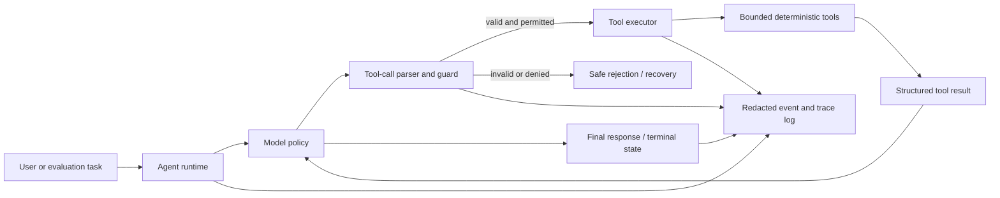
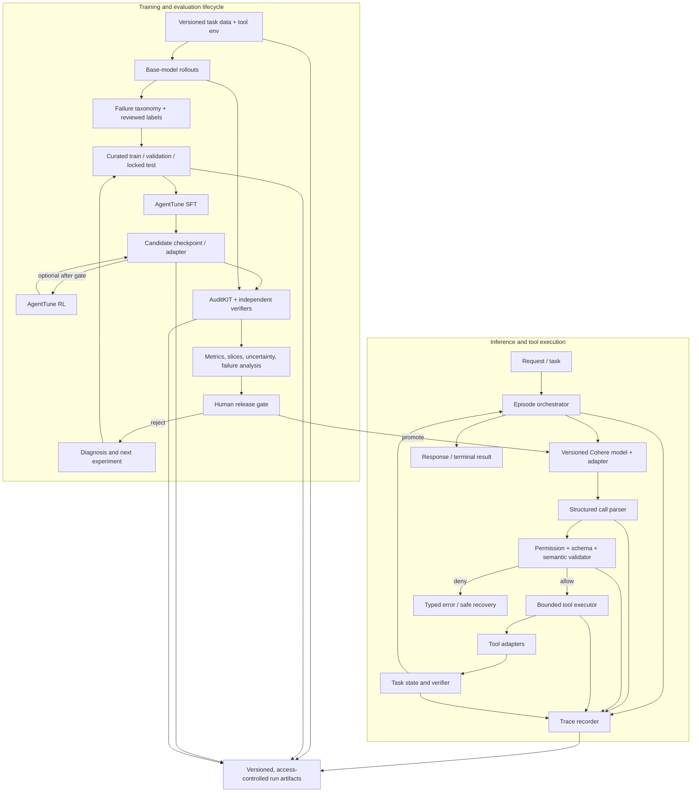

# M0 — System Architecture and Delivery Phases

> **Document type:** Milestone 0 architecture and phase plan  
> **Project:** Reliable and Efficient Tool-Using Agent  
> **Plan owner:** Product/Research lead (`TBD`)  
> **Status:** Draft for team review  
> **Source of truth:** [`plan.md`](plan.md) for charter, detailed task tracker, requirements, risks, and decisions.

## 1. M0 purpose

M0 turns the project charter into an implementation-ready system map and staged delivery plan. It defines the major runtime and research components, the data/model flow, security boundaries, phase gates, and the work products needed before implementation expands.

M0 is accepted when the team has selected the initial workflow, model/compute profile, tool contracts, benchmark protocol, and accountable owners, and has verified that the base-model and evaluation paths can run end to end.

## 2. System goals and boundaries

### Goals

- Improve verified task completion, tool-call correctness, and trajectory efficiency through measured post-training.
- Keep tool permissions, argument checks, step/time limits, and release decisions outside the model.
- Make each result traceable to a model revision, adapter, dataset, tool version, evaluator, config, and run.
- Support repeatable evaluation, failure diagnosis, safe candidate promotion, and rollback.

### Initial system boundaries

- One bounded workflow with deterministic tools and objectively verifiable outcomes. Recommended initial shape: structured lookup plus calculation; final workflow remains a team decision.
- Cohere Labs open-weights model for any event submission; exact model and revision remain a decision in [`plan.md`](plan.md#72-decision-log).
- AgentTune for supported post-training paths and AuditKIT for benchmark/evaluation orchestration, supplemented by independent checks for critical outcome predicates.
- Read-only tools by default. External side effects, sensitive data, unrestricted browsing/computer use, and autonomous production deployment are out of initial scope.

## 3. System context

The runtime may call a tool only through the guard. Model text is never executed as a shell command or treated as a trusted tool result. A run ends with a verified terminal state, a bounded failure, or a safe handoff; it cannot continue beyond configured step and time budgets.

## 4. Logical architecture

### Component responsibilities

| Component | Responsibility | Required invariant |
|---|---|---|
| Episode orchestrator | Owns task lifecycle, model/tool loop, maximum steps, deadline, and terminal handling. | Cannot exceed configured budgets; records every transition. |
| Versioned model and adapter | Produces structured tool decisions and final responses. | Model ID, revision, tokenizer/chat template, and adapter are pinned per run. |
| Parser | Converts model output to a typed tool-call representation. | Parse failures are explicit failures; no permissive execution of malformed output. |
| Permission/schema/semantic guard | Enforces tool allowlist, argument schema, value constraints, approval requirements, and policy. | Model output never grants itself permission. |
| Tool executor and adapters | Invokes only approved bounded tools with timeouts and normalized results. | Tools are isolated; retries are bounded and safe; writes require explicit approval. |
| Task state and verifier | Tracks environment state and computes deterministic success predicates. | Reward and headline success are tied to verifiable task outcomes where possible. |
| Trace recorder | Captures inputs/decisions/results, failure labels, timing, and provenance. | Redacts secrets and minimizes personal data; records enough for replay and diagnosis. |
| Dataset pipeline | Normalizes, validates, deduplicates, splits, and versions examples/traces. | Train, validation, and locked test are separated by task/template; provenance/license is stored. |
| AgentTune trainer | Runs SFT first and optional guarded RL after feasibility checks. | Training config, seed, code versions, data hash, reward version, and checkpoints are saved. |
| AuditKIT evaluator | Runs consistent metrics/comparisons and organizes results. | Metric behavior is smoke-tested; critical outcomes are independently checked. |
| Release gate | Reviews performance, safety, reproducibility, and operational evidence. | Promotion is human-approved; failed gates retain the last known-good model. |

## 5. Data and control flow

### 5.1 Runtime episode

1. Accept a task and assign an episode ID, model revision, tool-set version, and run configuration.
2. Provide the model only the task context and currently authorized tool schemas.
3. Parse the proposed response into either a tool call or a terminal response.
4. Validate tool name, arguments, semantic constraints, permission, approval state, and remaining budgets.
5. Reject invalid/disallowed actions with a typed, bounded recovery signal; otherwise execute the tool in an isolated adapter.
6. Record the normalized result and append a redacted event to the trace.
7. Continue until a verified terminal state, safe failure/hand-off, or enforced limit.
8. Store the final answer, environment outcome, trace, and performance measurements.

### 5.2 Training and evaluation lifecycle

1. Generate base-model episodes on versioned task splits.
2. Label failures using the taxonomy: wrong tool, malformed schema, invalid argument, wrong order/dependency, tool error handling, duplicate/redundant call, loop/step exhaustion, premature stop, incorrect final answer, policy violation, or appropriate abstention.
3. Curate only permitted training/repair data. Keep the locked test set unavailable to data generation and model selection.
4. Run SFT on reviewed successful trajectories. Validate the checkpoint before considering RL.
5. If reward tests pass and the compute spike is feasible, run bounded RL using environment-verifiable outcomes and guarded efficiency shaping.
6. Evaluate base, SFT, and selected final candidate with the same harness, task protocol, and metrics.
7. Review aggregate results and individual traces; perform safety and operational checks.
8. Promote only after the human release gate passes; otherwise retain the previous model and create a diagnosis/experiment issue.

### 5.3 Artifact and provenance contract

Each experiment must store:

- Run ID, timestamp, owner, purpose, status, and linked decision/task IDs.
- Model repository and immutable revision; tokenizer and prompt/template revision; adapter revision.
- AgentTune, AuditKIT, framework, driver, and tool versions or commit SHAs.
- Dataset name/revision, split manifest, license/provenance, and content hash.
- Task harness/tool versions, task IDs, seed, decoding settings, limits, and hardware profile.
- Reward implementation/version and reward-unit-test results for training runs.
- Raw or privacy-reviewed traces, RunResult/metrics exports, analysis, and checkpoint selection rationale.

Do not publish credentials, private user inputs, restricted datasets, or unredacted operational traces.

## 6. Trust boundaries and failure handling

| Boundary / failure | Required handling |
|---|---|
| User input → model | Treat prompt as untrusted; apply workflow policy and input limits. |
| Model output → parser | Strict structured parsing; malformed output is rejected and logged. |
| Parsed call → tool guard | Enforce allowlist, schema, semantic bounds, step/time budget, and approval. |
| Tool output → model | Treat as untrusted content; delimit/label it and test prompt-injection resistance. |
| Tool execution failure | Normalize typed errors; bounded retry only when idempotent and permitted; otherwise stop or hand off. |
| Training reward → optimizer | Unit-test score ordering, reject non-finite/unmeasured values, run degenerate-policy probes, correlate with verified success. |
| Evaluation result → release decision | Verify metric fixtures and provenance; review slices and transcripts; no promotion on proxy reward alone. |
| Candidate → production | Human approval, canary or limited pilot, monitoring, and tested rollback to prior known-good revision. |

## 7. Phases and checkpoints

The 30-day clock is relative to team kickoff. Keep event-specific submission dates as independent milestones in [`plan.md`](plan.md#21-verified-event-requirements-as-checked-2026-11-05).

| Phase | Days | Objective | Key outputs | Exit gate |
|---|---:|---|---|---|
| M0 — Charter and architecture | D1–3 | Finalize bounded use case, model/compute, tool contract, data policy, and architecture. | Approved decisions; environment/model smoke test; dependency/version map. | G0: scope and access are executable; owner and constraints are clear. |
| M1 — Harness and evaluation foundation | D3–9 | Implement deterministic tools, replayable tasks, trace contract, splits, and AuditKIT baseline. | Tool environment; task manifests; metric fixtures; frozen baseline and failure taxonomy. | G1: baseline and key metrics replay correctly; locked test is protected. |
| M2 — Data and SFT | D9–15 | Build reviewed data and train the first supervised candidate. | Data card; validated dataset; SFT checkpoint/logs; validation comparison. | G2: data/provenance checks pass and SFT yields a usable candidate or documented no-gain result. |
| M3 — Guarded RL and ablation | D14–20 | Establish reward trust, run feasibility spike, then optional bounded RL/efficiency comparison. | Reward tests; RL pilot decision; candidate checkpoints; full training provenance. | G3: reward tracks verified outcome and candidate passes validation safety floor; otherwise use SFT fallback. |
| M4 — Robustness and release evaluation | D20–25 | Evaluate task performance, transfer, safety, regressions, latency, and cost. | Locked-test report; robustness cases; failure analysis; performance profile. | G4: success and safety criteria pass, claims are evidence-backed, no critical blocker remains. |
| M5 — Packaging and controlled release | D23–30 | Build demo, publish permitted artifacts, document operations, conduct release review. | Public code/demo/artifacts; model/data cards; runbook; monitoring and rollback plan. | G5: fresh setup reproduces headline results and human release decision is recorded. |
| M6 — Limited operation and improvement | Post-D30 | Operate a bounded pilot, monitor drift, review failures, and propose repairs. | Health reports; incident/failure queue; reviewed corrective data proposals. | Any new model uses the same locked evaluation and release gate. |

### Phase checklist format

For each phase, maintain tasks in `plan.md` using this record: `ID · owner · status · target day · dependency · acceptance evidence · blocker/next action`. Mark phase complete only when its exit-gate evidence is linked.

## 8. M0 work items and tracking

| ID | M0 work item | Owner | Dependency | Acceptance evidence | Status |
|---|---|---|---|---|---|
| M0-01 | Select the first bounded workflow and define allowed/disallowed actions | Product/Research | None | Decision D1 recorded in `plan.md`; domain spec in `references/domain_spec.md` | Done |
| M0-02 | Confirm Cohere Labs model access, license, revision, and runtime format | ML/Infra | M0-01 | Decision D2 recorded; model pinned in `configs/model_config.yaml` and `references/hardware_profile.md` | Done |
| M0-03 | Confirm actual compute, budget, storage, and runtime limits | Infra | M0-01 | Decision D3 recorded; Apple M5 (16GB) profile & A100 budget in `references/hardware_profile.md` | Done |
| M0-04 | Inspect and pin compatible AgentTune/AuditKIT releases or commits | ML + Evaluation | M0-02 | Compatibility dossiers in `references/agenttune_notes.md` & `references/auditkit_notes.md`; adapters in `src/utils/compatibility.py` | Done |
| M0-05 | Define tool contracts, schemas, semantic constraints, permissions, and error types | Agent/Backend + Safety | M0-01 | Implemented in `src/environment/tools.py` & `src/environment/sandbox.py`; 9 unit tests passing | Done |
| M0-06 | Define task/episode/trace schema and provenance fields | Agent/Backend + Evaluation | M0-05 | Implemented in `src/data/schemas.py` & `src/data/redaction.py`; ShareGPT/AgentTune projections verified | Done |
| M0-07 | Choose benchmark/data sources and write split/licensing policy | Data + Evaluation | M0-01 | Implemented in `src/environment/task_generator.py` & `configs/task_splits.yaml`; leakage audit verified | Done |
| M0-08 | Define baseline metrics, safety floor, and threshold-setting protocol | Product + Evaluation + Safety | M0-07 | Metrics M1–M7 & 6-class taxonomy in `src/evaluation/metrics.py` and `src/evaluation/taxonomy.py` | Done |
| M0-09 | Create threat assumptions and release-control checklist | Safety + Backend | M0-05 | Implemented in `src/environment/guards.py` & `docs/release_checklist.md`; 4 unit tests passing | Done |
| M0-10 | Approve architecture and assign accountable owners/backups | Product lead | M0-01–09 | Team review recorded; owner table in `plan.md` filled | Not started |

### M0 review agenda

1. Confirm the actual production workflow and end user.
2. Confirm which actions the agent can take and which require human approval.
3. Review model/tool compatibility, current PR status, compute, and publishing constraints.
4. Approve the task split, headline success predicate, safety floor, and trace/artifact policy.
5. Assign owners, backups, and time budget for M1.

## 9. Architecture decisions still open

| Decision | Recommendation for M0 | Owner / due |
|---|---|---|
| Initial vertical | One deterministic lookup-plus-calculation workflow with synthetic or public non-sensitive task data. | Product / D2 |
| Model | Select only from currently permitted Cohere Labs open-weights models after a memory and tool-format smoke test; prefer the smallest capable option. | ML / D3 |
| Fine-tuning route | SFT first; RL is conditional on a successful reward audit and compute pilot. | ML / D14–16 |
| Tool side effects | Read-only for initial release; any write path needs explicit approval and idempotency controls. | Safety / D5 |
| Benchmark | Project-local deterministic suite as primary; a manageable external subset as transfer evidence. | Evaluation / D7 |
| Release hosting | Public repository and Hugging Face artifacts where event/license/privacy rules allow; deployment target remains `TBD`. | Infra / D20 |
| Self-healing | Phase M6 research/proposal only; no automatic production retraining or deployment in v1. | Product + Safety / post-D30 |

## 10. Risks and architecture mitigations

| Risk | Architecture mitigation | Trigger / action |
|---|---|---|
| Reward exploits a shortcut instead of completing work | Deterministic task verifier, reward unit tests, degeneracy probes, sampled trace review. | Reward and task success diverge → stop RL and rework reward. |
| Untrusted tool content redirects the agent | Delimited tool outputs, tool allowlist, independent permission guard, injection suite. | Any disallowed action executes → stop release and investigate boundary failure. |
| Audit metric bug produces misleading gains | Fixture tests, independent success predicate, pinned evaluator, explicit metric identity/config. | Metric disagrees with verifier → suppress affected claim until corrected. |
| Dataset or benchmark leakage inflates results | Provenance manifests, task-template split, locked test access, hash-based audit. | Suspected overlap → rebuild split and rerun baseline/candidates. |
| Training is unstable or unaffordable | Small early pilot, checkpointing, SFT-only release path, actual GPU profiling. | Pilot exceeds budget or harms validation → stop RL and retain best safe checkpoint. |
| Model/tool format mismatch | Parser contract and end-to-end smoke test before full dataset/training work. | Repeated invalid structured calls → select compatible model/serialization route. |
| Candidate regression after promotion | Human gate, limited rollout, health metrics, immutable prior revision and rollback. | Safety/success threshold breach → rollback and open incident/task. |

## 11. Definition of done for M0

- [ ] This architecture is reviewed by product, ML, evaluation, backend/infra, and safety owners.
- [ ] The initial use case, user, permitted actions, and out-of-scope actions are recorded.
- [ ] Model, compute, AgentTune/AuditKIT pins, and data source are selected or have explicit time-bounded spikes.
- [ ] Tool schemas, validators, error behavior, step/time limits, and audit event contract are agreed.
- [ ] Baseline success predicate and metric validation protocol are agreed before running comparisons.
- [ ] Train/validation/locked-test separation and publication/privacy policy are approved.
- [ ] Owners and backups are named in `plan.md`; M0 tasks include evidence links and current status.
- [ ] A minimal end-to-end base-model episode can be run, replayed, and scored, or the blocking issue is documented with a fallback.

## 12. Related documents and references

- Project charter and detailed tracker: [`plan.md`](plan.md)
- Antigravity skill research and master prompt: [`antigravity_skill.md`](antigravity_skill.md)
- [Official hackathon requirements](https://hackathon.lexsi.ai/)
- [AgentTune repository](https://github.com/Lexsi-Labs/AgentTune) · [AgentTune docs](https://agenttune.lexsi.ai)
- [AuditKIT repository](https://github.com/Lexsi-Labs/AuditKIT) · [AuditKIT docs](https://auditkit.lexsi.ai)

