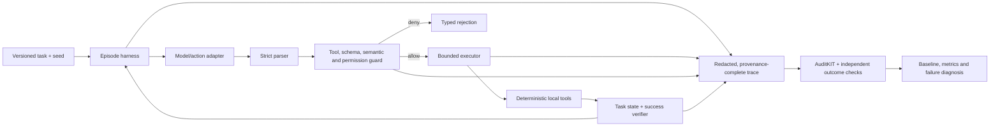

# M1 — Harness and Evaluation Foundation

> **Milestone:** M1  
> **Project:** Reliable and Efficient Tool-Using Agent  
> **Status:** Planned / in progress — update from verified evidence  
> **Schedule:** Relative project days D3–9; actual dates belong in the task tracker.  
> **References:** [`M0.md`](M0.md) · [`M1_p1.md`](M1_p1.md) · [`plan.md`](plan.md) · [`system_design.md`](../system_design.md)

## 1. Objective

Deliver a trustworthy harness and evaluation foundation for the agent. Given a versioned task and model action, the system must execute only valid, permitted, bounded tool calls; record a replayable, redacted trace; determine outcome from the environment; and produce a validated baseline with failure diagnosis.

M1 is the first end-to-end evidence milestone. Training work in M2 must not begin until the M1 exit gate passes or a specific blocker and approved fallback are recorded.

## 2. Scope

### In scope

- Deterministic tool contracts, permissions, validation, execution limits, and normalized failures.
- Seeded task generation, task reset/replay, environment-owned success verification.
- Trace schema use, provenance, safe redaction, and artifact handling.
- Train/validation/locked-test manifests and leakage checks.
- Failure taxonomy and annotation guide.
- AuditKIT integration for baseline measurements, with independent checks for headline outcomes.
- Base-model baseline and documented failure diagnosis, subject to model/compute access.

### Out of scope

- SFT, RL, reward shaping, and checkpoint selection (M2/M3).
- Automatic failure-to-training-data generation or self-healing deployment.
- Public production release or unrestricted external tools.
- Claims based on unverified metrics, unpinned dependencies, or unreviewed traces.

## 3. Architecture slice



**Control invariant:** model output cannot invoke a tool directly. Parsing, authorization, schema and semantic checks, time/step budgets, and outcome verification remain in trusted code outside the model. Tools are deterministic and read-only by default. Tool observations are untrusted input to the next model step.

## 4. Work packages

| ID | Work package | Deliverable | Acceptance criteria | Status |
|---|---|---|---|---|
| M1.P1 | Deterministic tool contracts and runtime harness | Existing or completed contract/parser/guard/executor path; typed failures; deterministic reset/replay; redacted trace | Malformed, unknown, denied, out-of-bounds, timed-out, and over-budget calls cannot execute or continue; seeded replay is stable; relevant tests pass | Not started |
| M1.P2 | Task suite, split manifests, and data integrity | Versioned task fixtures and train/validation/locked-test manifests with provenance | Split policy is task/template aware; deterministic generation and leakage checks pass; licenses/provenance recorded | Not started |
| M1.P3 | Failure taxonomy and annotation guide | Stable failure categories, labeling instructions, and labeled baseline sample | Categories cover observed failures; ambiguous examples are documented; sample labels are reviewed | Not started |
| M1.P4 | AuditKIT integration and metric validation | Reproducible evaluator/config and metric fixture report | Selected metrics pass hand-constructed fixtures; headline success agrees with independent environment verifier; failed/unmeasured runs are explicit | Not started |
| M1.P5 | Base-model baseline and diagnosis | Frozen baseline run, trace artifacts, metrics, and failure report | Same model/harness/config can replay; run provenance is complete; counts and limitations accompany results | Not started |
| M1.P6 | M1 gate review and handoff | Updated status/evidence in `M0.md` and `plan.md`; decision to enter M2 | G1 checklist passes or blockers and fallback are explicitly approved; locked test remains protected | Not started |

Use [`M1_p1.md`](M1_p1.md) as the detailed implementation prompt for M1.P1. Create or refine corresponding prompts for later work packages only when their dependencies and M1.P1 interfaces are verified.

## 5. Task-level tracking format

Track individual engineering tasks in `docs/plan.md` using:

`ID · task · owner · status · target day · dependencies · acceptance evidence/link · blocker/next action`

Allowed status values: `Not started`, `In progress`, `Blocked`, `In review`, `Done`, `Deferred`. Mark a task `Done` only when its acceptance evidence exists and has been reviewed.

### M1 checkpoint log

| Date | Package | Status | Evidence links | Blockers / decisions | Reviewer |
|---|---|---|---|---|---|
| TBD | M1.P1 | Not started | — | — | — |
| TBD | M1.P2 | Not started | — | — | — |
| TBD | M1.P3 | Not started | — | — | — |
| TBD | M1.P4 | Not started | — | — | — |
| TBD | M1.P5 | Not started | — | — | — |
| TBD | M1.P6 | Not started | — | — | — |

## 6. Verification and evidence requirements

### Harness and safety

- Nominal valid call reaches the intended tool and returns a normalized result.
- Unknown tool, malformed/truncated arguments, schema/semantic violations, and permission denial are explicit typed failures and do not invoke the tool.
- Tool exception, timeout, step exhaustion, and reset/replay failure terminate or recover according to the documented bounded behavior.
- Same task/seed and pinned tool version replay deterministically.
- Trace redaction covers nested structures and does not alter benign fields unexpectedly.
- Trace includes run/task IDs, seed, model/action adapter revision when applicable, tool/environment version, event sequence, outcomes, and error codes without storing secrets.

### Dataset and evaluation

- Task manifests are deterministic, versioned, and separated by underlying templates/entities where appropriate.
- Leakage audit checks train/validation/locked-test isolation; final test access is controlled.
- Failure taxonomy can represent all observed baseline failures and supports consistent labeling.
- AuditKIT selected metrics are tested against known fixtures and evaluator identity/config is captured.
- Headline task outcome is computed from deterministic environment state, not model self-report or an uncalibrated judge.
- Baseline report records model/revision, prompt/template, decoding settings, harness and tool versions, task/data hashes, seeds, hardware, metric definitions, sample counts, and known caveats.

### Required artifacts

- Focused tests and exact test commands/results.
- Task and split manifests with provenance/license notes.
- Sample redacted traces and run metadata.
- Metric fixture report and baseline run outputs (when the model baseline is run).
- Failure taxonomy/annotation guide and representative reviewed examples.
- Updated M1 status and evidence links in the project tracker.

## 7. M1 exit gate (G1)

M1 is complete only when all applicable conditions are evidenced:

- [ ] Runtime tool path is bounded, deterministic, permission-checked, and covered by tests.
- [ ] Task reset/replay and environment outcome verification work as specified.
- [ ] Trace provenance and redaction behavior are validated.
- [ ] Dataset splits and leakage checks are reproducible; locked test protection is defined.
- [ ] Failure taxonomy is documented and usable on baseline traces.
- [ ] AuditKIT metrics used in claims pass fixture checks; critical outcomes have an independent verifier.
- [ ] Base-model baseline is frozen with complete provenance, or an explicit model/compute blocker and accepted fallback are recorded.
- [ ] No unresolved critical safety or evaluation-integrity issue remains.
- [ ] `docs/M0.md`, `docs/plan.md`, and `system_design.md` agree with the implemented contracts and verified status.
- [ ] The team records a go/no-go decision for M2.

## 8. Risks and responses

| Risk | Response | Escalation condition |
|---|---|---|
| Existing M0 claims do not match implementation | Audit source and tests first; update status based on evidence rather than narrative. | Contract missing or incompatible: stop dependent tasks and document a blocker. |
| Metric behavior is incorrect or ambiguous | Fixture-test, pin evaluator, use independent outcome verification. | Suppress affected metric claim until fixed or replaced. |
| Split leakage inflates baseline | Use task/template/entity separation and automated overlap audit. | Rebuild splits and rerun all affected comparisons. |
| Model access/compute blocks baseline | Keep harness-only validation moving; define an approved smaller/hosted fallback consistent with project requirements. | Do not mark baseline complete without an actual logged run. |
| Trace includes sensitive data | Redact before persistence/export; inspect sample traces. | Any secret or prohibited data exposure: stop publication and remediate. |
| Scope expands into training prematurely | Hold M2/M3 until G1; track new work separately. | Any training run before trusted data/evaluation: pause and review validity. |

## 9. Phase checkpoint report

At each work-package or gate review, record:

```text
DONE: completed IDs and behavior
EVIDENCE: paths, test commands/results, run IDs, trace/report links
NEXT: next unblocked package or task
RISKS & GAPS: unresolved issue, impact, owner, proposed action
GATE: pass / fail / conditional, with reviewer and date
```

## 10. Related references

- [M1.P1 implementation prompt](M1_p1.md)
- [M0 architecture and phase plan](M0.md)
- [Overall project tracker](plan.md)
- [Authoritative system design](../system_design.md)
- [Engineering protocol](../instruction.md)
- [AgentTune](https://github.com/Lexsi-Labs/AgentTune) · [AuditKIT](https://github.com/Lexsi-Labs/AuditKIT)
