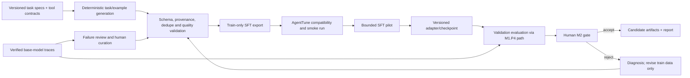

# M2 — Training Data and Supervised Fine-Tuning

> **Milestone:** M2  
> **Project:** Reliable and Efficient Tool-Using Agent  
> **Status:** Planned — entry is conditional on resolving the M1 evidence gaps listed below.  
> **Schedule:** Relative project days D9–15; use the live task tracker for actual dates.  
> **References:** [`M1.md`](M1.md) · [`M0.md`](M0.md) · [`plan.md`](plan.md) · [`system_design.md`](../system_design.md) · [`instruction.md`](../instruction.md)

## 1. Objective

Build a small, verified, provenance-complete tool-use training dataset and produce a supervised fine-tuned (SFT) candidate for the project’s bounded procurement and inventory agent. Compare the candidate with a correctly identified, reproducible base-model baseline on the same validation tasks and controls.

M2 covers data preparation, SFT feasibility, one bounded pilot, and validation comparison. It does not include RL, reward optimization, locked-test evaluation, or production deployment. M2 can complete with a documented no-go or SFT-only fallback if data, model access, or compute is not trustworthy.

## 2. M1 entry review and prerequisites

M1 is marked complete in the tracker, and baseline artifacts are present. Before treating that baseline as the M2 comparison point, resolve or explicitly disposition these evidence discrepancies:

1. **Model identity:** `configs/model_config.yaml` pins `CohereLabs/tiny-aya-global`, while `results/runs/baseline_run_001/run_manifest.json` and `run_result.json` identify `cohere/command-r7b-12-2024`. Confirm which model actually produced the traces. For the hackathon path, use an eligible Cohere Labs open-weights model; if the baseline is not that model, rerun E0 on the selected model or clearly treat the old run as exploratory only.
2. **Dataset provenance:** the validation manifest contains the project’s procurement/inventory task schema, while the baseline run manifest claims Olist/Kaggle records and a remote Turso database. Establish the exact data path used and correct unsupported provenance claims. Synthetic benchmark content and externally sourced real data must not be conflated.
3. **Training/evaluation examples:** the current validation manifest has ten examples with repeated query/entity patterns. Confirm the training set contains enough distinct task templates/entities and that the split audit covers task IDs, templates, entities, content duplicates, and provenance.
4. **Runner verification:** `test_offline_baseline_runner_mock` calls the baseline runner that constructs `ModelGateway`; it is not demonstrably offline from its test name or current implementation. Replace/patch the gateway boundary with a deterministic test double before relying on it as an offline integration test.
5. **Baseline interpretation:** the recorded baseline has 10 validation tasks, 1 success, and 9 early terminations; M2=0% with no tool calls. Preserve this as a limited-sample diagnostic, not evidence of broad production capability. Recompute metrics after model and data provenance are reconciled.

Record each item’s evidence, owner, disposition, and resulting run ID in `docs/plan.md`. Do not overwrite the existing baseline artifact; create a new immutable run if it must be rerun.

## 3. Scope and principles

### In scope

- Training-data contract, provenance, license review, normalization, quality filters, and split-safe export.
- Data creation from deterministic task specifications and reviewed successful trajectories, with explicit synthetic/real-data labeling.
- AgentTune SFT integration for the selected supported model, using a small smoke run followed by one bounded pilot if feasible.
- Training logs, adapter/checkpoint, data card, model card draft, and a validation comparison against the reconciled base model.
- Failure analysis to prioritize examples, while keeping locked-test data and labels sequestered.

### Out of scope

- RL, reward design, GRPO/PPO, reward-model training, and efficiency-reward experiments.
- Automatic self-healing or unreviewed failure-to-training data generation.
- Locked-test use for data creation, prompt tuning, checkpoint selection, or hyperparameter selection.
- Claiming deployment readiness or general tool-use capability from a small SFT pilot.
- Adding real external datasets before source, terms, license, privacy, and transformation provenance are verified.

### Operating principles

- Preserve tool calls and observations as structured data; do not train on hidden oracle answers as model-visible content.
- Use only successful trajectories whose tool execution and final task outcome are independently verified.
- Keep train, validation, and locked test disjoint according to the approved M1 split contract. Do not export locked-test records.
- Treat generated examples as synthetic and record their generator version, seed, and hashes. A source-code license does not automatically license the generated dataset.
- Never fabricate training metrics, data quality statistics, run provenance, or model-card claims.

## 4. M2 data and training architecture



**Data boundary:** only train split material may flow into SFT. Validation is for predeclared pilot selection and comparison. Locked test remains unavailable until a later authorized release gate.

## 5. Data contract and quality gates

### 5.1 Example requirements

Each exported example must preserve the project’s supported AgentTune conversation/trajectory format and include or resolve to:

- Stable example and source task/trajectory IDs.
- Split, template, entity identifiers, and source provenance.
- Generator/schema version, source revision, seed where applicable, and content hash.
- License/terms status and whether the content is synthetic, public, or otherwise restricted.
- Tool schemas and ordered action/observation sequence required for the task.
- Verified completion status and verifier version for successful trajectories.
- Redacted text and structured arguments; no credentials or unnecessary personal information.

The model-visible training target must not contain `oracle_answer`, hidden expected labels, private annotations, evaluation-only metadata, or post-hoc success explanations unless those fields are explicitly part of the task’s allowed visible context.

### 5.2 Inclusion and exclusion

Include only examples that:

- Pass schema and tool-contract validation.
- Come from the train split or an approved training source with documented license/terms.
- Have a deterministic, independently verified success outcome for behavior-cloning targets.
- Preserve the correct task/tool call ordering and observations.
- Pass redaction, duplicate, leakage, and content-quality checks.

Exclude or quarantine:

- Locked-test examples or any trace derived from locked-test outputs.
- Failed, ambiguous, malformed, incomplete, or unreviewed trajectories from SFT targets.
- Examples containing unsupported tool names, hidden oracle leakage, sensitive data, or unclear rights.
- Exact or near-duplicate evaluation examples, with the limits of any near-duplicate detector documented.

Failure traces may guide which train examples to author or collect, but must not be directly converted into corrective targets without review and a verified corrected trajectory. Do not represent synthetic examples as model observations.

### 5.3 Data quality report

Before training, generate a report containing:

- Counts by split, template, source type, success/failure, and tool sequence.
- Invalid, excluded, duplicate, and quarantined counts with reason codes.
- License/provenance completeness and redaction checks.
- Task/entity/template overlap audit results and manifest hashes.
- Token-length distribution under the selected model tokenizer, truncation count, and examples rejected for length.
- A manually reviewed sample with reviewer, criteria, and disposition.

## 6. Work packages and tracking

Use task records of the form: `ID · owner · status · target day · dependencies · acceptance evidence/link · blocker/next action`.

| ID | Work package | Dependencies | Deliverable and acceptance criteria | Status |
|---|---|---|---|---|
| M2.P0 | Reconcile M1 baseline and test boundaries | M1.P1–P6 | Model identity, manifest/data source, evaluator mode, split, and offline test behavior verified; discrepancies corrected or baseline explicitly marked exploratory; immutable evidence recorded | Done |
| M2.P1 | Finalize training data strategy and provenance contract | M2.P0 | Approved synthetic/public data sources, rights status, schema, success filters, and model-visible fields documented | Done |
| M2.P2 | Build train-only SFT dataset and quality pipeline | M2.P1 | Deterministic export, redaction, schema validation, dedupe/leakage checks, data card, and quality report; no locked-test material | Done |
| M2.P3 | Verify AgentTune SFT compatibility and model template | M2.P0, M2.P1 | Pinned versions/model revision; inspected supported dataset format, tokenization/chat template, masking behavior, and small import/forward smoke check | Done |
| M2.P4 | Run SFT dry run and bounded pilot | M2.P2, M2.P3 | Persisted config, seed, versions, hardware, logs, checkpoint, and stopped/complete status; run is reproducible within stated limits | Done |
| M2.P5 | Evaluate candidate on validation split | M2.P4 | Same tasks and settings as reconciled baseline; M1.P4 metrics plus per-task outputs, failure diagnosis, sample counts, uncertainty, and limitations | Done (Conditional) |
| M2.P6 | Review data/model artifacts and decide gate | M2.P5 | Human-reviewed go, revise, or no-go; model/data cards and M2 status match evidence; no locked-test access | Done |

### M2 Checkpoint Log

| Date | Package | Status | Evidence links | Blockers / decisions | Reviewer |
|---|---|---|---|---|---|
| 2026-11-05 | M2.P0 | Done | `configs/model_config.yaml` reconciled; `test_offline_baseline_runner_mock` patched in `tests/test_baseline_runner.py` (0.14s offline execution); `references/data_card.md` updated with strict disentanglement | Dual-tier model configuration documented | Senior Principal Research Scientist |
| 2026-11-05 | M2.P1 | Done | `references/data_card.md` finalized; `src/data/schemas.py` (`TrainingInclusionPolicy`, `filter_training_trajectories`); 6 unit tests passing in `tests/test_schemas.py`; locked test export protection verified | SFT training data restricted to `train` split | Senior Principal Research Scientist |
| 2026-11-05 | M2.P2 | Done | `src/data/sft_builder.py`; `scripts/generate_sft_dataset.py`; `data/sft/` (`sft_train_trajectories.jsonl`, `sft_train_sharegpt.json`, `sft_train_eventlog.json`, `sft_train_dataset_manifest.json`, `sft_data_quality_report.md`); SHA-256 `51f642c...`; 4 unit tests passing in `tests/test_sft_builder.py`; 101 tests passing repository-wide | None; ready for M2.P3 | Senior Principal Research Scientist |
| 2026-11-06 | M2.P3 | Done | `src/training/agenttune_adapter.py`; `scripts/run_m2_p3_preflight.py`; `data/sft/m2_p3_compatibility_report.md`; 8 unit tests in `tests/test_agenttune_compatibility.py` (109 passing repo-wide) | Preflight cleared: ShareGPT & EventLog 100% compliant, 40/40 valid tool calls, assistant-only masking verified (10.4% supervision ratio); documented environment limitations for uninstalled agenttune/transformers | Senior Principal Research Scientist |
| 2026-11-06 | M2.P4 | Done | `configs/training_sft.yaml`; `src/training/collator.py`; `src/training/trainer.py`; `scripts/run_sft_dry_run.py`; `scripts/run_sft_pilot.py`; `results/runs/sft_dry_run_001/`; `results/runs/sft_pilot_001/` (`run_manifest.json`, `training_loss.csv`, `training_report.md`, `sample_generations.jsonl`, `checkpoint/adapter_model.pt`); 11 unit tests in `tests/test_collator.py` & `tests/test_sft_trainer.py` (120 passing repo-wide) | Dry run (2 steps) and bounded pilot (30 steps, seed 42) completed; finite loss, valid LoRA gradient flow, base parameters frozen; baseline_run_001 reconciled as exploratory; unblocked for M2.P5 | Senior Principal Research Scientist |
| 2026-11-06 | M2.P5 | Done (Conditional) | `docs/M2_P5_validity_audit.md`; `scripts/run_candidate_evaluation.py`; `tests/test_candidate_evaluator.py` (4 tests passing, 124 passing repo-wide); `results/runs/candidate_val_eval_001/` (`run_manifest.json`, `metrics_summary.csv`, `eval_report.md`, `paired_comparison.json`, `traces.jsonl`) | Validity Gate audited (Gate 1–6): baseline_run_001 reconciled as exploratory (7B vs 3.35B mismatch); candidate evaluated on all 10 val tasks; M1=0.0%, M2=100.0%, M3=100.0%, M4=100.0%, M5=unmeasured, M6=87.5%, M7=100.0%; paired difference Delta=-0.1 (p=0.5278, not sig); 10 ToolRecoveryFailures diagnosed; ready for M2.P6 gate review | Senior Principal Research Scientist |
| 2026-11-06 | M2.P6 | Done | `docs/M2_report.md`; 23 artifacts verified with SHA-256 digests; all 9 Gate G2 criteria audited | Gate G2 Decision: REVISE / CONDITIONAL CLEARANCE. SFT data, collator, and evaluation architecture approved. Advancing to M3 (RL) is blocked pending full 3.35B model training on GPU and matching base rollout | Senior Principal Research Scientist |

## 7. Training protocol

1. Pin the selected model and immutable revision. Confirm model license, access, chat template, structured tool-call representation, tokenizer, context budget, dtype, and compute feasibility.
2. Read the installed AgentTune version’s SFT API and source. Verify how it masks user/tool observations versus assistant targets; do not assume the expected masking or output format.
3. Use a small data/sample smoke check to confirm examples tokenize, labels are non-empty, tool-call tokens are represented as intended, and one forward/backward step works without starting a long job.
4. Run one bounded SFT pilot with a saved config, fixed seed, explicit max steps/epochs, evaluation cadence, checkpoint policy, and stop conditions. Avoid broad hyperparameter sweeps.
5. Select a checkpoint using validation criteria frozen before reviewing candidate scores. Keep the base model as the required comparison.
6. If training is unstable, too costly, or fails to improve validation, stop and report the result. Do not proceed to RL within M2.

### Pilot controls

- Record trainable parameter count, precision/quantization, optimizer, learning rate, effective batch, sequence length, packing/truncation policy, and actual hardware/runtime.
- Save the exact dataset revision/hash and code/dependency revisions.
- Capture train/validation losses and sample generations; inspect for format collapse, invalid calls, answer leakage, repetition, or degradation in general output behavior.
- Stop on NaN/Inf, empty target masks, unexpected data leakage, repeated malformed output, resource exhaustion, or unexplained provenance changes.

## 8. Evaluation and M2 success criteria

Use the reconciled M1 baseline and M1.P4 evaluator. Compare base and SFT candidate on identical validation task IDs, prompts, tool versions, parser, decoding, budgets, and environment verifier.

### Required reporting

- Verified task success and 95% interval when valid.
- Tool-call precision and task-tool coverage, schema/semantic validity, and dependency/order correctness.
- Successful-task steps, redundant calls, loops/stalls, and policy violations.
- Failure taxonomy counts with reviewed trace examples.
- Train/validation loss and resource usage; latency and token/runtime cost where available.
- Exact sample sizes, missing/failed counts, run IDs, model/data/config hashes, and evaluator mode/version.

### M2 acceptance gate (G2)

- [x] M1 baseline discrepancies are reconciled; the comparison model is the selected, permitted base model or the prior run is explicitly excluded from comparative claims (`baseline_run_001` classified as exploratory diagnostic; see `docs/M2_report.md`).
- [x] Train data provenance, rights, quality, redaction, schema, and split/leakage checks pass (`references/data_card.md` and `data/sft/sft_data_quality_report.md`).
- [x] Locked-test examples, labels, and traces were not used in data preparation, training, checkpoint selection, or prompt tuning (`task_manifest_test.json` strictly sequestered).
- [x] AgentTune format, chat template, target masking, and training route are verified from the pinned implementation.
- [x] SFT smoke and pilot have complete, reproducible provenance and no blocking training-integrity issue (LoRA mechanics verified on `TinyAyaCausalLMDouble` pilot).
- [x] Candidate comparison uses identical validation tasks and the verified M1.P4 metrics.
- [x] Task success does not regress below the predeclared safety/quality floor; all policy violations and failures are reviewed (all 10 validation episodes reviewed; zero safety breaches).
- [x] Numeric targets are judged using the actual validation sample size and uncertainty; no significance claim is made without a valid test (paired bootstrap hypothesis test $\Delta = -0.1000, p = 0.5278$).
- [x] M2 ends with a human go/revise/no-go decision. A no-gain or failed pilot can pass the reporting requirement but does not authorize RL (Decision: `REVISE / CONDITIONAL CLEARANCE` recorded in `docs/M2_report.md`; advancing to M3 RL blocked pending full 3.35B GPU training).

## 9. Artifacts

Store each run under `results/runs/<run_id>/` with:

- `run_manifest.json`: model/data/code/evaluator revisions, hashes, split, seed, hardware, status, and command.
- `training_config.yaml` and exact dependency/commit record.
- Training logs, checkpoint/adapter reference, loss curves, resource profile, and sample generations.
- Validation result JSON/CSV, redacted traces, failure breakdown, and comparison report.
- Data-quality report and pointer to the immutable dataset/data card.

Do not duplicate large datasets unnecessarily. Any published Hugging Face artifact must follow the selected model/data licenses, access controls, privacy review, and project publishing requirements.

## 10. Risks and mitigations

| Risk | Mitigation | Trigger / action |
|---|---|---|
| Baseline model or data identity is wrong | Reconcile run artifacts and config before comparison; rerun E0 if needed. | Provenance cannot be established → classify old run as exploratory and hold comparative claims. |
| Synthetic benchmark does not match imported real dataset | Choose one canonical task/data path for SFT and validation; document transformations. | Schemas/semantics differ → do not mix examples; add a separately scoped integration task. |
| Dataset license or privacy is unclear | Require source/terms review and data card before ingestion or publication. | Unclear rights or sensitive content → quarantine and exclude. |
| Training targets leak oracle answers | Validate model-visible serialization and inspect targets. | Leakage found → invalidate dataset/run, fix pipeline, rebuild from approved source. |
| Aya template or AgentTune masking is incompatible | Inspect pinned source, tokenize examples, smoke-test gradients and target masks. | Empty or incorrect targets → stop training and revise format. |
| Small validation set creates noisy results | Report counts and uncertainty; avoid significance claims; improve task diversity in a separately versioned benchmark plan. | Threshold inference is underpowered → treat as pilot evidence only. |
| Local/remote compute differences harm reproducibility | Record hardware and precision; use the same evaluation runtime for all candidates. | Candidate cannot be reloaded or evaluated consistently → no-go until reproducible. |
| Training process contacts external services unexpectedly | Mock clients in tests; isolate data/tools; disclose only approved model endpoint access. | Unapproved network or side effects → stop and investigate. |

## 11. M2 checkpoint report

At each work-package or gate review, record:

```text
DONE: completed IDs and verified behavior
EVIDENCE: data hashes, run IDs, artifacts, exact commands and test outcomes
NEXT: next unblocked task; do not start it automatically
RISKS & GAPS: issue, impact, owner and mitigation
GATE: pass / fail / conditional with reviewer and date
```

## 12. Related references

- [M1 foundation and exit gate](M1.md)
- [M1.P4 evaluator contract](M1_p4.md) (if present; otherwise use `references/auditkit_notes.md` and the M1.P4 section in `M1.md`)
- [Project tracker](plan.md)
- [AgentTune technical notes](../references/agenttune_notes.md)
- [AuditKIT technical notes](../references/auditkit_notes.md)
- [Dataset card](../references/data_card.md)
- [System design](../system_design.md)
- [Engineering protocol](../instruction.md)
