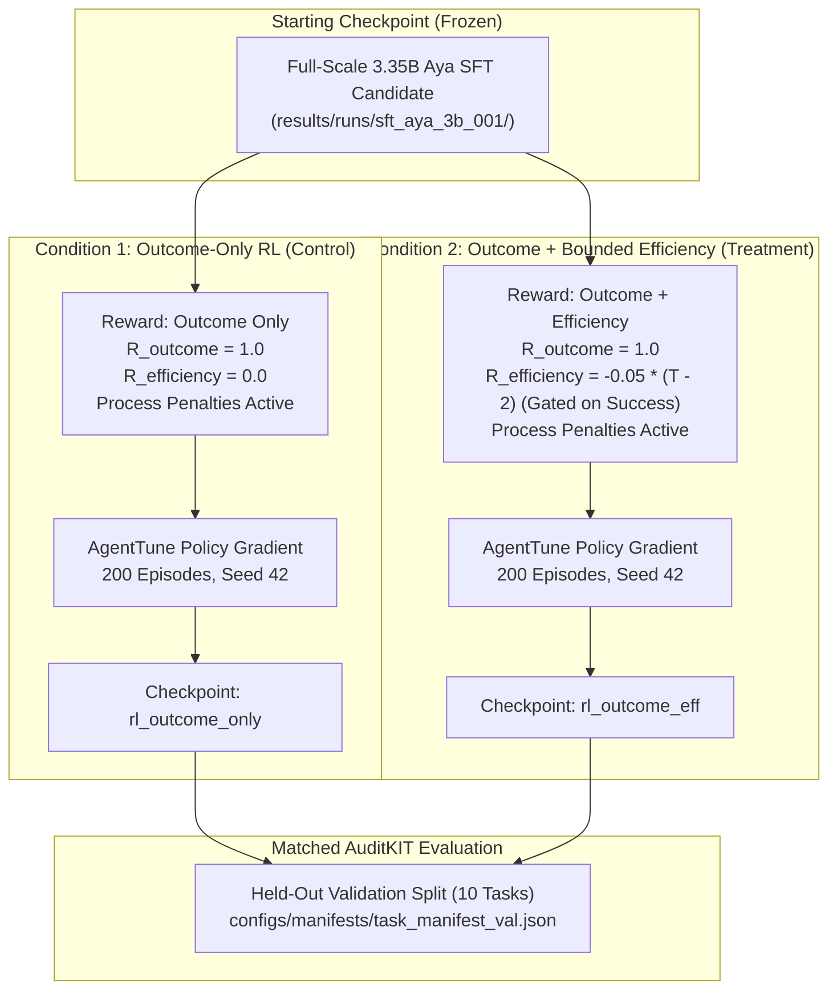

# Pre-Registration Protocol: M3.P4 Bounded RL Experiment & Efficiency Ablation

> **Document Type:** Formal Experimental Pre-Registration  
> **Milestone:** M3 — Work Package M3.P4  
> **Author:** ML Lead & Safety / Infrastructure Engineer  
> **Status:** **Pre-Registered Protocol (Execution Blocked at Gate G2)**  
> **Date:** 2026-11-06  
> **Traceability:** Maps to `docs/M3.md` §3 & §5, `references/reward_spec.md`, and `.agents/skills/reward-design-guard/SKILL.md`  

---

## 1. Executive Context & Pre-Registration Mandate

This document establishes the **immutable pre-registered protocol** for the bounded reinforcement learning experiment in Milestone 3, comparing outcome-only RL against outcome plus bounded efficiency RL.

In strict adherence to `instruction.md` and the scientific method:
- **No Mid-Run Retuning:** All hyperparameters, algorithm choices, seeds, dataset hashes, reward formulations, stopping conditions, and evaluation metrics are frozen prior to model execution.
- **Strict Predecessor Gate Status:** Execution of this experiment on the target model `CohereLabs/tiny-aya-global` (3.35B) remains **`BLOCKED AT GATE G2`** pending remote GPU provisioning and full SFT weights. No real-scale RL training will be launched on local hardware.
- **Sequestration Invariant:** The locked test split (`configs/manifests/task_manifest_test.json`) is permanently sealed and prohibited from training, validation, checkpoint selection, or hyperparameter tuning.

---

## 2. Pre-Registered Experimental Conditions

The experiment compares exactly two pre-registered conditions:



### 2.1 Condition 1: Outcome-Only RL (Control)
- **Objective:** Train the agent to maximize environment-verified task completion without explicit step minimization pressure.
- **Reward Formulation:**
  $$R_1(\tau) = R_{\text{outcome}}(\tau) + \sum_{t=1}^T \left( R_{\text{parse}}(a_t) + R_{\text{tool\_selection}}(a_t) + R_{\text{arguments}}(a_t) + R_{\text{order}}(a_t) \right) + R_{\text{safety}}(\tau)$$
  where $R_{\text{efficiency}}(\tau) \equiv 0.00$.
- **Hypothesis:** Maximizes raw task success ($M_1$), but may retain redundant exploratory calls ($M_6 > 0$).

### 2.2 Condition 2: Outcome Plus Bounded Efficiency RL (Treatment)
- **Objective:** Train the agent to complete tasks with minimal redundant steps while preventing empty no-op traps.
- **Reward Formulation:**
  $$R_2(\tau) = R_{\text{outcome}}(\tau) + \mathbb{I}(is\_success) \cdot R_{\text{efficiency}}(\tau) + \sum_{t=1}^T \left( R_{\text{parse}}(a_t) + R_{\text{tool\_selection}}(a_t) + R_{\text{arguments}}(a_t) + R_{\text{order}}(a_t) \right) + R_{\text{safety}}(\tau)$$
  where $R_{\text{efficiency}}(\tau) = -0.05 \cdot \max(0, T - 2)$, clamped at $-0.25$, and applied **strictly conditional on $\mathbb{I}(is\_success) == 1$**.
- **Hypothesis:** Achieves equivalent task success ($M_1$) with improved step efficiency ($M_5$) and reduced redundant calls ($M_6$).

---

## 3. Frozen Hyperparameters & Execution Controls

| Parameter | Frozen Value | Technical Rationale / Constraint |
|:---|:---|:---|
| **Base Model Target** | `CohereLabs/tiny-aya-global` (3.35B) | Target open-weights model (`configs/model_config.yaml`). |
| **Model Revision** | `main` | Immutable model commit. |
| **SFT Initial Checkpoint** | `results/runs/sft_aya_3b_001/checkpoint/` | Prerequisite full-scale SFT checkpoint. |
| **RL Algorithm** | AgentTune Policy Gradient / PPO | Pinned post-training algorithm with normalized relative advantages. |
| **Optimizer** | AdamW | Standard decoupled weight decay optimizer. |
| **Learning Rate** | $1.0 \times 10^{-5}$ | Conservative fine-tuning learning rate to prevent catastrophic forgetting. |
| **Weight Decay** | $0.01$ | Standard L2 regularization. |
| **Advantage Baseline** | Exponential Moving Average ($0.90$ decay) | Variance reduction for policy gradient updates. |
| **Episode Budget** | Exactly $200$ episodes per condition | Bounded compute cap preventing run divergence. |
| **Sequence Length** | $512$ tokens | Maximum context budget for dialogue + tool calls. |
| **Random Seed** | $42$ | Deterministic seed for reproducible task sampling. |
| **Hardware Cap** | $1 \times$ NVIDIA A100-SXM4-40GB | Predeclared remote cluster allocation. |
| **Wall-Clock Cap** | $30.0$ minutes per condition | Hard stop condition on training execution. |

---

## 4. Frozen Data Boundaries & Split Isolation

- **Training Input Only:** Exactly the 40 tasks declared in `configs/manifests/task_manifest_train.json` (SHA-256 `0175e752...`).
- **Validation Evaluation Only:** Exactly the 10 tasks declared in `configs/manifests/task_manifest_val.json` (SHA-256 `51a4275e...`).
- **Locked Test Sequestration:** The locked test split (`configs/manifests/task_manifest_test.json`, SHA-256 `d86265f0...`) is **strictly prohibited** from model training, validation looks, or checkpoint selection.

---

## 5. Checkpoint Selection & Evaluation Protocol

1. **Selection Metric:** The optimal checkpoint for each condition is chosen strictly by the **validation task success rate ($M_1$)** on `task_manifest_val.json`.
2. **Anti-Proxy Invariant:** Training reward alone **CANNOT** select a checkpoint. If training reward increases while validation success decreases, the checkpoint is rejected.
3. **Evaluation Spine:** Both checkpoints will be evaluated using `scripts/run_candidate_evaluation.py` under identical decoding settings ($T=0.0$, max steps $= 8$, timeout $= 30\text{s}$) and AuditKIT adapter mode `local-adapter-1.0.0`.

---

## 6. Fail-Closed Stop Conditions

The training run will halt immediately, preserve partial logs, and report a failure if any of the following triggers occur:
1. **Non-Finite Arithmetic:** Any NaN or $\pm\infty$ in loss, policy gradients, or reward values.
2. **Proxy Reward Gaming:** Occurrence of a High-Reward Failure ($R > 0.50 \land is\_success == False$).
3. **Guard Breach:** Any model attempt to bypass the relational sandbox or execute unpermitted shell/network I/O.
4. **Data Contamination:** Any attempt to read or import `task_manifest_test.json`.
5. **Resource Cap Overrun:** Training exceeding 30 minutes wall-clock time or exhausting 40GB VRAM.

---

## 7. Sign-Off & Status

```text
STATUS: PRE-REGISTERED EXPERIMENTAL PROTOCOL (EXECUTION BLOCKED AT GATE G2)
FROZEN CONDITIONS: Condition 1 (Outcome-Only) vs Condition 2 (Outcome + Bounded Efficiency)
BLOCKED ENTRY DEPENDENCY: Full-scale 3.35B SFT training and matching base rollout on remote A100 GPU infrastructure.
DOWNSTREAM ACTION: Maintain frozen protocol; do not modify hyperparameters or rewards prior to GPU execution.
```

