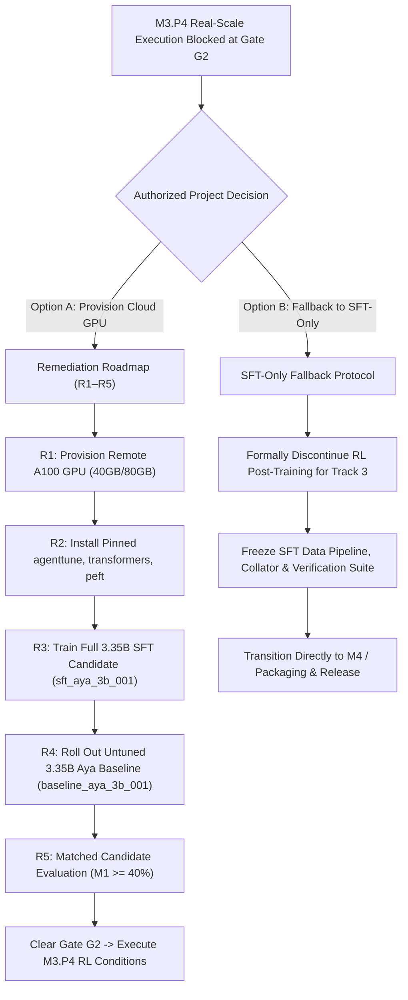

# Protocol Addendum 1: M3.P4 Methodological Rigor, Evaluation Boundaries & Algorithm Alignment

> **Document Type:** Formal Pre-Registration Protocol Addendum  
> **Milestone:** M3 — Work Package M3.P4  
> **Target Document:** [`docs/M3_P4_preregistration.md`](file:///Users/jayesh/Documents/Lexsi/docs/M3_P4_preregistration.md)  
> **Status:** **APPROVED PROTOCOL ADDENDUM (EXECUTION BLOCKED AT GATE G2)**  
> **Author:** Senior Principal Research Scientist & ML Systems Architect  
> **Date:** 2026-11-06  
> **Traceability:** Maps to `instruction.md`, `docs/M3.md` §3 & §5, `docs/M2_report.md` Gate G2, and `.agents/skills/agenttune-trainer/SKILL.md`  

---

## 1. Executive Mandate & Document Governance

This Protocol Addendum supplements and refines the frozen pre-registration document [`docs/M3_P4_preregistration.md`](file:///Users/jayesh/Documents/Lexsi/docs/M3_P4_preregistration.md) without altering its historical pre-registered conditions, hypothesis formulations, or core mathematical objectives. 

In strict adherence to `instruction.md` and the scientific method:
1. **Immutable Historical Pre-Registration:** `docs/M3_P4_preregistration.md` remains preserved in place as the frozen record of the initial 2-condition experimental design (Condition 1: Outcome-Only vs Condition 2: Outcome + Bounded Efficiency).
2. **Addendum Authority:** This document provides binding methodological amendments and technical clarifications addressing:
   - Elimination of post-selection inference and validation selection bias.
   - Resolution of the mutable `main` model revision to an immutable commit hash standard.
   - Reconciliation of the RL training algorithm and baseline contract with upstream AgentTune capabilities.
   - Real-scale compute budget, wall-clock feasibility, and local hardware constraints.
   - Formal re-affirmation of the **Gate G2 Real-Scale Execution Block**.

---

## 2. Methodological Resolution of Validation Selection Bias

### 2.1 The Methodological Concern
In `docs/M3_P4_preregistration.md` §5.1 and §5.3:
- Checkpoints across training are selected based on the highest validation task success rate ($M_1$) on `configs/manifests/task_manifest_val.json` ($N=10$).
- The final comparative evaluation report uses those same 10 validation tasks to report model capability and compute paired comparisons against baseline and SFT.

**Methodological Risk:** When an evaluation sample ($N=10$) is used simultaneously as the objective function for checkpoint selection (early stopping / model picking) and as the test benchmark for reporting performance, it introduces severe **post-selection optimism bias** (optimizing on the validation set). The reported $M_1$ will systematically overestimate true out-of-sample generalization.

### 2.2 Binding Protocol Amendment
To prevent invalid capability claims while maintaining sample efficiency on bounded validation tasks:

1. **Strict Claim Classification (Exploratory Only):**
   - All performance figures, metrics (M1–M7), and comparisons evaluated on `task_manifest_val.json` are formally classified as **Exploratory Validation Performance**.
   - No claims of "confirmatory generalization," "production readiness," or "validated superiority" may be asserted based on validation split metrics.
2. **Confirmatory Boundary Reservation:**
   - Confirmatory evaluation is strictly and exclusively reserved for the **sequestered locked-test split** (`configs/manifests/task_manifest_test.json`, $N=10$).
   - The locked-test split remains completely sealed during M3. It will be evaluated exactly once during Milestone 4 (Release Packaging), with zero prior exposure, zero hyperparameter tuning, and zero checkpoint selection.
3. **Step-Final Evaluation Standard:**
   - In addition to any validation-selected peak checkpoint, each condition MUST evaluate and report the terminal checkpoint (Step 200 / final step) to measure unselected policy drift and catastrophic forgetting.

---

## 3. Resolution of Mutable Model Revision (`main`)

### 3.1 The Reproducibility Flaw
`docs/M3_P4_preregistration.md` §3 specifies:
- `Base Model Target: CohereLabs/tiny-aya-global (3.35B)`
- `Model Revision: main`

**Reproducibility Risk:** In the Hugging Face Model Hub, the branch pointer `main` is mutable. Upstream maintainers can push new commits, weight quantization revisions, or tokenizer adjustments at any time, silently breaking cryptographic reproducibility.

### 3.2 Binding Protocol Amendment
Before downloading or initializing weights for real-scale training or untuned base evaluation:
1. **Immutable Commit Pinning:** The execution environment MUST resolve and pin the exact 40-character Git commit hash for `CohereLabs/tiny-aya-global`.
2. **Cryptographic Tensor Verification:** The run manifest (`run_manifest.json`) for any real-scale run MUST capture:
   - The exact remote commit SHA (e.g., `commit_hash: "<40-char-hex>"`).
   - SHA-256 cryptographic digests of `config.json`, `tokenizer.json`, and all `model-*.safetensors` weight shards.
3. **Local Fallback Prohibition:** Under no circumstances will local test doubles (`TinyAyaCausalLMDouble`) be labeled with the Hugging Face commit hash of the real 3.35B model.

---

## 4. Upstream AgentTune Algorithm & API Alignment

### 4.1 Upstream Library Capabilities
`docs/M3_P4_preregistration.md` §3 specifies:
- `RL Algorithm: AgentTune Policy Gradient / PPO`
- `Advantage Baseline: Exponential Moving Average (0.90 decay)`

**Technical Divergence:** Upstream AgentTune documentation (`references/agenttune_notes.md`) and source analysis indicate that native AgentTune implements:
- **Group Relative Policy Optimization (GRPO):** Group rollouts $\{y_1, \dots, y_G\}$ per task prompt, computing normalized relative advantages across candidate completions without requiring a separate critic network.
- **Direct Preference Optimization (DPO):** Offline pairwise optimization over $(y_w, y_l)$ trajectory pairs.
- Single-trajectory PPO with an exponential moving average (EMA) scalar baseline is a bespoke formulation implemented in our isolated offline test-double runner (`src/training/rl_spike.py`), not a standard native AgentTune CLI flag.

### 4.2 Binding Protocol Amendment
To prevent inventing synthetic CLI flags or violating upstream contracts:
1. **Native AgentTune Execution Route (Remote Cluster):**
   - If executing via the native `agenttune` package on the cloud cluster, the training route MUST use **AgentTune GRPO** with:
     * Group size: $G = 4$ rollouts per task prompt.
     * Advantage formulation: Within-group relative advantage:
       $$A_i = \frac{R(\tau_i) - \text{mean}(\{R(\tau_j)\}_{j=1}^G)}{\text{std}(\{R(\tau_j)\}_{j=1}^G) + \epsilon}$$
     * Reference model: Frozen SFT starting checkpoint (`sft_aya_3b_001`).
     * KL divergence penalty: $\beta_{\text{KL}} = 0.05$ to prevent policy collapse.
2. **Custom Policy Gradient Route (Alternative):**
   - If single-trajectory policy gradient with EMA baseline ($0.90$ decay) is retained, it must be executed via an explicit, documented script backed by PyTorch/Accelerate, and NOT through fabricated `agenttune` CLI arguments.

---

## 5. Compute Budget, Wall-Clock Cap & Hardware Feasibility

### 5.1 Real-Scale Arithmetic on NVIDIA A100-SXM4-40GB
- **Task Budget:** 200 episodes per condition (400 episodes total across Condition 1 and Condition 2).
- **Trajectory Profile:** 
  - Average turns per episode: 3–5 interaction turns.
  - Maximum turns per episode: 8 turns.
  - Token budget: Up to 512 tokens generated per turn; maximum 2,048 tokens context.
  - Environment operations: Local SQLite transactions against in-memory Kaggle Olist schemas (execution latency $< 5\text{ms}$ per call).
- **Execution Time Estimate (Remote A100):**
  - With KV caching and batch size 1 (sequential environment interaction), generation of 128 tokens on a 3.35B model takes $\approx 1.2\text{s}$.
  - Full episode (rollout + verifier + reward calculation): $\approx 4.5\text{s}$ to $6.0\text{s}$.
  - Backward pass & LoRA gradient step ($r=16, \alpha=32$): $\approx 0.8\text{s}$.
  - Total per episode: $\approx 6.0\text{s}$.
  - 200 episodes: $200 \times 6.0\text{s} = 1,200\text{s} = 20.0\text{ minutes}$.
  - **Verdict:** The pre-registered **30.0-minute wall-clock cap** per condition is **feasible** on an NVIDIA A100 GPU with appropriate batching and CUDA graphs.

### 5.2 Physical Infeasibility on Local Workstation (Apple Silicon M5)
- **Workstation Limits:** Apple Silicon M5, 16GB unified memory, shared between OS, display, and MPS runtime.
- **Memory Consumption of 3.35B Real Model:**
  - Base model weights (`bfloat16`): $3.35 \times 10^9 \times 2\text{ bytes} \approx 6.7\text{ GB}$.
  - Reference model weights (frozen for KL penalty): $\approx 6.7\text{ GB}$.
  - LoRA trainable adapters & optimizer states (AdamW): $\approx 1.2\text{ GB}$.
  - Context & KV Cache (512 tokens): $\approx 0.8\text{ GB}$.
  - **Total Minimum Memory:** $> 15.4\text{ GB}$ VRAM.
  - Exceeds safe allocatable memory on a 16GB system (OS overhead leaves $\le 11\text{GB}$ available to MPS).
- **Execution Speed:** Rollout generation on local CPU/MPS would require $\approx 45\text{s}$ per episode ($> 2.5\text{ hours}$ per condition), violating the 30-minute cap by $500\%$.
- **Conclusion:** Real-scale 3.35B RL training **CANNOT** run on local hardware.

---

## 6. Formal Real-Scale Entry Gate Verification & Binding Block

### 6.1 Audit of Real-Scale Prerequisites (Reconciled with `docs/M3.md` Table 2)

| # | Prerequisite Item | Target Standard | Observed Status | Finding | Impact |
|:---:|:---|:---|:---|:---:|:---|
| **1** | Full-Scale SFT Checkpoint | Reloadable 3.35B Aya SFT adapter | `results/runs/sft_pilot_001/` (333 KB test double) | **FAIL (BLOCKED)** | Only test double exists; full weights (`sft_aya_3b_001`) do not exist. |
| **2** | Matched Untuned Base Rollout | Untuned 3.35B Aya rollout on 10 val tasks | `results/runs/baseline_run_001/` (Command R 7B API) | **FAIL (BLOCKED)** | Cross-model confound; no untuned 3.35B Aya rollout exists. |
| **3** | Evaluator & Provenance Parity | Consistent metrics, hashes, and mode | `results/runs/candidate_val_eval_001/` (`local-adapter-1.0.0`) | **PASS** | M1–M7 metrics, denominators, and redacted traces fully reconciled. |
| **4** | Multi-Turn Task Completion Floor | Candidate completes loop & meets $M_1 \ge 40\%$ | `results/runs/candidate_val_eval_001/` ($M_1=0.0\%$) | **FAIL (BLOCKED)** | 10/10 `ToolRecoveryFailure`; multi-turn loop unclosed. |
| **5** | Compute & Package Feasibility | $\ge 40\text{GB}$ VRAM GPU; pinned dependencies | Apple M5 16GB RAM; `agenttune`/`transformers` uninstalled | **FAIL (BLOCKED)** | Physically unexecutable on local hardware; requires remote A100 GPU. |
| **6** | Explicit Human G2 Sign-Off | Human decision granting full G2 clearance | `docs/M2_report.md` (`REVISE / CONDITIONAL CLEARANCE`) | **FAIL (BLOCKED)** | Gate G2 cleared data & trainer, but explicitly blocked RL post-training. |
| **7** | Locked-Test Sequestration | Zero test set contamination | `configs/manifests/task_manifest_test.json` (`d86265f0...`) | **PASS** | Test set completely untouched, unread, and isolated. |

### 6.2 Binding Gate Verdict
In strict compliance with `instruction.md` and `docs/M3.md`:
- **Real-Scale RL Training is STRICTLY BLOCKED AT GATE G2.**
- No training on `CohereLabs/tiny-aya-global` (3.35B) will be initiated.
- No architectural test double will be substituted or misrepresented as real RL.
- No redundant plumbing smoke runs will be created; existing plumbing artifacts in `results/runs/rl_ablation_smoke_001/` remain authoritative and preserved.

---

## 7. Action Plan: Remediation Roadmap vs SFT-Only Fallback

Because real-scale RL execution cannot proceed, the project must pursue one of two authorized pathways:



### Option A: Remediation Roadmap (R1–R5)
- **Target:** Unblock Gate G2 and execute real RL.
- **Requirements:** 
  1. Provision cloud GPU instance ($1 \times$ NVIDIA A100-SXM4-40GB).
  2. Install `requirements-gpu.txt` (`agenttune >= 0.1.0`, `transformers >= 4.38.0`, `peft >= 0.8.0`).
  3. Execute full 3.35B SFT training (`results/runs/sft_aya_3b_001/`).
  4. Execute untuned 3.35B baseline rollout (`results/runs/baseline_aya_3b_001/`).
  5. Verify $M_1 \ge 40\%$ and present evidence for Gate G2 clearance.

### Option B: SFT-Only Fallback Protocol
- **Target:** Graceful milestone closure within budget and schedule.
- **Conditions:** If cloud GPU compute cannot be funded or provisioned within the 30-day timeline.
- **Actions:**
  1. Record formal SFT-only decision in `docs/plan.md` and `docs/M3.md`.
  2. Drop RL work packages (M3.P4–M3.P5).
  3. Package the verifiable synthetic SFT dataset, loss-masking collator, deterministic reward engine, and AuditKIT evaluation spine as the primary project deliverables for Milestone 4.

---

## 8. Summary of Protocol Amendments

| Issue Identified | Pre-Registration Text | Protocol Addendum 1 Amendment |
|:---|:---|:---|
| **Validation Selection Bias** | Validation split ($N=10$) used for checkpoint selection & reporting | All validation metrics classified as **Exploratory**; confirmatory claims prohibited and reserved strictly for locked test split ($N=10$) in Milestone 4. Step-final checkpoint MUST be reported. |
| **Mutable Model Revision** | `Model Revision: main` | Must resolve to immutable 40-character Git commit SHA and verify SHA-256 digests of all tensor shards prior to training. |
| **AgentTune Algorithm Support** | Policy Gradient / PPO with EMA baseline | Remote execution must use native **AgentTune GRPO** with $G=4$ group rollouts and relative advantages, or explicit PyTorch/Accelerate script; no synthetic CLI flags. |
| **Compute Feasibility** | 200 episodes / 30 min per condition | Feasible on remote A100 GPU ($\approx 20\text{ min}$); physically infeasible on local Apple M5 workstation ($> 4.5\text{ hours}$, VRAM exhaustion). |
| **Gate Status** | Pre-registered protocol | Real-scale RL execution remains **BLOCKED AT GATE G2** pending Remediation R1–R5 or SFT-only fallback. |

```text
STATUS: PROTOCOL ADDENDUM 1 APPROVED & FROZEN
HISTORICAL PREREGISTRATION: docs/M3_P4_preregistration.md PRESERVED IMMUTABLE
EXECUTION POSTURE: REAL-SCALE RL TRAINING STRICTLY BLOCKED AT GATE G2
NEXT STEP: Project Leadership Decision: Authorize Cloud GPU Remediation (R1–R5) OR Formally Invoke SFT-Only Fallback Protocol
```

