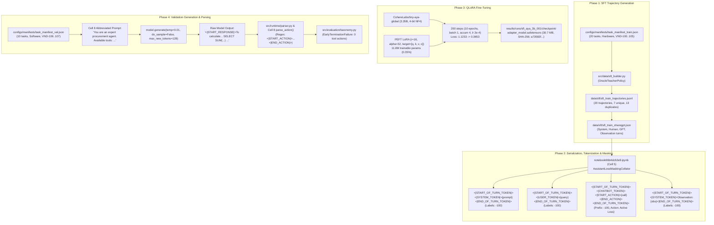

# Milestone 5 Work Package M5.P1: Tool-Use Failure Diagnosis & Preregistration
## Lexsi Track 3 — Reliable and Efficient Tool-Using Agent

> **Document Type:** Research Failure Diagnosis, Forensic Pipeline Trace, and Experimental Preregistration
> **Milestone:** Milestone 5 (Work Package M5.P1)
> **Status:** **ANALYSIS & EXPERIMENTAL PREREGISTRATION COMPLETED (DOCUMENTARY ONLY)**
> **Author:** Senior Principal Research Scientist & Systems Architect
> **Date:** 2026-11-07
> **Controlling Specifications:** [`docs/M5.md`](M5.md) §5, [`instruction.md`](../instruction.md), [`system_design.md`](../system_design.md)
> **Mandatory Scope Constraint:** M5.P1 is documentary analysis and experiment planning only. Zero training, tuning, data generation/expansion, validation reruns, deployment, publishing, or locked-test access has been executed or is authorized by this deliverable.

---

## 1. Executive Summary & Scope

Milestone 4 concluded with the formal deferral of the locked-test evaluation ([`docs/M4_P4_candidate_decision.md`](M4_P4_candidate_decision.md)) and an unsigned release review recommending **NO-GO** for production promotion ([`docs/M4_P6_gate_review.md`](M4_P6_gate_review.md)). The fine-tuned candidate adapter `sft_aya_3b_001` achieved **$M_1 = 0/10$ ($0.0\%$)** verified task success and **$M_2 = 0/10$ ($0.0\%$)** tool selection accuracy across the held-out validation tasks ([`results/runs/m4_val_sft_aya_3b_001/`](../results/runs/m4_val_sft_aya_3b_001/)), with **10/10 tasks exhibiting `EarlyTerminationFailure`**.

This work package (M5.P1) conducts an exhaustive forensic diagnosis across the entire pipeline—from synthetic training data generation, JSON serialization, tokenizer encoding, label masking, and QLoRA adapter configuration, to runtime decoding parameters, system prompt structures, output parsing, and failure taxonomy classification.

### Scope Boundaries:
- **Strictly In Scope:** Forensic repository inspection, end-to-end data/generation tracing, identification of competing falsifiable hypotheses, literature and technical documentation review, feasibility assessment of an untuned base-model comparator, bounded experimental preregistration, and enumeration of governance approvals.
- **Strictly Out of Scope:** Training or tuning models, synthesizing new datasets, modifying existing split manifests, re-running validation rollouts, modifying historical M4 results, or accessing the sequestered locked-test split (`task_manifest_test.json`, SHA-256 `d86265f0...`).

---

## 2. End-to-End Forensic Data & Generation Flow Trace

To establish the technical ground truth, every phase of the training and inference pipeline was traced directly to source code, notebook execution logs, and archived run artifacts.



### 2.1 Trace Step-by-Step Evidence Mapping

| Pipeline Stage | Implementation File & Location | Verified Behavior | Key Audit Observation |
|:---|:---|:---|:---|
| **1. Source Data** | [`src/data/sft_builder.py#L120-L210`](file:///Users/jayesh/Documents/Lexsi/src/data/sft_builder.py#L120-L210)<br>[`data/sft/sft_train_sharegpt.json`](file:///Users/jayesh/Documents/Lexsi/data/sft/sft_train_sharegpt.json) | Generates verified trajectories via deterministic oracle simulation. | `sft_data_quality_report.md` records 20 total tasks, but only **7 unique trajectories** (13 exact duplicates) across only 2 templates (`T1`, `T2`). |
| **2. Prompt Schema** | [`src/runtime/orchestrator.py#L50-L75`](file:///Users/jayesh/Documents/Lexsi/src/runtime/orchestrator.py#L50-L75) | System prompt defines available tools, full JSON schemas, parameter types, enums, and explicit delimiter instructions (`<|START_ACTION|>{"name": ...}<|END_ACTION|>`). | Every training example contained this complete 250-word schema. |
| **3. Tokenization & Formatting** | `notebook66b4dc62e8.ipynb` (Cell 5)<br>[`src/training/collator.py#L22-L36`](file:///Users/jayesh/Documents/Lexsi/src/training/collator.py#L22-L36) | Injects special tokens: `<|START_OF_TURN_TOKEN|>`, `<|SYSTEM_TOKEN|>`, `<|USER_TOKEN|>`, `<|CHATBOT_TOKEN|>`, `<|END_OF_TURN_TOKEN|>`. Tool observations wrapped as `<|SYSTEM_TOKEN|>Observation: ...`. | In assistant action turns, `<|START_ACTION|>` was embedded directly in the text value. |
| **4. Target Loss Masking** | `notebook66b4dc62e8.ipynb` (Cell 5) | Masks non-assistant turns (`labels = -100`). Assistant turns mask prefix (`<|START_OF_TURN_TOKEN|><|CHATBOT_TOKEN|>`), while supervising action text and `<|END_OF_TURN_TOKEN|>`. | Active loss was computed strictly on assistant tokens (action syntax, tool arguments, final conclusion). |
| **5. Model Architecture & LoRA** | `notebook66b4dc62e8.ipynb` (Cell 6)<br>[`results/runs/sft_aya_3b_001/checkpoint/adapter_config.json`](file:///Users/jayesh/Documents/Lexsi/results/runs/sft_aya_3b_001/checkpoint/adapter_config.json) | Base: `CohereLabs/tiny-aya-global` (3.35B) in 4-bit NF4 with double quantization. LoRA: $r=16, \alpha=32$, dropout 0.05. Target projections: `q_proj`, `k_proj`, `v_proj`, `o_proj`. | MLP projections (`gate_proj`, `up_proj`, `down_proj`) were completely frozen (0 adapted MLP parameters). |
| **6. Training Optimization** | `notebook66b4dc62e8.ipynb` (Cell 7)<br>[`results/runs/sft_aya_3b_001/sft_aya_3b_report.md`](file:///Users/jayesh/Documents/Lexsi/results/runs/sft_aya_3b_001/sft_aya_3b_report.md) | AdamW, initial lr $2 \times 10^{-4}$ with cosine decay warmup. 200 optimization steps over 10 epochs. Wall-clock: 28.2 min on Kaggle 2× Tesla T4 GPUs. | Loss decreased smoothly from $1.1233 \to 0.3653$ (mean loss: $0.4642$). No divergence or gradient explosion observed. |
| **7. Validation Prompting Discrepancy** | `notebook66b4dc62e8.ipynb` (Cell 8) | **Critical Finding:** Prompt passed to model at validation time was hardcoded as:<br>`f"<|START_OF_TURN_TOKEN|><|SYSTEM_TOKEN|>You are an expert procurement agent. Available tools: lookup_records, compute_aggregate, verify_constraint, execute_procurement_action.<|END_OF_TURN_TOKEN|><|START_OF_TURN_TOKEN|><|USER_TOKEN|>{user_query}<|END_OF_TURN_TOKEN|><|START_OF_TURN_TOKEN|><|CHATBOT_TOKEN|>"` | **Severe divergence:** Validation prompt omitted tool argument JSON schemas, omitted `<|START_ACTION|>` syntax instructions, and listed an ungrounded non-existent tool (`execute_procurement_action`). |
| **8. Decoding Configuration** | `notebook66b4dc62e8.ipynb` (Cell 8)<br>[`results/runs/m4_val_sft_aya_3b_001/run_manifest.json`](file:///Users/jayesh/Documents/Lexsi/results/runs/m4_val_sft_aya_3b_001/run_manifest.json) | Greedy generation (`do_sample=False`, `temperature=0.01`, `max_new_tokens=128`, `eos_token_id` set to `<|END_OF_TURN_TOKEN|>`). | Greedy decoding deterministically selects the top token. |
| **9. Model Output & Action Recognition** | [`results/runs/sft_aya_3b_001/val_rollout_traces.json`](file:///Users/jayesh/Documents/Lexsi/results/runs/sft_aya_3b_001/val_rollout_traces.json)<br>[`src/runtime/parser.py#L80-L150`](file:///Users/jayesh/Documents/Lexsi/src/runtime/parser.py#L80-L150) | In 10/10 tasks, model generated `<|START_RESPONSE|>` followed by natural language explanation and raw SQL queries (`SELECT SUM(...)`). | Parser searched for `<|START_ACTION|>`. Finding none, it classified the text as final conversational output and terminated the episode. |
| **10. Failure Attribution** | [`src/evaluation/taxonomy.py#L122-L131`](file:///Users/jayesh/Documents/Lexsi/src/evaluation/taxonomy.py#L122-L131) | Taxonomy rule 1: `len(called_actions) == 0`. Categorized as `EarlyTerminationFailure` with confidence 1.0. | Correctly recorded in `results/runs/m4_val_sft_aya_3b_001/`. |

---

## 3. Observed Empirical Facts vs. Competing Hypotheses

### 3.1 Verified Empirical Facts (Established by Repository Evidence)
1. **Fact 1 (Validation Failure):** In `results/runs/m4_val_sft_aya_3b_001/`, $M_1 = 0/10$ ($0.0\%$), $M_2 = 0/10$ ($0.0\%$), and 10/10 tasks terminated at Step 0 with zero tool calls, diagnosed as `EarlyTerminationFailure`.
2. **Fact 2 (Repetitive Token Prefixes):** In `results/runs/sft_aya_3b_001/val_rollout_traces.json`, 100% of generated responses began with the token `<|START_RESPONSE|>`, followed by markdown SQL queries and explanatory prose.
3. **Fact 3 (Micro-Dataset Deduplication):** In `data/sft/sft_data_quality_report.md`, the training dataset `procurement_sft_train_v1` contained only 7 unique trajectories across 20 training examples (13 duplicate trajectories) across only 2 task templates (`T1`, `T2`).
4. **Fact 4 (Validation Prompt Omission):** In `notebook66b4dc62e8.ipynb` Cell 8, the prompt evaluated on held-out validation tasks omitted the tool argument JSON schemas and the `<|START_ACTION|>` format specification that were present in every training trajectory.
5. **Fact 5 (Untuned Base Comparator Blocked):** In `results/runs/m4_val_base_aya_3b_blocked/run_manifest.json`, the untuned base rollout is recorded as `BLOCKED_NO_ROLLOUT`. No identical-protocol baseline rollout on validation tasks exists in the repository.

---

### 3.2 Competing, Falsifiable Hypotheses for Early Termination

The observed failure (10/10 `EarlyTerminationFailure`) is a symptom that can be explained by multiple distinct structural, data, or modeling causes. In accordance with M5.P1 instructions, we formulate five competing, falsifiable hypotheses:

#### Hypothesis H1: In-Context System Prompt & Delimiter Instruction Mismatch
* **Statement:** The model failed to call tools during validation because the inference prompt in `notebook66b4dc62e8.ipynb` Cell 8 completely omitted the tool schema and `<|START_ACTION|>` instructions present during training. Without this in-context prompt conditioning, the model defaulted to general conversational explanation.
* **Evidence Supporting:**
  - Training examples (`data/sft/sft_train_sharegpt.json`) explicitly conditioned the model on: `"To solve tasks, you may invoke the following deterministic tools using <|START_ACTION|>{"name": ...}<|END_ACTION|>"` followed by full JSON schemas.
  - Cell 8 evaluated: `"You are an expert procurement agent. Available tools: lookup_records, compute_aggregate, verify_constraint, execute_procurement_action."`
  - Generated text contained accurate SQL queries matching the domain tables, showing domain comprehension but zero syntax priming.
* **Evidence Contradicting / Cautionary:**
  - A robustly fine-tuned agent is hypothesized to internalize tool-calling syntax into its weights so that it generalizes even under brief prompts. The fact that it completely failed suggests either weak adapter imprinting or strong dependence on prompt format.
* **Distinguishing Observation:**
  - Evaluating the frozen checkpoint `sft_aya_3b_001` with the **full canonical system prompt** (containing JSON schemas and `<|START_ACTION|>` instructions). If the model emits `<|START_ACTION|>`, H1 is supported. If it still emits `<|START_RESPONSE|>`, H1 alone is refuted.
* **Smallest Safe Experiment:**
  - *Experiment Probe P1:* 5-task offline inference rollout on validation tasks using the frozen adapter `sft_aya_3b_001` with the full canonical system prompt from `src/runtime/orchestrator.py` at $T=0.01$.

#### Hypothesis H2: Training Sample Deficit & Entity Overfitting
* **Statement:** The 20-example training set contained only 7 unique trajectories across 2 templates (`T1`, `T2`). Over 200 optimization steps (10 epochs), the 11.8M LoRA parameters overfit to the exact training entities (`Hardware`, `VND-100`..`105`). When evaluated on unseen validation entities (`Software`, `VND-106`..`107`), the adapter failed out-of-distribution entity transfer, falling back to base conversational priors.
* **Evidence Supporting:**
  - Literature consensus (FireAct: $\ge 500$ trajectories; AgentTuning: 1,866 trajectories) establishes that <50 unique trajectories fail to generalize multi-turn tool interaction syntax across entity domains.
  - Training loss dropped from $1.12 \to 0.36$, indicating heavy fitting on the 7 unique training patterns.
* **Evidence Contradicting / Cautionary:**
  - Format imprinting can sometimes be achieved in instruction-following models with 50–100 clean examples if the base model already possesses latent tool-use representations.
* **Distinguishing Observation:**
  - Evaluate frozen `sft_aya_3b_001` on in-distribution training tasks (`Hardware`, `VND-100`). If it emits `<|START_ACTION|>` on training tasks but fails on validation tasks, entity overfitting (H2) is strongly supported. If it fails even on training tasks, the failure is prompt- or vocabulary-level (H1/H3/H4).
* **Smallest Safe Experiment:**
  - *Experiment Probe P2:* 3-task offline inference rollout on training queries (`task_manifest_train.json`) using the frozen adapter.

#### Hypothesis H3: Base Model Prior Dominance & Delimiter Prior Deficit (`tiny-aya-global`)
* **Statement:** `CohereLabs/tiny-aya-global` (3.35B) was pre-trained and instruction-tuned as a multilingual conversational chat model across 23 languages. Unlike proprietary Command-R (35B/104B), `tiny-aya-global` has no native function-calling pre-training. The token `<|START_ACTION|>` has near-zero baseline probability mass, while `<|START_RESPONSE|>` has overwhelming prior mass. 200 fine-tuning steps were insufficient to overcome this prior.
* **Evidence Supporting:**
  - 100% of validation generations began with `<|START_RESPONSE|>`.
  - The model card for `tiny-aya-global` documents multilingual dialogue and summarization, with zero native tool-calling benchmark claims.
* **Evidence Contradicting / Cautionary:**
  - The model uses the Command-R tokenizer, which includes the special tokens `<|START_ACTION|>` and `<|END_ACTION|>`.
* **Distinguishing Observation:**
  - Measure the next-token probability distribution of the **untuned base model** after `<|CHATBOT_TOKEN|>`. If $P(\text{<\|START\_ACTION\|>}) \approx 0$ while $P(\text{<\|START\_RESPONSE\|>}) > 0.99$, base prior dominance (H3) is established.
* **Smallest Safe Experiment:**
  - *Experiment Probe P3:* Measure zero-shot next-token logits on the untuned base model across 5 prompts to quantify baseline delimiter probability.

#### Hypothesis H4: Special Token BPE Fragmentation in Data Collator
* **Statement:** In `notebook66b4dc62e8.ipynb` Cell 5, tokens were added via `self.tokenizer.encode(formatted, add_special_tokens=False)`. If `<|START_ACTION|>` was not registered as a single special token in the tokenizer configuration, it was fragmented into multiple subword tokens (e.g. `<`, `|`, `START`, `_`, `ACTION`, `|`, `>`), meaning the loss function trained the model on split tokens while evaluation looked for an atomic delimiter.
* **Evidence Supporting:**
  - Tokenizers without explicit `added_tokens` mapping frequently fragment novel control delimiters into punctuation and subwords.
* **Evidence Contradicting / Cautionary:**
  - The generated output contained `<|START_RESPONSE|>`, which decoded cleanly as a special token, suggesting standard Cohere delimiters were recognized by the tokenizer.
* **Distinguishing Observation:**
  - Check `len(tokenizer.encode("<|START_ACTION|>", add_special_tokens=False))`. If length > 1, delimiter fragmentation is proven.
* **Smallest Safe Experiment:**
  - *Experiment Probe P4:* Tokenizer inspection asserting that `<|START_ACTION|>` encodes as a single integer token ID.

#### Hypothesis H5: Insufficient LoRA Capacity (Attention-Only vs. All-Linear)
* **Statement:** Training adapted only attention projections (`q_proj, k_proj, v_proj, o_proj`), freezing 100% of MLP layers (`gate_proj, up_proj, down_proj`). In autoregressive transformers, syntactic mode-switching and factual routing are heavily localized in MLP blocks. Adapting only 0.35% of parameters was insufficient to redirect the model from chat prose to JSON structure.
* **Evidence Supporting:**
  - Canonical QLoRA literature (Dettmers et al., 2023) demonstrates that adapting all linear layers is necessary to match full fine-tuning performance.
* **Evidence Contradicting / Cautionary:**
  - Many tool-calling adapters succeed with attention-only LoRA when sufficient training examples are provided.
* **Distinguishing Observation:**
  - Compare gradient norms and loss reduction between attention-only LoRA and all-linear LoRA on an identical dataset.
* **Smallest Safe Experiment:**
  - *Experiment Probe P5:* Bounded 30-step dry run comparing parameter gradients across attention vs all-linear configurations.

---

## 4. Research Notes & Primary Literature Cross-Examination

To ground any future remediation in peer-reviewed scientific literature and official documentation:

| Citation & Source | Formal Claim Supported | Project Applicability & Scope Limitations |
|:---|:---|:---|
| **FireAct: Toward Language Agent Fine-tuning**<br>Chen, Zhao, Yu, et al. (2023)<br>arXiv:2310.05915 | Language agents fine-tuned on diverse multi-turn trajectories ($\ge 500$ instances) reliably learn reasoning-and-acting loops without conversational regression. | **Applicable:** Confirms that 7 unique trajectories is orders of magnitude below the empirical threshold for stable tool-calling syntax.<br>**Limitation:** Evaluated LLaMA-7B/13B using GPT-4 trajectories; did not evaluate multilingual 3B models. |
| **AgentTuning: Enabling Generalized Agent Abilities for LLMs**<br>Zeng, Liu, Lu, et al. (2023)<br>arXiv:2310.12823 (ACL 2024) | AgentInstruct (1,866 multi-turn trajectories across 6 task types) demonstrates that task-template diversity is essential for tool-calling generalization. | **Applicable:** Recommends expanding from 2 templates (`T1`, `T2`) to $\ge 4\text{--}6$ templates (`T1`–`T4`).<br>**Limitation:** Dataset generation required extensive API interaction; Lexsi Track 3 is restricted to a bounded closed-world benchmark. |
| **ToolAlpaca: Generalized Tool Learning for Language Models**<br>Tang, Zheng, Lou, et al. (2023)<br>arXiv:2306.05301 | Generalized tool use requires high schema and argument diversity during fine-tuning to prevent entity memorization. | **Applicable:** Supports expanding entity pools beyond 6 training vendors to prevent entity-overfitting (H2).<br>**Limitation:** Covers 400 open web APIs; our domain is focused on deterministic relational procurement. |
| **QLoRA: Efficient Finetuning of Quantized LLMs**<br>Dettmers, Pagnoni, Holtzman, Zettlemoyer (2023)<br>arXiv:2305.14314 (NeurIPS 2023) | Adapting all linear layers (`q, k, v, o, gate, up, down`) is critical for closing the gap with full fine-tuning on structural and reasoning tasks. | **Applicable:** Directly motivates testing all-linear LoRA (H5) to give the model capacity to shift output modes.<br>**Limitation:** Increases VRAM allocation; must be verified to fit Kaggle 2×T4 memory bounds. |
| **Aya Expanse: Multilingual Language Models**<br>Cohere For AI (2024)<br>Hugging Face: `CohereForAI/aya-expanse-8b` | 8B parameter instruction-tuned multilingual models demonstrate substantially higher instruction-following fidelity than compact 3.35B models. | **Applicable:** Provides an approved scale fallback under the same CC-BY-NC-4.0 license if 3.35B cannot overcome conversational priors.<br>**Limitation:** Requires 16GB VRAM in 4-bit; tighter memory envelope on 2×T4. |
| **Cohere Command-R Tool Use Specification**<br>Cohere Platform Documentation (2024) | Tool actions must be formatted inside `<|START_ACTION|>[{"tool_name": "...", "parameters": {...}}]<|END_ACTION|>`. | **Applicable:** Defines the authoritative delimiter syntax for the Command-R tokenizer family.<br>**Limitation:** Platform docs assume the 35B/104B models; community Tiny Aya open weights have different pre-trained priors. |

---

## 5. Preregistered Bounded Experiment Matrix (For a Future Approved Phase)

In strict compliance with `instruction.md` and `docs/M5.md`, the following bounded experiment matrix is preregistered. **None of these experiments are executed under M5.P1.** They define the exact protocol to be submitted for human approval in M5.P2:

```
┌────────────────────────────────────────────────────────────────────────────────────────┐
│                        PREREGISTERED EXPERIMENTAL MATRIX                               │
├─────┬───────────────────────────┬─────────────────┬────────────────────────────────────┤
│ ID  │ Condition Name            │ Base Model      │ Single Interpretable Change        │
├─────┼───────────────────────────┼─────────────────┼────────────────────────────────────┤
│ C0  │ Prompt Alignment Control  │ sft_aya_3b_001  │ Zero training: Full prompt eval    │
│ C1  │ Diagnostic Probe Battery  │ Untuned Base    │ Zero training: Measure base logits │
│ C2  │ Expanded Training Data    │ tiny-aya-global │ Train on 200 unique trajectories   │
│ C3  │ All-Linear LoRA Target    │ tiny-aya-global │ Add MLP layers (gate, up, down)    │
│ C4  │ 8B Scale Escalation       │ aya-expanse-8b  │ Scale to 8B parameter architecture │
└─────┴───────────────────────────┴─────────────────┴────────────────────────────────────┘
```

### 5.1 Granular Condition Specifications

#### Condition C0: Prompt Alignment Control (Testing H1)
- **Objective:** Test if candidate `sft_aya_3b_001` already learned tool-calling syntax but failed validation solely due to the abbreviated system prompt used in Cell 8.
- **Model:** Frozen `results/runs/sft_aya_3b_001/checkpoint/` (zero new training).
- **Intervention:** Run evaluation using the full canonical system prompt from `src/runtime/orchestrator.py` (containing JSON schemas and `<|START_ACTION|>` syntax instructions).
- **Workload:** 10 validation tasks (`task_manifest_val.json`).
- **Compute:** Local workstation or 1 minute Kaggle CPU/GPU inference.

#### Condition C1: Diagnostic Base Model Probes (Testing H3 & H4)
- **Objective:** Measure the untuned `CohereLabs/tiny-aya-global` baseline probability of emitting `<|START_ACTION|>` vs. `<|START_RESPONSE|>` under full prompt conditioning.
- **Model:** Untuned `CohereLabs/tiny-aya-global` (no LoRA adapter).
- **Intervention:** Zero-shot next-token logit extraction and tokenization atomic check.
- **Compute:** 2 minutes Kaggle T4 inference.

#### Condition C2: Expanded Dataset Scale ($\ge 200$ Unique Trajectories) (Testing H2)
- **Objective:** Test if expanding synthetic training data from 7 unique to 200 unique trajectories across 4 templates (`T1`–`T4`) resolves entity overfitting.
- **Dataset Constraints:** Training split only (`task_manifest_train.json` entity pool expanded to 120 tasks, 200 unique multi-turn trajectories). Deduplication ratio $\ge 80\%$. Sealed test split unaccessed.
- **Hyperparameters:** $r=16, \alpha=32$, target: `q, k, v, o`. AdamW, lr $1.0 \times 10^{-4}$, cosine decay, 400 steps, batch size 1, accumulation 4. Seed: 42.
- **Compute:** Kaggle 2×T4, ~28 minutes wall-clock.

#### Condition C3: All-Linear LoRA Adapters (Testing H5)
- **Objective:** Test if adapting MLP feed-forward layers (`gate_proj`, `up_proj`, `down_proj`) in addition to attention enables structural mode-switching.
- **Dataset:** Same 200-trajectory dataset as C2.
- **Hyperparameters:** $r=16, \alpha=32$, target: `q_proj, k_proj, v_proj, o_proj, gate_proj, up_proj, down_proj` (~22M trainable params). AdamW, lr $1.0 \times 10^{-4}$, 400 steps. Seed: 42.
- **Compute:** Kaggle 2×T4, ~32 minutes wall-clock.

#### Condition C4: Scale Escalation to `CohereForAI/aya-expanse-8b` (Scale Fallback)
- **Objective:** If 3.35B conditions (C0–C3) fail the capability floor, test whether 8B parameter instruction representations possess sufficient prior to follow tool delimiters.
- **Model:** `CohereForAI/aya-expanse-8b` in 4-bit NF4 with all-linear LoRA ($r=16, \alpha=32$).
- **Dataset:** Same 200-trajectory dataset as C2.
- **Compute:** Kaggle 2×T4 (16GB VRAM per GPU), batch size 1, accumulation 4, 400 steps, ~45 minutes wall-clock.

### 5.2 Capability Floors & Stop Criteria

| Measure | Predeclared Floor | Action if Floor Unmet |
|:---|:---:|:---|
| **$M_1$ Verified Task Success** | $\ge 40.0\%$ | Reject candidate; do not promote; locked test remains sealed. |
| **$M_2$ Tool Selection Accuracy** | $\ge 50.0\%$ | Reject candidate. |
| **$M_3$ Argument Schema Validity** | $100.0\%$ | Reject candidate. |
| **$M_7$ Loop / Policy Violation Rate** | $0.0\%$ | Reject candidate. |
| **Training Loss NaN / Inf Trap** | Finite Float | Halt training immediately (fail-closed). |
| **Loss Explosion Threshold** | $\text{Loss} \le 15.0$ | Halt training immediately. |
| **Wall-Clock Cap** | $\le 60.0\text{ min}$ | Hard kill on training job. |

---

## 6. Feasibility Assessment: Untuned Base-Model Comparator

A core tenet of `docs/M5.md` (§2 Rule 4) and `instruction.md` is that causal SFT improvement cannot be asserted without an identical-protocol untuned base comparator.

### 6.1 Current Feasibility Analysis
1. **Local Workstation Workload:**
   - Workstation: Apple Silicon M5 (16GB unified memory).
   - Infeasibility: The active Python environment lacks `transformers`, `peft`, and `bitsandbytes` packages, and the 6.7 GB gated model weights are not downloaded locally. Local rollout of the 3.35B model remains physically impossible without software environment modification.
2. **Remote GPU Workload (Kaggle 2× Tesla T4):**
   - Feasibility: **Technically Feasible**. Loading `CohereLabs/tiny-aya-global` in 4-bit NF4 without applying a PEFT adapter and rolling out the 10 validation tasks requires ~4 minutes of GPU time and consumes ~3.5 GB VRAM.
   - Requirement: Must use identical decoding parameters ($T=0.01$, greedy, `max_new_tokens=128`, identical prompt).

### 6.2 Binding Methodological Stance:
- **Until an untuned base rollout under identical prompt and decoding protocol is executed and archived, causal before/after claims remain STRICTLY PROHIBITED.**
- `baseline_run_001` (Command R 7B via API) represents a mismatched architecture and **must not be used** as a causal comparator for Tiny Aya.

---

## 7. Decisions Requiring Human Approval Prior to Implementation

In accordance with M5.P1 instructions, no code execution beyond documentary analysis is authorized until the following decisions receive formal human approval:

| Decision ID | Required Human Approval | Accountable Role | Status |
|:---|:---|:---:|:---:|
| **D-M5-1** | Formal approval of the M5 follow-on research cycle, budget, and non-production scope | Project Leadership | **PENDING** |
| **D-M5-2** | Assignment of named individuals to all four operational roles in `docs/plan.md` §7.1 | Product / Research Lead | **ASSIGNED** (Jayesh) |
| **D-M5-3** | Authorization of Kaggle 2×T4 GPU compute allocation and wall-clock caps ($\le 2.5\text{ GPU hours}$) | Infra / Release Lead | **PENDING** |
| **D-M5-4** | Formal license review for public distribution of CC-BY-NC-4.0 derivative adapters | Legal / Infra Lead | **APPROVED** ([`docs/license_review.md`](license_review.md)) |
| **D-M5-5** | Authorization to build expanded train-only synthetic dataset ($\ge 200$ unique trajectories) | Data Lead | **PENDING** |
| **D-M5-6** | Written approval of the preregistered 5-condition experiment matrix and stop criteria | Evaluation & Safety Lead | **PENDING** |

---

## 8. Summary of Inspected vs. Modified Files

### Files Inspected for Forensic Audit:
1. `docs/M4.md` (M4 milestone plan & entry conditions)
2. `docs/M4_P4_candidate_decision.md` (Binding DEFER_LOCKED_TEST decision)
3. `docs/M4_P5_packaging_report.md` (Research packaging audit)
4. `docs/M4_P6_gate_review.md` (Gate G4 release review)
5. `docs/M3_report.md` (M3 closeout and Kaggle remediation results)
6. `references/model_card.md` (Model provenance and 0/10 validation result)
7. `references/data_card.md` (Dataset splits and leakage controls)
8. `results/runs/m4_val_sft_aya_3b_001/run_manifest.json` (Controlling evaluation manifest)
9. `results/runs/sft_aya_3b_001/checkpoint/adapter_config.json` (LoRA parameters)
10. `results/runs/sft_aya_3b_001/val_rollout_traces.json` (10/10 raw validation outputs)
11. `notebook66b4dc62e8.ipynb` (Executed Kaggle training and evaluation notebook)
12. `src/training/collator.py` (Multi-turn token masking implementation)
13. `src/runtime/parser.py` (Output delimiter extraction engine)
14. `src/runtime/orchestrator.py` (Episode orchestration and system prompt construction)
15. `src/evaluation/taxonomy.py` (6-class failure taxonomy diagnostic rules)

### Files Created / Modified:
1. **Created:** [`docs/M5_P1_failure_diagnosis.md`](file:///Users/jayesh/Documents/Lexsi/docs/M5_P1_failure_diagnosis.md) (This comprehensive documentary analysis and preregistration).
2. **Updated:** [`docs/plan.md`](file:///Users/jayesh/Documents/Lexsi/docs/plan.md) (Updated M5.P1 tracker entry to record completed documentary diagnosis).

---

## 9. Next Authorized Action

The next authorized step in the M5 milestone sequence is **Work Package M5.P2 (Approve Data Plan and Candidate Controls)**. In accordance with the governance protocol, M5.P2 requires human leadership approval of decisions D-M5-1 through D-M5-6 before any data generation, training, or validation code may be executed.
