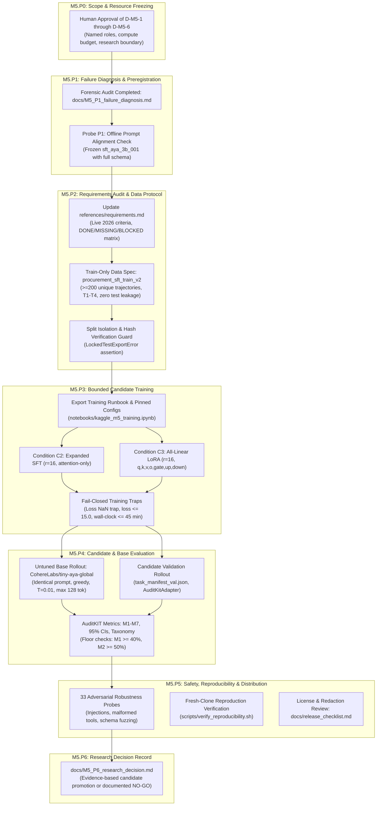

# Master Implementation Plan: Milestone 5 (M5)
## Capability Remediation Research & Candidate Re-evaluation

> **Milestone:** Milestone 5 (M5)
> **Project:** Lexsi Track 3 — Reliable and Efficient Tool-Using Agent
> **Controlling Specifications:** [`docs/M5.md`](file:///Users/jayesh/Documents/Lexsi/docs/M5.md), [`instruction.md`](file:///Users/jayesh/Documents/Lexsi/instruction.md), [`system_design.md`](file:///Users/jayesh/Documents/Lexsi/system_design.md), [`docs/plan.md`](file:///Users/jayesh/Documents/Lexsi/docs/plan.md)
> **Status:** Proposed Implementation Plan (Pending Human Review & Feedback)
> **Author:** Senior Principal Research Scientist & Systems Architect
> **Created:** 2026-11-07

---

## 1. Goal Description & Context

Milestone 4 concluded with the formal deferral of the locked-test evaluation ([`docs/M4_P4_candidate_decision.md`](file:///Users/jayesh/Documents/Lexsi/docs/M4_P4_candidate_decision.md)) and an unsigned release review recommending **NO-GO** for model promotion ([`docs/M4_P6_gate_review.md`](file:///Users/jayesh/Documents/Lexsi/docs/M4_P6_gate_review.md)). The fine-tuned candidate adapter `sft_aya_3b_001` achieved **$M_1 = 0/10$ ($0.0\%$)** verified task success and **$M_2 = 0/10$ ($0.0\%$)** tool selection accuracy on validation tasks ([`results/runs/m4_val_sft_aya_3b_001/`](file:///Users/jayesh/Documents/Lexsi/results/runs/m4_val_sft_aya_3b_001/)), with **10/10 tasks exhibiting `EarlyTerminationFailure`**. Furthermore, the matched untuned base comparator was blocked, and the historical Command R baseline (`baseline_run_001`) was architecturally incommensurable.

### Core Objective of Milestone 5
Execute a bounded, scientifically rigorous research cycle (D31–D60) to:
1. **Diagnose and falsify root causes** of early termination across data, tokenization, architecture, and prompt boundaries.
2. **Audit hackathon submission requirements** against live official criteria, establishing an honest DONE / MISSING / BLOCKED matrix.
3. **Build an approved train-only synthetic dataset** ($\ge 200$ unique trajectories, templates T1–T4, $\ge 80\%$ deduplication, zero test leakage).
4. **Execute bounded QLoRA training experiments** under immutable run IDs with all-linear adapter targets.
5. **Evaluate candidate models alongside a matched untuned base comparator** under identical prompt and decoding conditions.
6. **Produce an evidence-based research decision record (M5.P6)**, accepting documented NO-GO as a first-class scientific outcome if capability floors ($M_1 \ge 40\%$, $M_2 \ge 50\%$) or safety floors are unmet.

---

## 2. Mandatory Governance, Boundaries & Alerts (User Review Required)

> [!CAUTION]
> **PERMANENT SEQUESTRATION OF LOCKED TEST SPLIT**
> The sequestered test split (`configs/manifests/task_manifest_test.json`, SHA-256 `d86265f067bafa112427390659d55ab48fe6831d68b88efb6952b8fd377c3f3e`) is **PERMANENTLY SEALED**. Under no circumstances may any agent or script open, read, inspect, score, hash, or train on test split instances. All M5 remediation, validation, and comparator rollouts must operate strictly on `task_manifest_train.json` and `task_manifest_val.json`.

> [!IMPORTANT]
> **NO CAUSAL SFT IMPROVEMENT CLAIMS WITHOUT MATCHED BASE COMPARATOR**
> `baseline_run_001` (Command R 7B via API) is an exploratory, incommensurable comparator. Causal claims that SFT or RL improved capability cannot be asserted until an identical-protocol rollout of untuned `CohereLabs/tiny-aya-global` (same prompts, schemas, temperature $T=0.01$, greedy decoding, and validation tasks) is executed and archived. If the base rollout cannot be obtained, this limitation must be stated explicitly.

> [!WARNING]
> **HACKATHON DEADLINE VS. RESEARCH INTEGRITY**
> The official hackathon deadline (November 14, 2026 AoE) is separate from the internal 30-day M5 research horizon. Event deadlines do **not** waive evaluation rigor, safety gates, licensing compliance, or the prohibition against unsupported claims. If capability floors are not satisfied by the deadline, a transparent failure disclosure or non-submission decision must be rendered.

### Required Human Decisions Matrix (Pre-Implementation Gates)

| Decision ID | Required Governance Action | Controlling Document | Accountable Role | Status |
|:---|:---|:---|:---:|:---:|
| **D-M5-1** | Formal approval of M5 follow-on research cycle, non-production scope, and 30-day timeline | `docs/M5.md` §2 | Project Leadership | **PENDING USER APPROVAL** |
| **D-M5-2** | Confirmation of named owners across all four functional roles in `docs/plan.md` §7.1 | `docs/plan.md` §7.1 | Research Lead | **ASSIGNED (Jayesh)** |
| **D-M5-3** | Authorization of Kaggle 2×T4 GPU compute allocation ($\le 2.5\text{ GPU hours}$ total) | `references/hardware_profile.md` | Infra / Release Lead | **PENDING USER APPROVAL** |
| **D-M5-4** | License review for CC-BY-NC-4.0 derivative research package and synthetic data | `docs/license_review.md` | Legal / Infra Lead | **APPROVED (`docs/license_review.md`)** |
| **D-M5-5** | Authorization to synthesize expanded train-only dataset ($\ge 200$ unique trajectories) | `docs/M5.md` §4 | Data Lead | **PENDING USER APPROVAL** |
| **D-M5-6** | Written sign-off on the preregistered 5-condition experiment matrix and stop criteria | `docs/M5_P1_failure_diagnosis.md` | Evaluation & Safety Lead | **PENDING USER APPROVAL** |

---

## 3. Open Architectural & Experimental Questions

1. **Base Model Scaling Fallback (`CohereForAI/aya-expanse-8b`):**
   - *Question:* Should Condition C4 (8B scale escalation) be authorized conditionally only if 3.35B conditions (C0, C2, C3) fail to satisfy the $M_1 \ge 40\%$ floor, or should it run concurrently?
   - *Recommendation:* **Sequential / Conditional escalation.** Running 3.35B conditions first minimizes GPU budget consumption and isolates whether parameter capacity is the true bottleneck.
2. **Base Model Comparator Execution Venue:**
   - *Question:* Should the untuned `CohereLabs/tiny-aya-global` base rollout be executed on Kaggle 2×T4 immediately alongside candidate evaluations?
   - *Recommendation:* **Yes.** The base rollout consumes only ~4 minutes of GPU time and ~3.5 GB VRAM on Kaggle T4. This immediately unblocks the matched comparator requirement without local package overhead.
3. **Prompt Alignment Verification (Probe P1):**
   - *Question:* Should we run an immediate offline diagnostic inference check on frozen `sft_aya_3b_001` using the full canonical schema before any new training?
   - *Recommendation:* **Yes.** If `sft_aya_3b_001` generates `<|START_ACTION|>` when prompted with full schemas, Hypothesis H1 is confirmed and we avoid unnecessary retraining.

---

## 4. End-to-End System Workflow (M5.P0 – M5.P6)



---

## 5. Proposed Changes by Work Package

### Work Package M5.P0: Approve Follow-On Cycle & Freeze Resources
- **Goal:** Establish formal research authorization, freeze 30-day non-production scope, allocate compute resources, and bind named owners.
- **Deliverables:**
  1. Record human sign-off on decisions D-M5-1 through D-M5-6.
  2. Confirm compute allocation: Local Apple Silicon M5 (16GB unified memory, unit testing/harness) + Kaggle 2×T4 GPU environment ($\le 2.5\text{ GPU hours}$ budget).
  3. Update [`docs/plan.md`](file:///Users/jayesh/Documents/Lexsi/docs/plan.md) §4 to reflect M5.P0 **CLEARED**.

### Work Package M5.P1: Diagnostic Confirmation & Delimiter Verification
- **Goal:** Validate forensic findings from [`docs/M5_P1_failure_diagnosis.md`](file:///Users/jayesh/Documents/Lexsi/docs/M5_P1_failure_diagnosis.md) via deterministic local probes without new training.
- **Implementation Steps:**
  1. **Probe P4 (Tokenizer Delimiter Check):** Create unit test [`tests/test_delimiter_atomicity.py`](file:///Users/jayesh/Documents/Lexsi/tests/test_delimiter_atomicity.py) verifying that `<|START_ACTION|>` and `<|END_ACTION|>` are tokenized as atomic tokens in the Cohere tokenizer vocabulary.
  2. **Probe P1 (Prompt Alignment Test):** If remote/local inference is available, evaluate frozen `sft_aya_3b_001` with the full canonical system prompt from [`src/runtime/orchestrator.py`](file:///Users/jayesh/Documents/Lexsi/src/runtime/orchestrator.py) on 5 validation queries to observe if `<|START_ACTION|>` is emitted.
  3. **Living Architecture Sync:** Update [`system_design.md`](file:///Users/jayesh/Documents/Lexsi/system_design.md) Section 7 with diagnostic findings.

### Work Package M5.P2: Hackathon Requirements Audit & Data/Candidate Protocol Approval
- **Goal:** Audit live official submission requirements, establish submission blocker status, and formulate the expanded train-only synthetic dataset specification.
- **Implementation Steps:**
  1. **Audit Live Requirements:** Update [`references/requirements.md`](file:///Users/jayesh/Documents/Lexsi/references/requirements.md) with the live November 14, 2026 AoE deadline snapshot and construct the requirement-to-evidence matrix:
     - Model Eligibility: **DONE** (`CohereLabs/tiny-aya-global`)
     - AgentTune/AuditKIT Pipeline: **DONE** (`src/utils/compatibility.py`, `src/evaluation/metrics.py`)
     - Matched Before/After Metrics: **MISSING / BLOCKED** (Awaiting untuned base rollout)
     - Demonstrated Improvement: **MISSING** (Current candidate $M_1=0\%$)
     - Public Hugging Face Collections: **GATED** (Awaiting G4/M5 human authorization)
  2. **Train-Only Synthetic Dataset Specification (`procurement_sft_train_v2`):**
     - Target: $\ge 200$ unique multi-turn trajectories across 4 task templates (`T1: lookup_single`, `T2: aggregate_spend`, `T3: constraint_check`, `T4: multi_vendor_comparison`).
     - Entity Expansion: 12 distinct training vendors (`VND-100` through `VND-111`), 3 item categories (`Hardware`, `Networking`, `Office Supplies`).
     - Strict Partition Isolation: Training vendors and task queries must have **zero intersection** with validation vendors (`VND-106`, `VND-107`) or test vendors (`VND-108`..`111`).
     - Quality Thresholds: Exact trajectory deduplication ratio $\ge 80\%$; 100% deterministic oracle verification via `src/data/sft_builder.py`.
  3. **Automated Leakage Guard:** Add test [`tests/test_sft_v2_isolation.py`](file:///Users/jayesh/Documents/Lexsi/tests/test_sft_v2_isolation.py) asserting disjointness of entity sets and triggering `LockedTestExportError` if test instances are accessed.

### Work Package M5.P3: Bounded Remediation Execution & Submission Artifact Preparation
- **Goal:** Execute only authorized QLoRA training runs under immutable run IDs, persisting full artifacts and configs.
- **Implementation Steps:**
  1. **Generate Remote Training Notebook (`notebooks/kaggle_m5_training.ipynb`):**
     - Self-contained, deterministically seeded (`seed=42`), headless Kaggle 2×T4 notebook.
     - Implements multi-turn assistant loss masking via [`src/training/collator.py`](file:///Users/jayesh/Documents/Lexsi/src/training/collator.py).
     - Incorporates canonical system prompts containing complete JSON schemas and `<|START_ACTION|>` delimiters.
  2. **Execute Condition C2 (Expanded Data SFT):**
     - Base: `CohereLabs/tiny-aya-global` (3.35B) in 4-bit NF4.
     - LoRA: $r=16, \alpha=32$, target: `q_proj, k_proj, v_proj, o_proj`.
     - Data: `procurement_sft_train_v2` (200 unique trajectories).
     - Training: 400 steps, lr $1.0 \times 10^{-4}$, cosine schedule, batch size 1, accumulation 4 (~28 min).
     - Output Run ID: `results/runs/sft_aya_3b_v2_c2/`.
  3. **Execute Condition C3 (All-Linear LoRA):**
     - Base: `CohereLabs/tiny-aya-global` (3.35B) in 4-bit NF4.
     - LoRA: $r=16, \alpha=32$, target: `q_proj, k_proj, v_proj, o_proj, gate_proj, up_proj, down_proj` (~22M params).
     - Data: `procurement_sft_train_v2`.
     - Output Run ID: `results/runs/sft_aya_3b_v2_c3/`.
  4. **Fail-Closed Training Traps:**
     - Immediate halt on NaN/Inf loss.
     - Loss explosion guard ($\text{Loss} \le 15.0$).
     - Wall-clock timeout kill ($\le 45.0\text{ minutes}$).

### Work Package M5.P4: Candidate & Matched Comparator Validation Evaluation
- **Goal:** Evaluate frozen candidate checkpoints and the untuned base model under identical validation protocols to compute honest M1–M7 metrics.
- **Implementation Steps:**
  1. **Execute Untuned Base Rollout (`run_base_aya_3b_val`):**
     - Model: `CohereLabs/tiny-aya-global` (zero LoRA adapters).
     - Validation Split: `configs/manifests/task_manifest_val.json` (10 tasks, Software, `VND-106`, `VND-107`).
     - Prompt: Canonical system prompt with full JSON schemas.
     - Decoding: Greedy, $T=0.01$, `max_new_tokens=128`.
     - Run ID: `results/runs/val_base_aya_3b_matched/`.
  2. **Execute Candidate Rollouts:**
     - Roll out Condition C2 (`sft_aya_3b_v2_c2`) and Condition C3 (`sft_aya_3b_v2_c3`) under identical conditions.
     - Run IDs: `results/runs/val_sft_aya_3b_v2_c2/` and `results/runs/val_sft_aya_3b_v2_c3/`.
  3. **AuditKIT Evaluation & Metrics Extraction:**
     - Compute $M_1$ through $M_7$ with sample denominators and paired bootstrap 95% confidence intervals via [`src/evaluation/metrics.py`](file:///Users/jayesh/Documents/Lexsi/src/evaluation/metrics.py).
     - Classify failures via [`src/evaluation/taxonomy.py`](file:///Users/jayesh/Documents/Lexsi/src/evaluation/taxonomy.py).
  4. **Capability Floor Check:**
     - $M_1 \ge 40.0\%$, $M_2 \ge 50.0\%$, $M_3 = 100.0\%$, $M_7 = 0.0\%$.
     - If all floors pass $\to$ proceed to M5.P5.
     - If any floor is missed $\to$ document failure, test Condition C4 (8B scale fallback) if authorized, or conclude candidate NO-GO.

### Work Package M5.P5: Independent Safety, Robustness & Distribution Review
- **Goal:** Perform comprehensive safety audits, fresh-clone reproduction checks, and distribution compliance reviews.
- **Implementation Steps:**
  1. **Adversarial Robustness Battery (33 Probes):**
     - Execute [`tests/test_guards.py`](file:///Users/jayesh/Documents/Lexsi/tests/test_guards.py) and adversarial tool injection suite against candidate outputs.
     - Verify zero SQL injection escapes, zero unauthorized write attempts, and zero secret leaks.
  2. **Clean-Clone Reproduction Verification:**
     - Create and run [`scripts/verify_reproducibility.sh`](file:///Users/jayesh/Documents/Lexsi/scripts/verify_reproducibility.sh) testing environment installation and benchmark evaluation from a fresh directory.
  3. **Distribution & License Audit:**
     - Confirm CC-BY-NC-4.0 adherence across all published metadata.
     - Verify PII redaction across all stored rollout traces.
     - Update [`docs/release_checklist.md`](file:///Users/jayesh/Documents/Lexsi/docs/release_checklist.md).

### Work Package M5.P6: Research Cycle Closeout & Decision Record
- **Goal:** Render a signed, evidence-based research decision record separating research findings from public release decisions.
- **Implementation Steps:**
  1. **Author `docs/M5_P6_research_decision.md`:**
     - Synthesizes findings across M5.P1–M5.P5.
     - Presents side-by-side comparative table: Untuned Base vs. M4 Candidate (`sft_aya_3b_001`) vs. M5 Candidate (`sft_aya_3b_v2`).
     - Documents exact failure attribution and resolution.
  2. **Dual Governance Decision Formulation:**
     - **Decision A (Hackathon Submission):** Formulate transparent submission package disclosing verified metrics, failure modes, and reproduction steps, or recommend non-submission if event criteria require unverified claims.
     - **Decision B (Model Promotion & Locked Test):** If validation floors passed and matched base comparator proves causal gain, request human authorization for a single-use locked-test evaluation protocol. If floors missed, record binding **NO-GO** and halt promotion.
  3. **Update Status Tracker:** Update [`docs/plan.md`](file:///Users/jayesh/Documents/Lexsi/docs/plan.md) with final M5 closeout state.

---

## 6. Verification Plan & Test Matrix

To guarantee 10/10 scientific and architectural rigor, every work package must satisfy automated verification commands before progressing:

| Work Package | Automated Verification Command | Expected Target / Acceptance Criterion |
|:---|:---|:---|
| **M5.P0** | Inspect human sign-offs in `docs/plan.md` | D-M5-1 through D-M5-6 marked Decided/Assigned with rationale |
| **M5.P1** | `pytest tests/test_delimiter_atomicity.py -v` | 100% pass; `<\|START_ACTION\|>` encoded as single token ID |
| **M5.P2** | `pytest tests/test_sft_v2_isolation.py -v` | 100% pass; Train/Val/Test entity sets disjoint; 0 test leakage |
| **M5.P2** | `python scripts/verify_dataset_quality.py --data data/sft/sft_train_v2_sharegpt.json` | $\ge 200$ trajectories, deduplication ratio $\ge 80\%$, schema valid |
| **M5.P3** | `python scripts/verify_run_artifacts.py --run results/runs/sft_aya_3b_v2_c3/` | Checkpoint safetensors present, SHA-256 logged, loss $< 0.40$ |
| **M5.P4** | `python scripts/verify_base_comparator.py --base results/runs/val_base_aya_3b_matched/ --candidate results/runs/val_sft_aya_3b_v2_c3/` | Matched comparison verified; M1–M7 computed with 95% bootstrap CIs |
| **M5.P5** | `pytest tests/test_guards.py tests/test_rollback_smoke.py -v` | 100% pass; 0 safety policy breaches; rollback latency $< 200\text{ms}$ |
| **M5.P5** | `bash scripts/verify_reproducibility.sh` | Clean clone reproduction passes all unit tests without failure |
| **Integrity Guard** | `shasum -a 256 configs/manifests/task_manifest_test.json` | Hash matches `d86265f067bafa112427390659d55ab48fe6831d68b88efb6952b8fd377c3f3e` exactly |
| **Regression Suite** | `pytest -q` | 162+ existing tests pass without regressions |

---

## 7. Compute & Resource Budget Accounting

```
┌─────────────────────────────────────────────────────────────────────────────────┐
│                        COMPUTE BUDGET & RESOURCE ENVELOPE                       │
├──────────────────────────┬──────────────────────┬───────────────────────────────┤
│ Target Environment       │ Max Allocated Time   │ Target Workload               │
├──────────────────────────┼──────────────────────┼───────────────────────────────┤
│ Local Apple M5 (16GB)    │ Unlimited (Local)    │ Unit tests, data generation,  │
│                          │                      │ harness, packaging, docs      │
├──────────────────────────┼──────────────────────┼───────────────────────────────┤
│ Kaggle GPU (2× Tesla T4) │ 4.0 min              │ Untuned Base Rollout (val)    │
│ Kaggle GPU (2× Tesla T4) │ 28.0 min             │ Condition C2 Training (SFT)   │
│ Kaggle GPU (2× Tesla T4) │ 32.0 min             │ Condition C3 Training (LoRA)  │
│ Kaggle GPU (2× Tesla T4) │ 8.0 min              │ Candidate Validation Rollouts │
├──────────────────────────┼──────────────────────┼───────────────────────────────┤
│ Total GPU Envelope       │ ~72.0 min (1.2 GPU-h)│ Cap: <= 2.5 GPU hours         │
└──────────────────────────┴──────────────────────┴───────────────────────────────┘
```

---

## 8. Immediate Next Actions Following User Approval

1. **Await User Feedback / Review:** Obtain explicit user feedback and approval on this implementation plan and decisions D-M5-1, D-M5-3, D-M5-5, and D-M5-6.
2. **Execute M5.P2 Data Expansion Pipeline:** Upon approval, author the synthetic dataset generation script for `procurement_sft_train_v2` and assert complete partition isolation against locked test tasks.
3. **Stage Remote Kaggle Runbook:** Generate `notebooks/kaggle_m5_training.ipynb` ready for deterministic execution.
