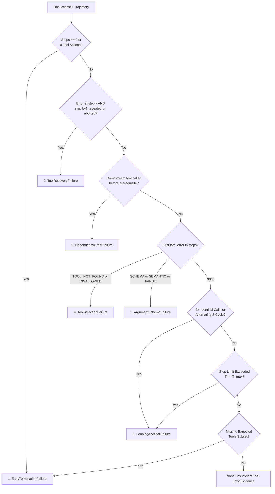

# Failure Taxonomy & Annotation Guide

> **Document Version:** 1.0.0  
> **Status:** Active Specification  
> **Effective Date:** 2026-11-05  
> **Author:** Senior Principal Research Scientist & Systems Lead  
> **Target System:** Lexsi Track 3 (Reliable & Efficient Tool-Using Agent)  
> **Authoritative Systems Blueprint:** [system_design.md](file:///Users/jayesh/Documents/Lexsi/system_design.md) §2.5  
> **Implementation Reference:** [`src/evaluation/taxonomy.py`](file:///Users/jayesh/Documents/Lexsi/src/evaluation/taxonomy.py)

---

## 1. Scope, Purpose & Labeling Unit

### 1.1 Purpose
This guide establishes the formal annotation protocol for diagnosing, categorizing, and auditing failures in multi-step tool-using agent episodes. Accurate, deterministic root-cause diagnosis is essential for:
1. Tracking benchmark metrics across model checkpoints (AuditKIT M1–M7).
2. Measuring shifts in failure mode distributions between baseline and fine-tuned models.
3. Preventing spurious or ungrounded failure attribution.

### 1.2 The Labeling Unit
- **Primary Labeling Unit:** A complete episodic trajectory $\tau = (s_0, a_0, o_0, \dots, a_T, o_T)$ represented by a [`TrajectoryRecord`](file:///Users/jayesh/Documents/Lexsi/src/data/schemas.py#L40-L60).
- **Condition for Labeling:** An episode is eligible for failure classification if and only if `trajectory.is_success == False`, as evaluated by the deterministic environment outcome verifier (`verify_task_outcome`). Successful trajectories (`is_success == True`) evaluate to `None`.
- **Unit Granularity:** Exactly **one primary root cause** is assigned per failed trajectory. While multiple failure signals may appear sequentially across steps, the annotator must identify the initial unrecovered causal defect that derailed the trajectory using the Precedence Hierarchy (§3).

---

## 2. The 6-Class Failure Taxonomy

```
┌────────────────────────────────────────────────────────────────────────────────────────┐
│                          THE 6 CANONICAL FAILURE CATEGORIES                            │
├─────────────────────────┬──────────────────────────────────────────────────────────────┤
│ 1. ToolSelectionFailure │ Non-existent, unauthorized, disallowed, or irrelevant tool   │
│ 2. ArgumentSchemaFailure│ Schema type error, missing field, extra arg, semantic bounds │
│ 3. DependencyOrderFail  │ Downstream tool called before upstream prerequisite          │
│ 4. LoopingAndStallFail  │ 3+ identical calls, cyclic alternating calls, step limit     │
│ 5. EarlyTerminationFail │ Prematurely halting before completing necessary task tools   │
│ 6. ToolRecoveryFailure  │ Crashing, repeating error, or aborting upon error observation│
└─────────────────────────┴──────────────────────────────────────────────────────────────┘
```

---

### Category 1: `ToolSelectionFailure`

* **Formal Definition:** The agent attempts to invoke a tool that does not exist in the environment registry, is prohibited by the runtime permission tier, or is entirely extraneous to the task requirements.
* **Observable Signals:**
  - Step error contains `TOOL_NOT_FOUND`.
  - Step error contains `DISALLOWED_TOOL`.
  - Step action specifies a tool not present in `task.expected_tools` (when `task` context is provided).
* **Inclusion Criteria:** The tool identifier itself is invalid, unauthorized, or irrelevant.
* **Exclusion Criteria:** The tool identifier is valid and permitted, but the arguments provided fail validation (label as `ArgumentSchemaFailure`). The tool is valid and expected, but called in the wrong order (label as `DependencyOrderFailure`).
* **Root-Cause Rule:** If the first fatal unrecovered error in the episode is an invalid or unauthorized tool name, classify as `ToolSelectionFailure`.

#### Positive Example
```json
{
  "step_index": 0,
  "action": {
    "tool_name": "execute_bash_command",
    "arguments": {"cmd": "ls"}
  },
  "error": "TOOL_NOT_FOUND: Tool 'execute_bash_command' is not recognized or authorized."
}
```
*Rationale:* The agent hallucinated a shell tool not registered in `TOOL_CONTRACTS`.

#### Near-Miss Example
```json
{
  "step_index": 0,
  "action": {
    "tool_name": "lookup_records",
    "arguments": {"table": "nonexistent_table"}
  },
  "error": "SCHEMA_VALIDATION_ERROR: Value error, Table 'nonexistent_table' not found in database."
}
```
*Rationale:* `lookup_records` is a valid, authorized tool. The error arises from argument validation. Label as `ArgumentSchemaFailure`, **not** `ToolSelectionFailure`.

---

### Category 2: `ArgumentSchemaFailure`

* **Formal Definition:** The agent selects a valid, permitted tool, but supplies arguments that violate the Pydantic schema contract (`extra='forbid'`), parameter typing, required fields, regular expressions, or domain semantic bounds.
* **Observable Signals:**
  - Step error contains `SCHEMA_VALIDATION_ERROR`.
  - Step error contains `SEMANTIC_BOUND_ERROR`.
  - Step error contains `MALFORMED_TOOL_ARGUMENTS` or `JSON_PARSE_ERROR`.
* **Inclusion Criteria:** The tool exists and is permitted, but the parameter payload fails structural validation prior to tool execution (`tool_call_counts == 0`).
* **Exclusion Criteria:** An error returned by the underlying tool during execution because no matching database records were found (this is a valid observation, not a schema failure).
* **Root-Cause Rule:** If the first fatal unrecovered error is an argument schema or semantic bound violation, classify as `ArgumentSchemaFailure`.

#### Positive Example
```json
{
  "step_index": 0,
  "action": {
    "tool_name": "lookup_records",
    "arguments": {
      "table": "vendors",
      "unauthorized_filter": 123
    }
  },
  "error": "SCHEMA_VALIDATION_ERROR: Extra inputs are not permitted [extra_forbidden]"
}
```
*Rationale:* Violates `ConfigDict(extra="forbid")` enforced on all tool contracts.

#### Near-Miss Example
```json
{
  "step_index": 0,
  "action": {
    "tool_name": "lookup_records",
    "arguments": {"table": "vendors", "filters": {"vendor_id": "VND-999"}}
  },
  "observation": []
}
```
*Rationale:* Schema validation succeeded; the tool returned an empty list because the vendor ID does not exist in the database. This is a valid observation.

---

### Category 3: `DependencyOrderFailure`

* **Formal Definition:** The agent invokes tools in an order that violates topological prerequisites or dataflow dependencies (e.g., executing an aggregation before retrieving the data to aggregate).
* **Observable Signals:**
  - A downstream tool in `task.expected_tools` is called before an upstream prerequisite tool is called.
  - In procurement workflows, `compute_aggregate` or `verify_constraint` is called before `lookup_records` has executed.
  - A dependent tool is called with empty or placeholder arguments because the upstream retrieval was omitted.
* **Inclusion Criteria:** The individual tool calls are schema-valid, but their sequence violates causal dependency requirements.
* **Exclusion Criteria:** The prerequisite tool was called but failed with an error, after which the agent called the dependent tool anyway (label as `ToolRecoveryFailure`).
* **Root-Cause Rule:** When tools are invoked out of topological order, classify as `DependencyOrderFailure`.

#### Positive Example
```json
[
  {
    "step_index": 0,
    "action": {"tool_name": "compute_aggregate", "arguments": {"values": [10.0, 20.0], "operation": "sum"}},
    "observation": 30.0
  },
  {
    "step_index": 1,
    "action": {"tool_name": "lookup_records", "arguments": {"table": "inventory_items"}},
    "observation": [{"item_id": "ITM-001", "stock_level": 50, "unit_cost": 4.5}]
  }
]
```
*Rationale:* The agent fabricated values for `compute_aggregate` at step 0 before looking up the actual inventory items at step 1.

#### Near-Miss Example
```json
[
  {
    "step_index": 0,
    "action": {"tool_name": "lookup_records", "arguments": {}},
    "error": "SCHEMA_VALIDATION_ERROR: Missing field 'table'"
  },
  {
    "step_index": 1,
    "action": {"tool_name": "compute_aggregate", "arguments": {"values": [1.0], "operation": "sum"}}
  }
]
```
*Rationale:* `lookup_records` was attempted first, but failed. Step 1 attempted aggregation without fixing the lookup. Label as `ToolRecoveryFailure`, **not** `DependencyOrderFailure`.

---

### Category 4: `LoopingAndStallFailure`

* **Formal Definition:** The agent enters a repetitive state loop by executing 3 or more identical tool calls, repeating an alternating cycle ($\ge 2$ repetitions of $A \to B \to A \to B$), or exhausting the step budget ($T \ge T_{\max}$) without completing the task.
* **Observable Signals:**
  - $\ge 3$ tool calls share identical tool names and canonically sorted argument strings.
  - An alternating 2-cycle of calls repeats $\ge 2$ times.
  - Step error contains `STEP_LIMIT_EXCEEDED` or `EXECUTION_TIMEOUT` in the absence of preceding unrecovered tool errors.
* **Inclusion Criteria:** Repetitive identical or cyclic actions, or step-limit exhaustion during active non-error execution.
* **Exclusion Criteria:** The step limit was reached because the agent produced an error on every step and failed to recover (label as `ArgumentSchemaFailure` or `ToolRecoveryFailure`).
* **Root-Cause Rule:** If repetitive calling or cycle-trapping stalls the trajectory, classify as `LoopingAndStallFailure`.

#### Positive Example
```json
[
  {"step_index": 0, "action": {"tool_name": "lookup_records", "arguments": {"table": "vendors"}}},
  {"step_index": 1, "action": {"tool_name": "lookup_records", "arguments": {"table": "vendors"}}},
  {"step_index": 2, "action": {"tool_name": "lookup_records", "arguments": {"table": "vendors"}}}
]
```
*Rationale:* 3 identical calls executed consecutively with identical arguments.

#### Near-Miss Example
```json
[
  {"step_index": 0, "action": {"tool_name": "lookup_records", "arguments": {"table": "vendors", "filters": {"category": "Hardware"}}}},
  {"step_index": 1, "action": {"tool_name": "lookup_records", "arguments": {"table": "vendors", "filters": {"category": "Software"}}}},
  {"step_index": 2, "action": {"tool_name": "lookup_records", "arguments": {"table": "vendors", "filters": {"category": "Logistics"}}}}
]
```
*Rationale:* Distinct argument filters exploring different subsets. Not a loop.

---

### Category 5: `EarlyTerminationFailure`

* **Formal Definition:** The agent terminates the episode (emits a final answer or halts) prematurely without executing the minimum necessary tools required by the task.
* **Observable Signals:**
  - Trajectory contains 0 tool actions when the task requires environmental data.
  - Agent halts after executing only an incomplete subset of `task.expected_tools` (e.g. executed 1 of 3 required tools and stopped).
* **Inclusion Criteria:** The agent voluntarily stops before acquiring the data or completing the verification required by the environment outcome predicate.
* **Exclusion Criteria:** All expected tools were executed successfully, but the final text output contained an arithmetic miscalculation (label as `None` / Insufficient Evidence).
* **Root-Cause Rule:** If the agent stops before executing required tools, classify as `EarlyTerminationFailure`.

#### Positive Example
```json
{
  "task_id": "task_audit_t1_001",
  "steps": [],
  "final_output": "The total inventory valuation is $125,000.00."
}
```
*Rationale:* The agent hallucinated an answer without querying `lookup_records` or `compute_aggregate`.

#### Near-Miss Example
```json
[
  {"step_index": 0, "action": {"tool_name": "lookup_records", "arguments": {"table": "inventory_items"}}, "observation": [{"unit_cost": 10, "stock_level": 5}]},
  {"step_index": 1, "action": {"tool_name": "compute_aggregate", "arguments": {"values": [50.0], "operation": "sum"}}, "observation": 50.0}
]
```
*Final output:* `"Total is 55.0."` (Oracle was 50.0).  
*Rationale:* All required tools were executed in valid order with valid schemas. The error was purely arithmetic in the language head. Do not classify as `EarlyTerminationFailure`; label as `None` (insufficient tool-use error evidence).

---

### Category 6: `ToolRecoveryFailure`

* **Formal Definition:** Following an error observation returned at step $k$, the agent is given an opportunity to recover at step $k+1$, but fails to exhibit corrective adaptation (e.g., repeats the identical failing call, immediately aborts, or crashes).
* **Observable Signals:**
  - Step $k$ contains an error (`error is not None` or `obs.is_error = True`).
  - Step $k+1$ repeats the exact same tool and arguments, aborts with a final answer without completing the task, or crashes with unparseable output.
* **Inclusion Criteria:** Explicit evidence of failing to handle or adapt to an environmental error signal.
* **Exclusion Criteria:** An error occurred on the final allowed step ($k = T_{\max}-1$), providing no subsequent step for the agent to recover.
* **Root-Cause Rule:** When an agent is prompted with an error observation and fails to adapt on the subsequent step, classify as `ToolRecoveryFailure`.

#### Positive Example
```json
[
  {
    "step_index": 0,
    "action": {"tool_name": "lookup_records", "arguments": {}},
    "error": "SCHEMA_VALIDATION_ERROR: Field required: 'table'"
  },
  {
    "step_index": 1,
    "action": {"tool_name": "lookup_records", "arguments": {}},
    "error": "SCHEMA_VALIDATION_ERROR: Field required: 'table'"
  }
]
```
*Rationale:* Step 0 informed the agent of the missing field. Step 1 repeated the exact same invalid call without correcting the argument.

#### Near-Miss Example
```json
[
  {
    "step_index": 0,
    "action": {"tool_name": "lookup_records", "arguments": {}},
    "error": "SCHEMA_VALIDATION_ERROR: Field required: 'table'"
  },
  {
    "step_index": 1,
    "action": {"tool_name": "lookup_records", "arguments": {"table": "vendors"}},
    "observation": [{"vendor_id": "VND-100"}]
  }
]
```
*Rationale:* Step 1 successfully corrected the argument payload in response to the feedback. This is successful recovery.

---

## 3. Precedence Hierarchy for Overlapping Signals

When multiple failure signals occur in a trajectory, root cause must be resolved deterministically using causal priority:



### Precedence Priority Table

| Priority | Category | Causal Trigger |
|:---:|:---|:---|
| **1** | `EarlyTerminationFailure` | Trajectory terminated with 0 tool calls before any environmental interaction. |
| **2** | `ToolRecoveryFailure` | Error observation was delivered at step $k$, and step $k+1$ repeated the error, aborted, or crashed. |
| **3** | `DependencyOrderFailure` | Tool sequence violated topological prerequisites or data dependencies. |
| **4** | `ToolSelectionFailure` | First unrecovered fatal action invoked an unregistered or disallowed tool. |
| **5** | `ArgumentSchemaFailure` | First unrecovered fatal action invoked a valid tool with invalid schema or bounds. |
| **6** | `LoopingAndStallFailure` | Agent exhibited $\ge 3$ identical calls, cycle loops, or exhausted step limit without prior tool errors. |
| **7** | `EarlyTerminationFailure` | Incomplete tool subset: agent halted without executing all expected tools. |
| **8** | `None` (Insufficient Evidence) | All tools executed correctly; failure was in arithmetic/reasoning outside tool usage. |

---

## 4. Evidence Schema & Annotation Record

All annotations (both synthetic test fixtures and future baseline evaluations) must conform to the strict JSON schema:

```json
{
  "$schema": "http://json-schema.org/draft-07/schema#",
  "title": "FailureAnnotationRecord",
  "type": "object",
  "required": [
    "annotation_id",
    "task_id",
    "split",
    "taxonomy_version",
    "is_synthetic",
    "evidence_step",
    "evidence_error_codes",
    "initial_label",
    "reviewer_label",
    "adjudicated_label",
    "disagreement_outcome",
    "evidence_summary",
    "redacted_trace_snippet"
  ],
  "properties": {
    "annotation_id": {"type": "string"},
    "task_id": {"type": "string"},
    "split": {"enum": ["train", "val", "test"]},
    "taxonomy_version": {"type": "string", "pattern": "^\\d+\\.\\d+\\.\\d+$"},
    "is_synthetic": {"type": "boolean"},
    "evidence_step": {"type": ["integer", "null"]},
    "evidence_error_codes": {"type": "array", "items": {"type": "string"}},
    "initial_label": {"type": "string"},
    "reviewer_label": {"type": "string"},
    "adjudicated_label": {"type": "string"},
    "disagreement_outcome": {"type": "string"},
    "evidence_summary": {"type": "string"},
    "redacted_trace_snippet": {"type": "object"}
  }
}
```

---

## 5. Security, Privacy & Secret Redaction

Before storing or publishing any annotation record:
1. **Recursive Secret Scrubbing:** All payloads must be processed through [`redact_data()`](file:///Users/jayesh/Documents/Lexsi/src/data/redaction.py#L40-L60), which recursively scrubs API keys, bearer tokens, passwords, and private identifiers matching defined patterns across dictionaries, lists, and strings.
2. **Minimal Trace Snippets:** Annotation files must store only the minimal necessary step records (the error step and its immediate predecessor/successor) rather than bloated uncompressed episode histories.
3. **Fail-Closed Test Protection:** Labeled traces from the locked test set (`split == "test"`) must **never** be exported into training corpora.

---

## 6. Multi-Reviewer Adjudication Protocol

To guarantee scientific rigor and zero subjective drift:
1. **Dual Independent Review:**
   - Annotator A (Primary Researcher) assigns an `initial_label` based on trajectory inspection.
   - Annotator B (Secondary Reviewer) independently inspects the trajectory and assigns a `reviewer_label`.
2. **Inter-Annotator Agreement Calculation:**
   - Raw percentage agreement: $P_o = \frac{\sum \mathbb{I}(\text{label}_A == \text{label}_B)}{N}$.
   - Cohen's Kappa: $\kappa = \frac{P_o - P_e}{1 - P_e}$.
   - Target standard: $\kappa \ge 0.85$ (near-perfect agreement).
3. **Senior Adjudication:**
   - Any disagreement where $\text{label}_A \ne \text{label}_B$ is submitted to the Senior Principal Systems Architect.
   - The arbiter examines the structured evidence codes, traces the Precedence Ladder (§3), and renders the authoritative `adjudicated_label`.
   - The exact disagreement rationale is documented in `disagreement_outcome`.

> [!IMPORTANT]
> **Baseline Model Provenance Note:** In Milestone 1, Work Package M1.P3 provides synthetic calibration fixtures (`references/synthetic_annotation_sample.json`) for verifying annotation schema adherence and classifier accuracy. Annotation of actual model-generated baseline rollouts will be performed and reported during **M1.P5 / P2.2** upon completion of the frozen baseline rollout.

---

## 7. Version History

| Version | Date | Author | Summary of Changes |
|:---:|:---:|:---|:---|
| **1.0.0** | 2026-11-05 | Senior Principal Research Scientist | Initial release of 6-class failure taxonomy, formal observable evidence mapping, precedence hierarchy, adjudication protocol, and synthetic fixture schema. |

