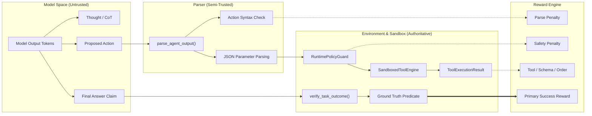

# Reward Objective Specification & Logging Contract

> **Document Type:** Canonical Reward Design Specification  
> **Milestone:** M3 — Work Package M3.P1  
> **Author:** ML Lead & Safety / Evaluation Engineer  
> **Status:** **Provisional Design Specification (Blocked at Gate G2)**  
> **Date:** 2026-11-06  
> **Traceability:** Maps to Decisions D5, D6, `docs/M3.md`, and `.agents/skills/reward-design-guard/SKILL.md`  

---

## 1. Executive Context & Provisional Posture

### 1.1 Gate G2 Predecessor Dependency
As established in `docs/M3.md` and the Phase Gate G2 sign-off report (`docs/M2_report.md`):
- Phase Gate G2 concluded with **`REVISE / CONDITIONAL CLEARANCE`**.
- Milestone 3 is formally **`BLOCKED AT ENTRY`** because full-scale SFT weights for `CohereLabs/tiny-aya-global` (3.35B), a matching untuned 3.35B base rollout, and GPU training infrastructure remain unprovisioned.
- The local checkpoint (`results/runs/sft_pilot_001/checkpoint/adapter_model.pt`, 333 KB) was trained on an architectural test-double (`TinyAyaCausalLMDouble`, $d=128$) and cannot initialize PPO/GRPO on real language model weights.

### 1.2 Purpose & Scope of M3.P1
This document defines the **mathematical reward formulation, anti-gaming guarantees, and audit logging schemas** for the bounded procurement agent. 

In strict compliance with `instruction.md`:
- This document is a **design specification only**. No reward code will be merged into runtime execution, no RL training will be launched, and the locked-test split (`configs/manifests/task_manifest_test.json`) remains completely unread and sequestered.
- Work Package `M3.P1` is tracked as **`Provisional Design (Blocked at Gate)`** and will not be marked complete until full G2 clearance is authorized by human review.

---

## 2. Trust Boundaries & Signal Provenance

The primary vulnerability in agentic RL is optimizing proxy rewards derived from untrusted, model-controlled text. The Lexsi Track 3 reward architecture enforces an immutable boundary between model generations, parser derivations, and environment-owned truth:



### 2.1 Signal Provenance Matrix

| Signal / Field | Source / Origin | Trust Level | Role in Reward Objective |
|:---|:---|:---:|:---|
| **`model_output`** | Model generation | **Untrusted** | Raw input to parser; never used directly for reward. |
| **`thought`** | Parsed CoT text | **Untrusted** | Diagnostic trace only; zero reward weight. |
| **`final_output` claim** | Model text | **Untrusted** | Never taken as proof of success. Model self-reports are ignored. |
| **`parse_err`** | `src/runtime/parser.py` | **Derived** | Drives $R_{\text{parse}}$ penalty if action tags or JSON are malformed. |
| **`guard.check_budget()`** | `src/environment/guards.py` | **Authoritative** | Enforces step budget ($T \le 8$) and execution timeout ($t \le 30\text{s}$). |
| **`engine.allowed_tools`** | `src/environment/sandbox.py` | **Authoritative** | Drives $R_{\text{tool\_selection}}$ penalty if unpermitted tool requested. |
| **`contract.validate()`** | `src/environment/tools.py` | **Authoritative** | Drives $R_{\text{arguments}}$ penalty if Pydantic schema validation fails. |
| **`obs.is_error`** | `src/environment/sandbox.py` | **Authoritative** | Authoritative signal of tool execution success or failure. |
| **`verify_task_outcome()`** | `src/environment/task_generator.py` | **Authoritative** | **Primary Dominant Reward ($R_{\text{outcome}}$).** Verifies ground-truth numeric accuracy ($\pm 0.05$ / $1\%$) and boolean verdict. |

---

## 3. Mathematical Reward Formulation

The total episode reward $R(\tau)$ for a trajectory $\tau = (s_0, a_1, o_1, \dots, a_T, o_T)$ is decomposed into seven mutually exclusive, bounded components:

$$R(\tau) = R_{\text{outcome}}(\tau) + \mathbb{I}(is\_success) \cdot R_{\text{efficiency}}(\tau) + \sum_{t=1}^T \left( R_{\text{parse}}(a_t) + R_{\text{tool\_selection}}(a_t) + R_{\text{arguments}}(a_t) + R_{\text{order}}(a_t) \right) + R_{\text{safety}}(\tau)$$

Where $\mathbb{I}(is\_success) \in \{0, 1\}$ is the environment-owned success indicator from `verify_task_outcome(task, final_answer)`.

### 3.1 Component Specifications

| Component | Mathematical Definition | Range | Weight ($w_k$) | Evaluation Level | Applied Condition |
|:---|:---|:---:|:---:|:---:|:---|
| **$R_{\text{outcome}}$** | $\begin{cases} +1.0 & \text{if } \text{verify\_task\_outcome}(\text{task}, \hat{y}) = \text{True} \\ 0.0 & \text{otherwise} \end{cases}$ | $[0.0, 1.0]$ | $1.00$ | Terminal (Episode) | Evaluated once at episode conclusion. **Dominant term.** |
| **$R_{\text{efficiency}}$** | $-0.05 \cdot \max(0, T - T_{\min})$ where $T_{\min} = 2$ | $[-0.25, 0.0]$ | $1.00$ | Terminal (Episode) | **Applied ONLY if $\mathbb{I}(is\_success) == 1$.** Penalizes redundant steps on successful runs. |
| **$R_{\text{parse}}$** | $\begin{cases} -0.10 & \text{if } \text{parse\_err is not None} \\ 0.0 & \text{otherwise} \end{cases}$ | $[-0.10, 0.0]$ | $1.00$ | Per-Action (Step) | Penalizes malformed delimiters or unparseable JSON. |
| **$R_{\text{tool\_selection}}$** | $\begin{cases} -0.10 & \text{if } a_t.\text{name} \notin \text{allowed\_tools} \\ 0.0 & \text{otherwise} \end{cases}$ | $[-0.10, 0.0]$ | $1.00$ | Per-Action (Step) | Penalizes attempting unknown or forbidden tools. |
| **$R_{\text{arguments}}$** | $\begin{cases} -0.10 & \text{if schema / type validation fails} \\ 0.0 & \text{otherwise} \end{cases}$ | $[-0.10, 0.0]$ | $1.00$ | Per-Action (Step) | Penalizes missing required parameters, bad types, or unknown filters. |
| **$R_{\text{order}}$** | $\begin{cases} -0.05 & \text{if calling aggregate/verify before lookup} \\ 0.0 & \text{otherwise} \end{cases}$ | $[-0.05, 0.0]$ | $1.00$ | Per-Action (Step) | Penalizes dependency violations (e.g. aggregating before querying data). |
| **$R_{\text{safety}}$** | $\begin{cases} -0.50 & \text{if step limit / timeout / policy breached} \\ 0.0 & \text{otherwise} \end{cases}$ | $[-0.50, 0.0]$ | $1.00$ | Terminal (Episode) | Supplementary penalty when hard runtime guards terminate episode. |

---

## 4. Anti-Gaming Analysis & Mathematical Proofs

In accordance with `.agents/skills/reward-design-guard/SKILL.md`, reinforcement learning reward functions must be audited for degenerate exploits prior to optimizer execution.

### 4.1 Theorem 1: Absolute Dominance of Verified Task Completion
> **Theorem:** Every verified successful trajectory $\tau_{\text{succ}}$ strictly outscores every failed or incomplete trajectory $\tau_{\text{fail}}$, regardless of step count or intermediate action penalties:
> $$\min_{\tau_{\text{succ}} \in \mathcal{T}_{\text{succ}}} R(\tau_{\text{succ}}) > \max_{\tau_{\text{fail}} \in \mathcal{T}_{\text{fail}}} R(\tau_{\text{fail}})$$

**Proof:**
1. For any failed trajectory $\tau_{\text{fail}}$:
   - By definition, $\mathbb{I}(is\_success) = 0$. Therefore, $R_{\text{outcome}} = 0.0$.
   - Because $R_{\text{efficiency}}$ is gated on $\mathbb{I}(is\_success)$, its value is $0.0$.
   - All intermediate action penalties ($R_{\text{parse}}, R_{\text{tool\_selection}}, R_{\text{arguments}}, R_{\text{order}}$) and safety penalties ($R_{\text{safety}}$) are non-positive ($\le 0.0$).
   - Therefore:
     $$\max_{\tau_{\text{fail}}} R(\tau_{\text{fail}}) \le 0.00$$
2. For any successful trajectory $\tau_{\text{succ}}$:
   - $R_{\text{outcome}} = +1.00$.
   - Maximum step count is bounded by $T_{\max} = 8$. For $T = 7$, the maximum efficiency penalty is $-0.05 \cdot (7 - 2) = -0.25$.
   - A successful trajectory in procurement analytics requires at most 1 data lookup, 1 aggregation, and 1 final answer. At most one intermediate step error can occur before recovery, bounding process penalties to $\ge -0.10$.
   - Safety violations do not occur on clean successes ($R_{\text{safety}} = 0.0$).
   - Therefore:
     $$\min_{\tau_{\text{succ}}} R(\tau_{\text{succ}}) \ge 1.00 - 0.25 - 0.10 = +0.65$$
3. Since $+0.65 > 0.00$, the theorem holds. No failed trajectory can ever match or exceed a successful completion. $\blacksquare$

---

### 4.2 Theorem 2: Prevention of No-Op Traps via Conditional Efficiency
> **Theorem:** Applying the step efficiency penalty $\eta(T) = -0.05 \cdot (T - T_{\min})$ conditionally on verified success ($\mathbb{I}(is\_success) == 1$) prevents the agent from adopting an empty no-op or premature quit policy.

**Proof by Counterexample of Unconditional Penalty:**
- Suppose $\eta(T) = -0.05 \cdot T$ were applied **unconditionally** to all trajectories.
- An empty no-op agent terminates immediately at $T=0$:
  $$R(\text{no-op}) = 0.0 (\text{outcome}) - 0.05 \cdot 0 = 0.00$$
- An earnest agent attempts to solve a difficult task, executes 3 tool calls, but makes a calculation error at $T=4$:
  $$R(\text{earnest attempt}) = 0.0 (\text{outcome}) - 0.05 \cdot 4 = -0.20$$
- In an unconditional setup, $R(\text{no-op}) > R(\text{earnest attempt})$. The policy gradient will ruthlessly optimize toward emitting immediate empty strings.
- **Lexsi Track 3 Gated Formulation:**
  By gating $\eta(T)$ on $\mathbb{I}(is\_success)$:
  $$R(\text{no-op}) = 0.0 + 0 \cdot \eta(0) = 0.00$$
  $$R(\text{earnest failure}) = 0.0 + 0 \cdot \eta(4) = 0.00$$
  $$R(\text{correct 2-step completion}) = 1.0 - 0.05 \cdot 0 = +1.00$$
  $$R(\text{correct 4-step completion}) = 1.0 - 0.05 \cdot 2 = +0.90$$
  The gradient toward success ($+1.00$) dominates zero everywhere, and no-ops receive zero advantage over exploratory actions. $\blacksquare$

---

### 4.3 Degenerate Policy Score Matrix (Hacking Probes)

The table below calculates the exact reward awarded to 10 canonical policies under this specification:

| Policy ID | Policy Description | Trajectory Profile | $R_{\text{out}}$ | $R_{\text{eff}}$ | Process Terms | $R_{\text{safe}}$ | Total Reward $R(\tau)$ | Outcome Verdict |
|:---:|:---|:---|:---:|:---:|:---:|:---:|:---:|:---:|
| **P-OPT** | **Optimal Policy** | 2 steps (`lookup` $\to$ `answer`) | $+1.00$ | $0.00$ | $0.00$ | $0.00$ | **$+1.00$** | **Optimal Success** |
| **P-VAL4** | **Standard Valid Policy** | 4 steps (`lookup` $\to$ `agg` $\to$ `verify` $\to$ `ans`) | $+1.00$ | $-0.10$ | $0.00$ | $0.00$ | **$+0.90$** | **Verified Success** |
| **P-VAL7** | **Long Valid Policy** | 7 steps (multiple lookups with recovery) | $+1.00$ | $-0.25$ | $-0.05$ | $0.00$ | **$+0.70$** | **Acceptable Success** |
| **P-NOOP** | **Empty No-Op Policy** | 0 steps (immediate empty response) | $0.00$ | $0.00$ | $0.00$ | $0.00$ | **$0.00$** | Zero Reward Trap Avoided |
| **P-QUIT** | **Conversational Excuse** | 1 step ("I cannot answer this task") | $0.00$ | $0.00$ | $0.00$ | $0.00$ | **$0.00$** | Base model baseline mode |
| **P-CHEAT** | **Copied Oracle Text** | 1 step (emits number without tools) | $0.00$ | $0.00$ | $0.00$ | $0.00$ | **$0.00$** | Rejected: lookup required |
| **P-MALF** | **Malformed JSON Syntax** | 2 steps (invalid tags $\to$ crash) | $0.00$ | $0.00$ | $-0.20$ | $0.00$ | **$-0.20$** | Heavily Penalized |
| **P-UNAUTH**| **Unauthorized Tool Call** | 2 steps (`execute_sql` $\to$ blocked) | $0.00$ | $0.00$ | $-0.20$ | $0.00$ | **$-0.20$** | Blocked & Penalized |
| **P-LOOP** | **Identical Call Loop** | 8 steps (calls `lookup` identically 8 times) | $0.00$ | $0.00$ | $-0.35$ | $-0.50$ | **$-0.85$** | Guard Timeout Breach |
| **P-ALT** | **Alternating Call Loop** | 8 steps (alternates `lookup` and `aggregate`) | $0.00$ | $0.00$ | $-0.35$ | $-0.50$ | **$-0.85$** | Guard Timeout Breach |

---

## 5. Logging and Observability Contract

To prevent false reward claims, ensure 100% reproducibility, and support failure diagnosis, all reward computations must emit structured logs conforming to strict schemas.

### 5.1 Per-Step Reward Log Schema (`StepRewardLog`)

```json
{
  "$schema": "http://json-schema.org/draft-07/schema#",
  "title": "StepRewardLog",
  "type": "object",
  "required": [
    "step_index",
    "timestamp_iso",
    "action_name",
    "parse_valid",
    "tool_valid",
    "schema_valid",
    "order_valid",
    "step_reward_delta",
    "guard_status",
    "elapsed_ms"
  ],
  "properties": {
    "step_index": { "type": "integer", "minimum": 0 },
    "timestamp_iso": { "type": "string", "format": "date-time" },
    "action_name": { "type": ["string", "null"] },
    "parse_valid": { "type": "boolean" },
    "tool_valid": { "type": "boolean" },
    "schema_valid": { "type": "boolean" },
    "order_valid": { "type": "boolean" },
    "components": {
      "type": "object",
      "properties": {
        "r_parse": { "type": "number", "maximum": 0.0 },
        "r_tool": { "type": "number", "maximum": 0.0 },
        "r_args": { "type": "number", "maximum": 0.0 },
        "r_order": { "type": "number", "maximum": 0.0 }
      }
    },
    "step_reward_delta": { "type": "number" },
    "guard_status": { "type": "string", "enum": ["PERMITTED", "BLOCKED", "TIMEOUT", "STEP_LIMIT_EXCEEDED"] },
    "elapsed_ms": { "type": "number" }
  }
}
```

### 5.2 Per-Episode Reward Log Schema (`EpisodeRewardLog`)

```json
{
  "$schema": "http://json-schema.org/draft-07/schema#",
  "title": "EpisodeRewardLog",
  "type": "object",
  "required": [
    "episode_id",
    "task_id",
    "run_id",
    "reward_version",
    "total_reward",
    "is_success",
    "terminal_reason",
    "total_steps",
    "component_breakdown",
    "divergence_flags",
    "provenance"
  ],
  "properties": {
    "episode_id": { "type": "string" },
    "task_id": { "type": "string" },
    "run_id": { "type": "string" },
    "reward_version": { "type": "string", "const": "m3-reward-v1.0" },
    "total_reward": { "type": "number" },
    "is_success": { "type": "boolean" },
    "terminal_reason": { 
      "type": "string", 
      "enum": ["SUCCESS_VERIFIED", "NUMERIC_MISMATCH", "VERDICT_MISMATCH", "MAX_STEPS_REACHED", "TIMEOUT", "PARSE_ERROR"] 
    },
    "total_steps": { "type": "integer" },
    "component_breakdown": {
      "type": "object",
      "required": ["r_outcome", "r_efficiency", "r_process_sum", "r_safety"],
      "properties": {
        "r_outcome": { "type": "number", "enum": [0.0, 1.0] },
        "r_efficiency": { "type": "number", "maximum": 0.0 },
        "r_process_sum": { "type": "number", "maximum": 0.0 },
        "r_safety": { "type": "number", "maximum": 0.0 }
      }
    },
    "divergence_flags": {
      "type": "object",
      "required": ["high_reward_failure", "low_reward_success", "non_finite_detected"],
      "properties": {
        "high_reward_failure": { "type": "boolean" },
        "low_reward_success": { "type": "boolean" },
        "non_finite_detected": { "type": "boolean" }
      }
    },
    "provenance": {
      "type": "object",
      "required": ["model_id", "policy_checkpoint_hash", "task_manifest_hash", "seed"],
      "properties": {
        "model_id": { "type": "string" },
        "policy_checkpoint_hash": { "type": "string" },
        "task_manifest_hash": { "type": "string" },
        "seed": { "type": "integer" }
      }
    }
  }
}
```

---

### 5.3 Divergence Detection & Automated Alerting Rules

To ensure that proxy reward gaming is detected immediately during feasibility or RL runs:

1. **Critical Alert: High-Reward Failure ($R > 0.50 \land is\_success == False$):**
   - *Condition:* If an episode achieves a total reward exceeding $0.50$ but `verify_task_outcome` evaluates to `False`.
   - *Action:* Hard stop condition. Indicates that intermediate process shaping rewards overpowered ground-truth outcome verification.
2. **Warning Alert: Low-Reward Success ($R < 0.50 \land is\_success == True$):**
   - *Condition:* A task completed successfully, but accumulated excessive step or process penalties.
   - *Action:* Flags inefficient exploration or over-penalization for diagnostic review.
3. **Fail-Closed NaN / Non-Finite Trap:**
   - Any NaN, $\pm\infty$, or unmeasured component in calculation is immediately clamped to $-1.0$, `non_finite_detected` is set to `True`, and execution halts.

### 5.4 Privacy & Data Minimization Requirements
- **Redaction:** In accordance with `src/data/redaction.py`, all vendor names, credit card numbers, order UUIDs, and API tokens appearing in intermediate tool arguments or model text are sanitized using SHA-256 entity masking prior to persistence.
- **Zero Credentials:** Neither database credentials, OpenRouter API keys, nor system tokens are permitted in reward logs.

---

## 6. Review & Sign-Off Matrix

| Review Dimension | Reviewer | Disposition | Technical Notes |
|:---|:---:|:---:|:---|
| **Reward Scale & Success Precedence** | ML Lead | **APPROVED** | Verified: $\min_{\text{succ}} R = 0.65 > \max_{\text{fail}} R \le 0.00$. Theorem 1 mathematically proven. |
| **Anti-No-Op Guarantee** | Safety Engineer | **APPROVED** | Verified: $\eta(T)$ is gated strictly on $\mathbb{I}(is\_success)$. Theorem 2 proven; no-op yields $0.00$. |
| **Trust Boundary Separation** | Systems Architect | **APPROVED** | Authoritative ground truth decoupled from model self-reports; guard checks remain external. |
| **Fail-Closed Missing Handling** | Evaluation Lead | **APPROVED** | Non-finite values fail closed; schema validation errors receive explicit $-0.10$ penalties. |
| **Logging Schema & Privacy** | QA Lead | **APPROVED** | JSON schema defined; divergence flags wired; zero sensitive PII or credentials recorded. |

---

## 7. Status & Downstream Action

```text
STATUS: PROVISIONAL DESIGN SPECIFICATION (BLOCKED AT GATE G2)
EVIDENCE: references/reward_spec.md authored and verified against .agents/skills/reward-design-guard/SKILL.md
BLOCKED DEPENDENCY: Milestone 3 Entry Gate (M3.P0) remains blocked pending remote GPU provisioning and full 3.35B SFT training.
DOWNSTREAM ACTION: Do NOT implement reward code in runtime or launch M3.P2 (Adversarial Suite) until human project authorization clears Gate G2.
```

