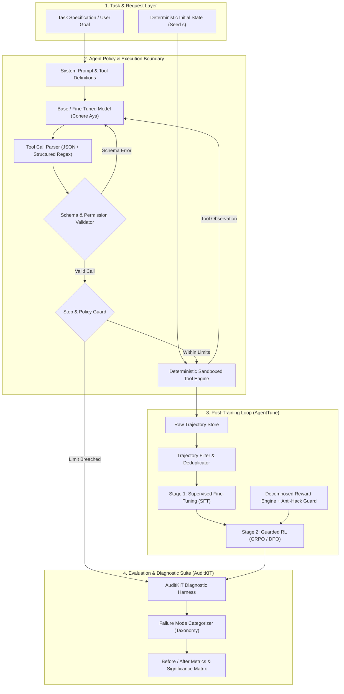
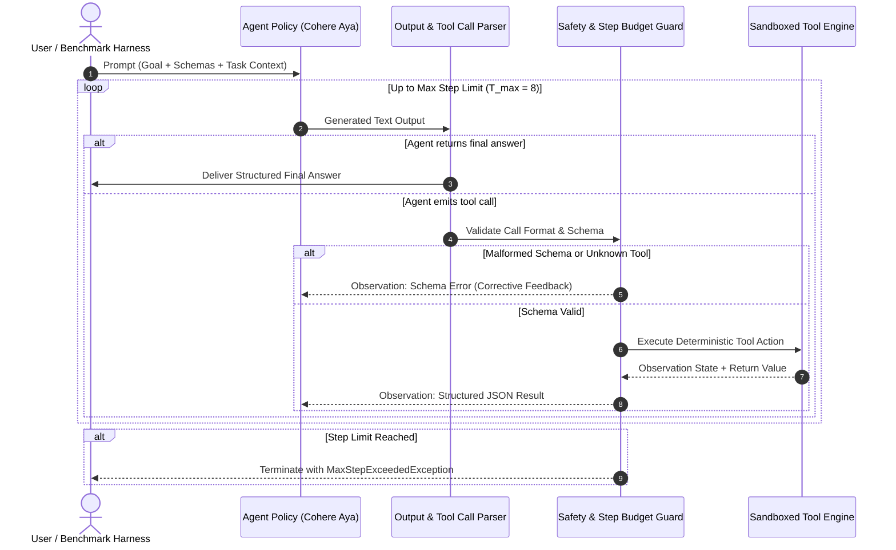

# System Design Blueprint: Reliable & Efficient Tool-Using Agent
## Lexsi Track 3: Agentic Fine-Tuning System Architecture

> **Document Status:** Authoritative Architectural Source of Truth (`system_design.md`)  
> **Target System:** Production-Grade Cohere Open-Weights Agent with AgentTune & AuditKIT  
> **Reference Plan:** [docs/plan.md](file:///Users/jayesh/Documents/Lexsi/docs/plan.md) · **Operational Protocol:** [instruction.md](file:///Users/jayesh/Documents/Lexsi/instruction.md)

---

## 1. Executive Architecture Overview

The system addresses **Problem Statement #1 (Reliable Tool Calling)** and **Problem Statement #2 (Efficient Trajectories)**, supported by **#9 (Reward-Hacking Defenses)**. It optimizes dense open-weights models (Cohere Tiny Aya / Aya Expanse) to execute complex, multi-step tasks across deterministic local tool environments with 100% schema compliance, minimal redundant actions, zero unhandled errors, and mathematically bounded rewards.



---

## 2. Core Subsystems and Technical Specifications

### 2.1 Subsystem A: Deterministic Environment & Tool Engine
* **Purpose:** Provides a fully reproducible, stateful yet deterministic simulation environment for tool interaction (structured data lookup, relational joins, mathematical calculations, and verification checks).
* **Guarantees:**
  * **Zero External Network Dependencies:** All tools execute in-memory or over local mock fixtures.
  * **Strict Pydantic Typing:** Every tool parameter is defined via a strict Pydantic model with typed constraints (e.g., regex, bounds, non-null values).
  * **Idempotency & Rollback:** State mutations are tracked in a transaction log with instantaneous state reset to seed $s$.

```
Tool Execution Contract:
(ToolName, TypedArguments, EnvironmentState_t) ──> (ToolObservation_{t+1}, EnvironmentState_{t+1}, ErrorCode)
```

### 2.2 Subsystem B: Trajectory Curation & Data Split Architecture
* **Partitioning Principle:** Splits are isolated at the **task-template and entity level**, completely preventing data contamination or paraphrase leakage:
  * **Train Set ($\mathcal{D}_{\text{train}}$):** Used for supervised format tuning and on-policy RL rollouts.
  * **Validation Set ($\mathcal{D}_{\text{val}}$):** Used for hyperparameter tuning, checkpoint selection, and reward calibration.
  * **Locked Test Set ($\mathcal{D}_{\text{test}}$):** Held-out task compositions, novel entity values, and reordered tool schemas evaluated exactly once.
* **Trajectory Format:** Standardized ShareGPT / OpenAI tool-calling JSON schema compatible with AgentTune and Hugging Face TRL.

### 2.3 Subsystem C: AgentTune Post-Training Pipeline
The training pipeline executes in two sequential stages:

```
┌────────────────────────────────────────────────────────────────────────┐
│                        TWO-STAGE POST-TRAINING                         │
├───────────────────────────────────┬────────────────────────────────────┤
│ Stage 1: Supervised Fine-Tuning   │ Stage 2: Guarded RL (GRPO)         │
│ - Target: Formatting & Syntax     │ - Target: Trajectory Efficiency    │
│ - Loss: Token-Masked CE on Tools  │ - Reward: Verified Outcome + Step  │
│ - Filter: 100% Successful Traces  │ - Guard: Anti-Hacking Probes       │
└───────────────────────────────────┴────────────────────────────────────┘
```

#### Stage 1: Token-Masked Supervised Fine-Tuning (SFT)
Objective: Ensure the model masters the exact special tokens, JSON argument structure, and tool call triggers.
* **Loss Function:** Masked Cross-Entropy Loss:
  $$\mathcal{L}_{\text{SFT}}(\theta) = -\sum_{t \in \mathcal{T}_{\text{assistant}}} \log P_\theta(x_t \mid x_{<t})$$
  *(Tokens generated by the user or returned by the environment observation $\mathcal{T}_{\text{env}}$ are strictly masked out of loss computation).*

#### Stage 2: Group Relative Policy Optimization (GRPO)
Objective: Optimize for task success while pruning redundant, cyclic, or superfluous tool calls.
* **Objective Formulation:**
  $$\mathcal{J}_{\text{GRPO}}(\theta) = \mathbb{E}_{\{y_i\}_{i=1}^G \sim \pi_{\theta_{\text{old}}}(y|x)} \left[ \frac{1}{G} \sum_{i=1}^G \left( \min\left( r_i(\theta) A_i, \text{clip}(r_i(\theta), 1-\epsilon, 1+\epsilon) A_i \right) - \beta D_{\text{KL}}(\pi_\theta \parallel \pi_{\text{ref}}) \right) \right]$$
  where $r_i(\theta) = \frac{\pi_\theta(y_i|x)}{\pi_{\theta_{\text{old}}}(y_i|x)}$, and normalized group advantage:
  $$A_i = \frac{R_i - \text{mean}(\{R_k\})}{\text{std}(\{R_k\}) + \epsilon_0}$$

---

### 2.4 Subsystem D: Guarded Reward Engine (`reward-design-guard`)

To prevent reward gaming (Skalse et al., 2022), the total reward $R(\tau)$ for a trajectory $\tau = (s_0, a_0, o_0, \dots, a_T, o_T)$ is strictly decomposed:

$$R(\tau) = R_{\text{format}}(\tau) + R_{\text{selection}}(\tau) + R_{\text{arguments}}(\tau) + R_{\text{order}}(\tau) + R_{\text{outcome}}(\tau) - \Omega_{\text{efficiency}}(\tau)$$

#### Strict Reward Invariants:
1. **Verified Outcome Primacy:** $R_{\text{outcome}}(\tau) \in \{0, 1\}$ is determined **exclusively** by the environment's deterministic success predicate, never by an uncalibrated LLM judge.
2. **Conditional Efficiency Penalty:**
   $$\Omega_{\text{efficiency}}(\tau) = \begin{cases} \lambda_{\text{step}} \cdot (T - T_{\min}) & \text{if } R_{\text{outcome}}(\tau) = 1 \\ 0 & \text{if } R_{\text{outcome}}(\tau) = 0 \end{cases}$$
   > [!IMPORTANT]
   > The step penalty $\lambda_{\text{step}}$ is applied **only when the task succeeds**. If applied to failed runs, the degenerate policy of terminating immediately with no tool calls achieves a higher reward than an agent that attempts the task and fails, causing policy collapse.
3. **Adversarial Probes:** Before training, reward functions are tested against four degenerate policies:
   * Policy A (No-op / Immediate termination): Expected reward $= 0$.
   * Policy B (Looping / Tool spamming): Expected reward $< 0$.
   * Policy C (Malformed JSON / Hallucinated tools): Expected reward $< 0$.
   * Policy D (Oracle minimal optimal trajectory): Expected reward $= \max R$.

---

### 2.5 Subsystem E: AuditKIT Diagnostic & Evaluation Suite

AuditKIT performs automated, reproducible before/after assessments across seven primary dimensions:

| Metric ID | Metric Name | Mathematical Definition | Success Target |
|:---|:---|:---|:---|
| **M1** | Task Success Rate | $\frac{1}{N} \sum_{i=1}^N \mathbb{I}(\text{Task}_i = \text{Success})$ | Statistically significant increase vs base ($p < 0.05$) |
| **M2** | Tool Call Accuracy | $\frac{\text{Correct Tool Choices}}{\text{Total Tool Call Opportunities}}$ | $\ge 95\%$ |
| **M3** | Schema Validity | $\frac{\text{Schema-Valid Tool Invocations}}{\text{Total Tool Calls}}$ | $\ge 99\%$ (near zero parsing errors) |
| **M4** | Call Order Validity | $\frac{\text{Valid Dependent Sequences}}{\text{Total Multi-Step Dependencies}}$ | Significant reduction in order violations |
| **M5** | Trajectory Efficiency | Mean steps $T$ conditional on success: $\mathbb{E}[T \mid \text{Success} = 1]$ | $\ge 20\%$ reduction vs baseline |
| **M6** | Redundant Call Rate | $\frac{\text{Duplicate / Pointless Tool Calls}}{\text{Total Tool Calls}}$ | $< 2\%$ |
| **M7** | Loop & Stall Frequency| Fraction of runs hitting max step limit without completing | $< 1\%$ |

#### Failure Taxonomy Architecture
Failures are categorized systematically into six discrete classes:
```
Failure Event
├── 1. ToolSelectionFailure (Invoking incorrect tool, hallucinating non-existent tool)
├── 2. ArgumentSchemaFailure (Invalid parameter types, missing required fields, bad regex)
├── 3. DependencyOrderFailure (Calling downstream tool before upstream input is acquired)
├── 4. LoopingAndStallFailure (Repeating identical call 3+ times, step limit exhaustion)
├── 5. EarlyTerminationFailure (Prematurely concluding without satisfying task predicate)
└── 6. ToolRecoveryFailure (Crashing upon receiving a valid tool error observation)
```

---

## 3. End-to-End Execution Workflows

### 3.1 Inference & Agent Loop Workflow



---

## 4. Interface Contracts and Data Schemas

### 4.1 Tool Definition Contract (Pydantic Specification)
```python
from pydantic import BaseModel, Field
from typing import Dict, Any, List, Optional

class ToolParameterSchema(BaseModel):
    name: str = Field(..., description="Unique parameter identifier")
    type: str = Field(..., description="Primitive type: string, integer, float, boolean")
    description: str = Field(..., description="Functional semantic explanation")
    required: bool = Field(True, description="Whether parameter is mandatory")
    enum: Optional[List[str]] = Field(None, description="Allowed values if categorical")

class ToolContract(BaseModel):
    name: str = Field(..., description="Unique tool name")
    description: str = Field(..., description="Precise description of tool capability")
    parameters: List[ToolParameterSchema]
    is_stateful: bool = Field(False, description="Whether tool mutates environment state")
    idempotent: bool = Field(True, description="Whether repeated calls produce identical results")
```

### 4.2 Trajectory Record Contract
```python
class ToolCallAction(BaseModel):
    tool_name: str
    arguments: Dict[str, Any]
    call_id: str

class StepRecord(BaseModel):
    step_index: int
    thought: Optional[str]
    action: Optional[ToolCallAction]
    observation: Optional[str]
    error: Optional[str]
    elapsed_ms: float

class TrajectoryRecord(BaseModel):
    task_id: str
    seed: int
    system_prompt: str
    user_query: str
    steps: List[StepRecord]
    final_output: Optional[str]
    is_success: bool
    total_steps: int
    raw_reward: float
```

---

## 5. Security, Sandboxing, and Safety Guardrails

1. **Deterministic Mock Sandboxing:** Tools run inside isolated Python modules with no OS-level shell, network, or filesystem write capabilities.
2. **Strict Timeouts & Step Budgets:** Any trajectory exceeding $T_{\max} = 8$ steps or 30 seconds execution time is halted and marked `LoopingAndStallFailure`.
3. **Data Protection & Secret Redaction:** Trajectory loggers automatically strip API keys, tokens, and personal identifying information (PII).
4. **Human-in-the-Loop Release Gating:** Model promotion requires passing Gates G0–G4 with reproducible log verification.

---

## 6. System Design Change Management
* Any structural change to tools, prompt formatting, loss functions, reward weights, or evaluation metrics **must be updated in this file first**.
* All code implementations must verify line-by-line adherence to this architecture.

