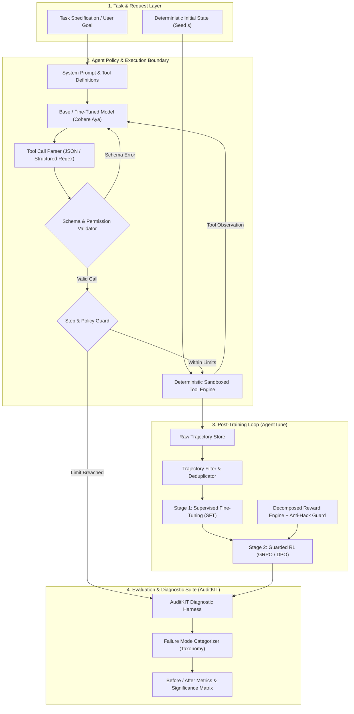
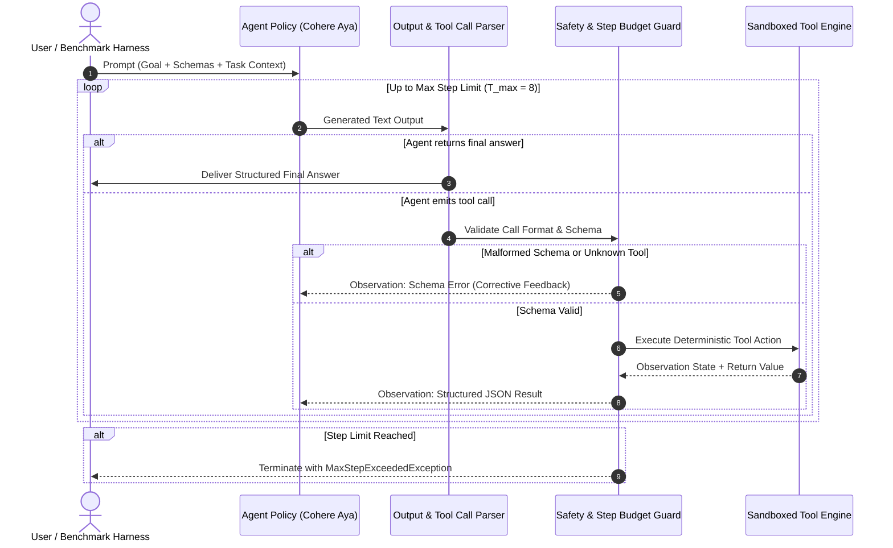

# System Design Blueprint: Reliable & Efficient Tool-Using Agent
## Lexsi Track 3: Agentic Fine-Tuning System Architecture

> **Document Status:** Authoritative Architectural Source of Truth (`system_design.md`)  
> **Target System:** Production-Grade Cohere Open-Weights Agent with AgentTune & AuditKIT  
> **Reference Plan:** [docs/plan.md](file:///Users/jayesh/Documents/Lexsi/docs/plan.md) · **Operational Protocol:** [instruction.md](file:///Users/jayesh/Documents/Lexsi/instruction.md)

---

## 1. Executive Architecture Overview

The system addresses **Problem Statement #1 (Reliable Tool Calling)** and **Problem Statement #2 (Efficient Trajectories)**, supported by **#9 (Reward-Hacking Defenses)**. It optimizes dense open-weights models (Cohere Tiny Aya / Aya Expanse) to execute complex, multi-step tasks across deterministic local tool environments with 100% schema compliance, minimal redundant actions, zero unhandled errors, and mathematically bounded rewards.



---

## 2. Core Subsystems and Technical Specifications

### 2.1 Subsystem A: Deterministic Environment & Database Tool Engine
* **Purpose:** Provides a fully reproducible, stateful yet deterministic simulation environment for tool interaction (structured data lookup, relational joins, mathematical calculations, and verification checks).
* **Guarantees:**
  * **Dual Engine Architecture:**
    * **Production Relational Database (`src/environment/database.py`, `src/environment/db_tools.py`):** Powered by SQLAlchemy with connection pooling, supporting Turso libSQL (`libsql://...`), local SQLite (`sqlite+aiosqlite:///...`), and cloud PostgreSQL (`postgresql+asyncpg://...`). Enforces parameterized SQL queries with zero injection risk.
    * **Olist Brazilian E-Commerce & Supply Chain Schema (`src/data/olist_loader.py`):** Realistic enterprise relational tables (`vendors`, `inventory_items`, `purchase_orders`, `budget_caps`) with real Brazilian seller metadata, product dimensions, order lines, and quarterly budget caps.
    * **In-Memory Sandbox (`src/environment/sandbox.py`, `src/environment/tools.py`):** High-throughput in-memory execution harness for ultra-fast unit testing.
  * **Strict Pydantic Typing:** Every tool parameter is defined via a strict Pydantic model with `ConfigDict(extra="forbid")` and typed constraints.
  * **Pre-Execution Validation & Call Counters:** Validates parameters and permissions before execution; failed calls never invoke database or tool logic (`tool_call_counts == 0`).

```
Tool Execution Contract:
(ToolName, TypedArguments, EnvironmentState_t) ──> (ToolObservation_{t+1}, EnvironmentState_{t+1}, ErrorCode)
```

### 2.2 Subsystem B: Trajectory Curation & Data Split Architecture
* **Partitioning Principle:** Splits are isolated at the **task-template, vendor entity, and item category level**, completely preventing data contamination or paraphrase leakage:
  * **Train Set ($\mathcal{D}_{\text{train}}$):** Templates T1–T3, Category `Hardware`, Vendors `VND-100`–`VND-105` (6 vendors). Used for supervised format tuning and on-policy RL rollouts.
  * **Validation Set ($\mathcal{D}_{\text{val}}$):** Templates T1–T3, Category `Software`, Vendors `VND-106`–`VND-107` (2 vendors). Measures generalization within known task templates under 100% disjoint entities. Used for hyperparameter tuning, checkpoint selection, and reward calibration.
  * **Locked Test Set ($\mathcal{D}_{\text{test}}$):** Templates T4–T5 (compositional tasks: joint vendor-spend constraint audits and multi-vendor cap verifications), Categories `Services` & `Logistics`, Vendors `VND-108`–`VND-111` (4 vendors). Measures true template and entity transfer; evaluated under strict gate controls.
* **Deterministic Generation & Index Decoupling:** Task generators decouple template cycling (`index % len(templates)`) from entity stepping (`template_step = index // len(templates)`), resolving parity lock and ensuring 100% of declared partition entities are reachable.
* **Machine-Readable Manifests (`configs/manifests/`):**
  * `dataset_manifest.json`: Root metadata containing dataset version (`1.0.0`), schema version (`1.0.0`), config hash, random seed, aggregate counts, licensing (`not separately asserted (synthetic closed-world benchmark)`), and split-level partition summaries.
  * `train_manifest.json`, `val_manifest.json`, `test_manifest.json`: Granular per-task manifests logging task ID, template ID, entity keys, deterministic content fingerprint (SHA-256), prompt hash, and expected tool sequences.
* **Pairwise Isolation Verifier (`audit_split_isolation`):**
  * Evaluates all 3 split pairs ($(\text{train}, \text{val}), (\text{train}, \text{test}), (\text{val}, \text{test})$) across 5 dimensions: Task IDs, SHA-256 fingerprints, Query prompts, Vendor entities, and Category entities.
  * Enforces template isolation invariant: $\text{Templates}(\mathcal{D}_{\text{test}}) \cap (\text{Templates}(\mathcal{D}_{\text{train}}) \cup \text{Templates}(\mathcal{D}_{\text{val}})) = \emptyset$.
* **Fail-Closed Locked-Test Safeguards:**
  * Trajectory conversion methods (`to_sharegpt_format()`, `export_training_trajectories()`) enforce strict partition boundaries via `LockedTestExportError`.
  * Trajectories labeled with split `test` are prohibited from being formatted or exported into training datasets, preventing accidental leakage into fine-tuning corpora.
* **Trajectory Format:** Standardized ShareGPT / OpenAI tool-calling JSON schema compatible with AgentTune and Hugging Face TRL.

### 2.3 Subsystem C: AgentTune Post-Training Pipeline
The training pipeline executes in two sequential stages:

```
┌────────────────────────────────────────────────────────────────────────┐
│                        TWO-STAGE POST-TRAINING                         │
├───────────────────────────────────┬────────────────────────────────────┤
│ Stage 1: Supervised Fine-Tuning   │ Stage 2: Guarded RL (GRPO)         │
│ - Target: Formatting & Syntax     │ - Target: Trajectory Efficiency    │
│ - Loss: Token-Masked CE on Tools  │ - Reward: Verified Outcome + Step  │
│ - Filter: 100% Successful Traces  │ - Guard: Anti-Hacking Probes       │
└───────────────────────────────────┴────────────────────────────────────┘
```

#### Stage 1: Token-Masked Supervised Fine-Tuning (SFT)
Objective: Ensure the model masters the exact special tokens, JSON argument structure, and tool call triggers.
* **Loss Function:** Masked Cross-Entropy Loss:
  $$\mathcal{L}_{\text{SFT}}(\theta) = -\sum_{t \in \mathcal{T}_{\text{assistant}}} \log P_\theta(x_t \mid x_{<t})$$
  *(Tokens generated by the user or returned by the environment observation $\mathcal{T}_{\text{env}}$ are strictly masked out of loss computation).*

#### Stage 2: Group Relative Policy Optimization (GRPO)
Objective: Optimize for task success while pruning redundant, cyclic, or superfluous tool calls.
* **Objective Formulation:**
  $$\mathcal{J}_{\text{GRPO}}(\theta) = \mathbb{E}_{\{y_i\}_{i=1}^G \sim \pi_{\theta_{\text{old}}}(y|x)} \left[ \frac{1}{G} \sum_{i=1}^G \left( \min\left( r_i(\theta) A_i, \text{clip}(r_i(\theta), 1-\epsilon, 1+\epsilon) A_i \right) - \beta D_{\text{KL}}(\pi_\theta \parallel \pi_{\text{ref}}) \right) \right]$$
  where $r_i(\theta) = \frac{\pi_\theta(y_i|x)}{\pi_{\theta_{\text{old}}}(y_i|x)}$, and normalized group advantage:
  $$A_i = \frac{R_i - \text{mean}(\{R_k\})}{\text{std}(\{R_k\}) + \epsilon_0}$$

---

### 2.4 Subsystem D: Guarded Reward Engine (`reward-design-guard`)

To prevent reward gaming (Skalse et al., 2022), the total reward $R(\tau)$ for a trajectory $\tau = (s_0, a_0, o_0, \dots, a_T, o_T)$ is strictly decomposed:

$$R(\tau) = R_{\text{format}}(\tau) + R_{\text{selection}}(\tau) + R_{\text{arguments}}(\tau) + R_{\text{order}}(\tau) + R_{\text{outcome}}(\tau) - \Omega_{\text{efficiency}}(\tau)$$

#### Strict Reward Invariants:
1. **Verified Outcome Primacy:** $R_{\text{outcome}}(\tau) \in \{0, 1\}$ is determined **exclusively** by the environment's deterministic success predicate, never by an uncalibrated LLM judge.
2. **Conditional Efficiency Penalty:**
   $$\Omega_{\text{efficiency}}(\tau) = \begin{cases} \lambda_{\text{step}} \cdot (T - T_{\min}) & \text{if } R_{\text{outcome}}(\tau) = 1 \\ 0 & \text{if } R_{\text{outcome}}(\tau) = 0 \end{cases}$$
   > [!IMPORTANT]
   > The step penalty $\lambda_{\text{step}}$ is applied **only when the task succeeds**. If applied to failed runs, the degenerate policy of terminating immediately with no tool calls achieves a higher reward than an agent that attempts the task and fails, causing policy collapse.
3. **Adversarial Probes:** Before training, reward functions are tested against four degenerate policies:
   * Policy A (No-op / Immediate termination): Expected reward $= 0$.
   * Policy B (Looping / Tool spamming): Expected reward $< 0$.
   * Policy C (Malformed JSON / Hallucinated tools): Expected reward $< 0$.
   * Policy D (Oracle minimal optimal trajectory): Expected reward $= \max R$.

---

### 2.5 Subsystem E: AuditKIT Diagnostic & Evaluation Suite

#### 2.5.1 AuditKIT Integration Boundary & Adapter Architecture
AuditKIT serves as the unified evaluation spine for Track 3. To maintain 100% deterministic, zero-network sandboxed testing while ensuring full schema compatibility with Lexsi Labs AuditKIT, the evaluation subsystem implements `AuditKitAdapter` (`src/utils/compatibility.py`).

* **Native vs. Adapter Boundary:** When the native `auditkit` package is installed (`pip install auditkit`), `AuditKitAdapter` can delegate directly to `ak.evaluate(...)`. When operating in self-contained sandboxed environments, `AuditKitAdapter` executes the local deterministic evaluation spine producing identical `AuditKitRunResult` contracts, directional metadata, and provenance fingerprints.
* **Environment Outcome Primacy:** Task success ($M_1$) is derived strictly from `TrajectoryRecord.is_success`, established by `EnvironmentOutcomeVerifier` against deterministic environment state. LLM judges are not used for headline outcomes.
* **Result Persistence:** Every evaluation run serializes machine-readable artifacts into `results/runs/<run_id>/`:
  - `run_result.json`: Canonical run metadata, SHA-256 fingerprint, aggregate metrics, failure breakdown, and per-task prediction/score records.
  - `metrics_summary.csv`: Tabular metrics export with confidence intervals, sample counts, and unmeasured tallies.
  - `eval_report.md`: Human-readable Markdown summary table with failure mode distribution and evaluation provenance.

#### 2.5.2 Metric Specifications (M1–M7)

| Metric ID | Metric Name | Direction | Unit | Mathematical Definition & Denominator Handling | Success Target |
|:---|:---|:---:|:---:|:---|:---|
| **M1** | Task Success Rate | Maximize | Fraction $[0, 1]$ | $M_1 = \frac{1}{N_{\text{tasks}}} \sum_{i=1}^{N_{\text{tasks}}} \mathbb{I}(\text{Task}_i = \text{Success})$. Aligned to input task manifest; missing/unmeasured runs are counted as $0.0$. | Statistically significant increase vs base ($p < 0.05$) |
| **M2** | Tool Call Accuracy | Maximize | Fraction $[0, 1]$ | Call Precision: $\frac{\text{Valid Selected Calls}}{\max(1, N_{\text{calls}})}$. Task Coverage: $\frac{1}{N_{\text{tasks}}}\sum_{i=1}^{N_{\text{tasks}}} \frac{\|\text{Called}_i \cap \text{Expected}_i\|}{\|\text{Expected}_i\|}$. | $\ge 95\%$ precision & coverage |
| **M3** | Argument & Schema Validity | Maximize | Fraction $[0, 1]$ | $M_3 = 1.0 - \frac{N_{\text{arg\_errors}}}{\max(1, N_{\text{calls}})}$, where $N_{\text{arg\_errors}}$ checks all schema and semantic codes (`SCHEMA_VALIDATION_ERROR`, `SEMANTIC_BOUND_ERROR`, `MALFORMED_TOOL_ARGUMENTS`, `JSON_PARSE_ERROR`). Zero calls yields $1.0$ with unmeasured note. | $\ge 99\%$ (near zero parsing errors) |
| **M4** | Call Order Validity | Maximize | Fraction $[0, 1]$ | $M_4 = \frac{N_{\text{valid\_ordered\_episodes}}}{N_{\text{multi\_step\_episodes}}}$. Evaluates topological prerequisite constraints across all tool invocations (not just first occurrences). | Significant reduction in order violations |
| **M5** | Trajectory Efficiency | Minimize | Steps | Mean steps conditional on success: $\mathbb{E}[T \mid \text{Success} = 1] = \frac{1}{\|\mathcal{S}\|} \sum_{i \in \mathcal{S}} T_i$. If $\|\mathcal{S}\| = 0$, returns `None` (unmeasured) with sample count $0$. | $\ge 20\%$ reduction vs baseline |
| **M6** | Redundant Call Rate | Minimize | Fraction $[0, 1]$ | $M_6 = \frac{N_{\text{duplicate\_calls}}}{\max(1, N_{\text{calls}})}$. Calls are hashed canonically via `tool_name + json.dumps(args, sort_keys=True)`. | $< 2\%$ |
| **M7** | Loop & Stall Frequency | Minimize | Fraction $[0, 1]$ | $M_7 = \frac{N_{\text{stalls}}}{N_{\text{tasks}}}$. Stalls include: (1) $T \ge T_{\max}$ without success, (2) $\ge 3$ consecutive duplicate calls, (3) alternating 2-cycles, and (4) explicit timeout errors. | $< 1\%$ |

#### 2.5.3 Statistical Inference & Paired Hypothesis Testing Engine

To provide empirical rigor and prevent false reporting:
1. **Single-Sample Uncertainty (`compute_bootstrap_ci`):** Computes $B = 10,000$ non-parametric bootstrap resamples to report descriptive 95% confidence intervals $[L, U]$ of the sample mean. Explicitly documented as parameter uncertainty, never as a significance test.
2. **Paired Comparative Testing (`compute_paired_bootstrap_comparison`):** Compares candidate model $Y$ against baseline model $X$ on identical task instances:
   - Aligns observations strictly by `task_id` into paired differences $D_i = Y_i - X_i$.
   - Point estimate: $\hat{\Delta} = \bar{Y} - \bar{X}$.
   - Confidence interval: 95% percentile bootstrap interval $[L_\Delta, U_\Delta]$ over $B = 10,000$ paired resamples.
   - Empirical two-sided p-value against $H_0: \Delta = 0$:
     $$p = 2 \cdot \min\left( \frac{1}{B}\sum_{b=1}^B \mathbb{I}(\Delta_b^* \le 0), \frac{1}{B}\sum_{b=1}^B \mathbb{I}(\Delta_b^* \ge 0) \right)$$
   - Decision rule: A claim of statistical significance requires $p < 0.05$ and $0 \notin [L_\Delta, U_\Delta]$. Sample size caveat emitted if $N < 30$.

#### 2.5.4 Data Contracts & Compatibility Schema
```python
class TaskEvaluationResult(BaseModel):
    task_id: str
    template_id: str
    is_success: bool
    total_steps: int
    executed_tools: List[str]
    expected_tools: List[str]
    has_schema_error: bool
    has_order_error: bool
    is_stall: bool
    redundant_calls: int
    error_type: Optional[str] = None
    diagnosed_failure: Optional[str] = None

class AuditKitMetricResult(BaseModel):
    metric_name: str
    value: Optional[float]
    direction: str = "maximize"
    unit: str = "fraction"
    ci_lower: Optional[float] = None
    ci_upper: Optional[float] = None
    sample_count: int
    unmeasured_count: int = 0
    details: Dict[str, Any] = Field(default_factory=dict)

class PairedComparisonResult(BaseModel):
    metric_name: str
    baseline_mean: float
    candidate_mean: float
    delta: float
    ci_lower: float
    ci_upper: float
    p_value: float
    is_significant: bool
    sample_count: int
    method: str
    caveats: List[str] = Field(default_factory=list)

class AuditKitRunResult(BaseModel):
    run_id: str
    model_id: str
    evaluator_version: str = "local-adapter-1.0.0"
    split: str = "val"
    timestamp: float
    sha256_fingerprint: str
    headline: Dict[str, float]
    metrics: Dict[str, AuditKitMetricResult]
    per_task_results: List[TaskEvaluationResult] = Field(default_factory=list)
    failure_breakdown: Dict[str, int] = Field(default_factory=dict)
    provenance_metadata: Dict[str, Any] = Field(default_factory=dict)
```

#### Failure Taxonomy Architecture
Failures are categorized systematically into six discrete classes with strict observable evidence, root-cause precedence, and deterministic resolution:
```
Failure Event
├── 1. ToolSelectionFailure (Invoking non-existent, unauthorized, disallowed, or task-irrelevant tool)
├── 2. ArgumentSchemaFailure (Invalid parameter types, missing required fields, extra='forbid', bad regex, semantic bound violation)
├── 3. DependencyOrderFailure (Calling downstream tool before upstream prerequisite data/execution is acquired)
├── 4. LoopingAndStallFailure (Repeating identical call 3+ times, cyclic alternating calls, or non-advancing step-budget exhaustion)
├── 5. EarlyTerminationFailure (Prematurely concluding without executing required task tools to satisfy predicate)
└── 6. ToolRecoveryFailure (Crashing, repeating identical failing action, or aborting upon receiving a valid tool error observation)
```

##### Diagnostic Contract & Output Interface
```python
class FailureDiagnosis(BaseModel):
    category: Optional[FailureCategory] = Field(None, description="Diagnosed root-cause failure category, or None if successful or unclassifiable")
    confidence: float = Field(..., ge=0.0, le=1.0, description="Diagnostic confidence score based on observable evidence")
    root_cause_step: Optional[int] = Field(None, description="0-indexed step number where primary failure occurred")
    evidence: str = Field(..., description="Observable evidence string including step index, error code, or tool name")
    details: Dict[str, Any] = Field(default_factory=dict, description="Diagnostic metadata: called tools, error codes, repeated call counts")

def classify_failure(
    trajectory: TrajectoryRecord,
    task: Optional[TaskSpec] = None,
    max_steps: int = 8,
) -> Optional[FailureCategory]:
    """Preserved backwards-compatible classifier returning Optional[FailureCategory]."""
```

##### Observable Evidence & Error Code Mapping
1. **ToolSelectionFailure:**
   - *Observable Signals:* Step error code `TOOL_NOT_FOUND`, `DISALLOWED_TOOL`, or `action.tool_name not in task.expected_tools` (when task is provided).
   - *Inclusion:* Attempting to invoke an unregistered tool, a tool prohibited by policy permission tier, or a tool irrelevant to the task specification.
   - *Exclusion:* Tool name is valid but arguments are malformed (`ArgumentSchemaFailure`), or tool is valid but invoked out of order (`DependencyOrderFailure`).
2. **ArgumentSchemaFailure:**
   - *Observable Signals:* Step error code `SCHEMA_VALIDATION_ERROR`, `SEMANTIC_BOUND_ERROR`, `MALFORMED_TOOL_ARGUMENTS`, `JSON_PARSE_ERROR`.
   - *Inclusion:* Valid tool name, but arguments violate Pydantic validation (missing field, forbidden extra field, invalid type), domain bounds, or JSON formatting.
   - *Exclusion:* Malformed arguments resulting from invoking a non-existent tool (`ToolSelectionFailure`).
3. **DependencyOrderFailure:**
   - *Observable Signals:* Calling a downstream tool at index $j$ in `task.expected_tools` before prerequisite tool at index $i < j$ has successfully executed, or invoking a dependent tool with empty/placeholder inputs because lookup was omitted.
   - *Inclusion:* Tool calls are individually valid in schema, but violate topological prerequisite execution order.
   - *Exclusion:* Prerequisite tool was called and failed with an error, after which downstream tool was attempted (`ToolRecoveryFailure`).
4. **LoopingAndStallFailure:**
   - *Observable Signals:* $\ge 3$ identical tool calls (same tool and canonically sorted JSON arguments), alternating 2-cycles repeated $\ge 2$ times ($A \to B \to A \to B$), or episode terminates via `STEP_LIMIT_EXCEEDED` / `EXECUTION_TIMEOUT` without preceding tool error.
   - *Inclusion:* Repetitive action loops or budget exhaustion during active execution.
   - *Exclusion:* Step limit reached because agent received an error on every step and failed to recover (root cause is underlying tool/schema error).
5. **EarlyTerminationFailure:**
   - *Observable Signals:* Trajectory terminates (model outputs final answer text, or emits empty output) before invoking the required tool actions defined in `task.expected_tools` (0 steps or incomplete subset).
   - *Inclusion:* Premature halting before executing the necessary environmental interactions.
   - *Exclusion:* All required tools executed successfully, but final arithmetic answer was incorrect (outcome calculation error, not tool-use early termination).
6. **ToolRecoveryFailure:**
   - *Observable Signals:* Step $k$ produced an error observation (`error is not None` or `obs.is_error = True`), and in step $k+1$, the agent: (a) repeats the exact same failing action with identical arguments, (b) crashes with unparseable text / unhandled exception, or (c) prematurely aborts without attempting corrective parameters.
   - *Inclusion:* Failure to adapt or recover following an explicit error observation.
   - *Exclusion:* Error occurred on the final allowed step ($k = T_{\max}-1$), offering no opportunity for recovery.

##### Precedence Hierarchy for Overlapping Signals
When multiple failure signals occur, the classifier resolves root cause via causal precedence:
1. `EarlyTerminationFailure`: Trajectory ended with 0 tool calls or omitted required tools before any execution error.
2. `ToolRecoveryFailure`: An execution error occurred in step $k$ and step $k+1$ failed to adapt, repeated the error, or crashed.
3. `ToolSelectionFailure`: First unrecovered fatal action invoked an unregistered or disallowed tool.
4. `ArgumentSchemaFailure`: First unrecovered fatal action invoked a valid tool with invalid schema or domain bounds.
5. `DependencyOrderFailure`: Valid tool actions executed in an invalid topological sequence.
6. `LoopingAndStallFailure`: Trajectory exhibited $\ge 3$ identical calls, cycle loops, or exhausted step budget without prior unrecovered tool errors.
7. `Insufficient Evidence (None)`: Unsuccessful trajectory with zero tool execution errors where required tools were executed (e.g. arithmetic mistake in final response). Deterministic classification never invents a root cause.

##### Dynamic Failure Generation & Adversarial Probing Architecture (`src/evaluation/failure_generator.py`)
To prevent reliance on static handcrafted JSON fixtures, the diagnostic harness integrates three programmatic generation tiers:
1. **Tier 1 (Programmatic Trajectory Fuzzer - `TrajectoryFuzzer`):** Grounded in Gorilla BFCL and property-based perturbation testing, automatically mutates valid oracle trajectories into parameterized failure cases across all 6 categories (injecting unknown tools, extra forbidden keys, inverted dependencies, cyclic loops, or truncated steps).
2. **Tier 2 (Executable Adversarial Mock Policies - `AdversarialPolicyFactory`):** Grounded in Skalse et al. (2022) reward-hacking probes, implements executable agent policies (`NoOpPolicy`, `SpamLoopPolicy`, `StubbornErrorPolicy`, `HallucinationPolicy`) running live through `EpisodeOrchestrator` to test runtime boundary enforcement and recovery.
3. **Tier 3 (Empirical Failure Harvester - `DynamicFailureSuite`):** Generates balanced evaluation suites on demand from any task split, clustering failure modes and preparing contrastive negative trajectory pairs for downstream DPO preference training.

---

### 2.6 Subsystem F: Universal Async Model Gateway & Langfuse Observability
* **Universal Asynchronous Gateway (`src/runtime/gateway.py`):**
  * Connects to OpenAI-compatible cloud inference providers: OpenRouter (free models), NVIDIA NIM API, Groq, and local vLLM.
  * Implements automated exponential backoff with jitter on rate limits (429) and seamless fallback routing from primary to secondary models.
  * Handles asynchronous connection pooling via `httpx.AsyncClient`.
* **Langfuse Observability & Tracing (`src/evaluation/telemetry.py`):**
  * Implemented per the official Langfuse AI Skill (`.agents/skills/langfuse/`):
  * Captures hierarchical trace trees: `agent` root trace $\rightarrow$ `generation` (LLM policy calls with token usage and latency) $\rightarrow$ `tool` (tool executions with inputs, outputs, error statuses).
  * Records deterministic outcome scores: `trace.score_trace(name="task_success", value=1.0 / 0.0)`.
  * Integrates recursive PII and credential redaction, preventing secrets from leaking to telemetry dashboards.

---

## 3. End-to-End Execution Workflows

### 3.1 Inference & Agent Loop Workflow



---

## 4. Interface Contracts and Data Schemas

### 4.1 Tool Definition Contract (Pydantic Specification)
```python
from pydantic import BaseModel, ConfigDict, Field
from typing import Dict, Any, List, Literal, Optional

class ToolParameterSchema(BaseModel):
    name: str = Field(..., description="Unique parameter identifier")
    type: str = Field(..., description="Primitive type: string, integer, float, boolean, list, dict")
    description: str = Field(..., description="Functional semantic explanation")
    required: bool = Field(True, description="Whether parameter is mandatory")
    enum: Optional[List[str]] = Field(None, description="Allowed values if categorical")

class ToolContract(BaseModel):
    name: str = Field(..., description="Unique tool name")
    description: str = Field(..., description="Precise description of tool capability")
    parameters: List[ToolParameterSchema]
    is_stateful: bool = Field(False, description="Whether tool mutates environment state")
    idempotent: bool = Field(True, description="Whether repeated calls produce identical results")
    permission_level: Literal["read_only", "write", "admin"] = Field("read_only", description="Access permission tier")
    result_schema: Optional[Dict[str, Any]] = Field(None, description="Normalized return value schema")

# Invariant: All tool argument models enforce extra="forbid" to reject unapproved fields
class StrictToolArgs(BaseModel):
    model_config = ConfigDict(extra="forbid")
```

### 4.2 Trajectory Record Contract
```python
class ToolCallAction(BaseModel):
    tool_name: str
    arguments: Dict[str, Any]
    call_id: str

class StepRecord(BaseModel):
    step_index: int
    thought: Optional[str]
    action: Optional[ToolCallAction]
    observation: Optional[Any]
    error: Optional[str]
    elapsed_ms: float

class TrajectoryRecord(BaseModel):
    task_id: str
    seed: int
    system_prompt: str
    user_query: str
    steps: List[StepRecord]
    final_output: Optional[str]
    is_success: bool
    total_steps: int
    raw_reward: float
    run_id: Optional[str] = None
    environment_version: str = "0.1.0"
    metadata: Dict[str, Any] = Field(default_factory=dict)
    fingerprint: Optional[str] = None
```

---

## 5. Security, Sandboxing, and Safety Guardrails

1. **Deterministic Mock Sandboxing:** Tools run inside isolated Python modules with no OS-level shell, network, or filesystem write capabilities.
2. **Pre-Execution Validation Boundary:** Calls are validated against tool allowlists, permissions, Pydantic argument schemas (`extra='forbid'`), and semantic constraints before invoking underlying tool functions. Malformed or denied calls never reach tool logic.
3. **Strict Timeouts & Step Budgets:** Any trajectory exceeding $T_{\max} = 8$ steps or 30 seconds episode wall-clock time is halted. Individual tool executions enforce a per-call timeout (5.0 seconds).
4. **Environment-Owned Outcome Verification:** Task completion is evaluated by an environment-owned predicate checking both numerical calculation and boolean constraint verdicts (`oracle_verdict`), completely independent of model self-claims or LLM judges.
5. **Data Protection & Secret Redaction:** Trajectory loggers automatically strip API keys, tokens, credentials, and personal identifying information (PII) across strings and nested dictionary/list structures prior to persistence or export.
6. **Human-in-the-Loop Release Gating:** Model promotion requires passing Gates G0–G4 with reproducible log verification.

---

## 6. System Design Change Management
* Any structural change to tools, prompt formatting, loss functions, reward weights, or evaluation metrics **must be updated in this file first**.
* All code implementations must verify line-by-line adherence to this architecture.

